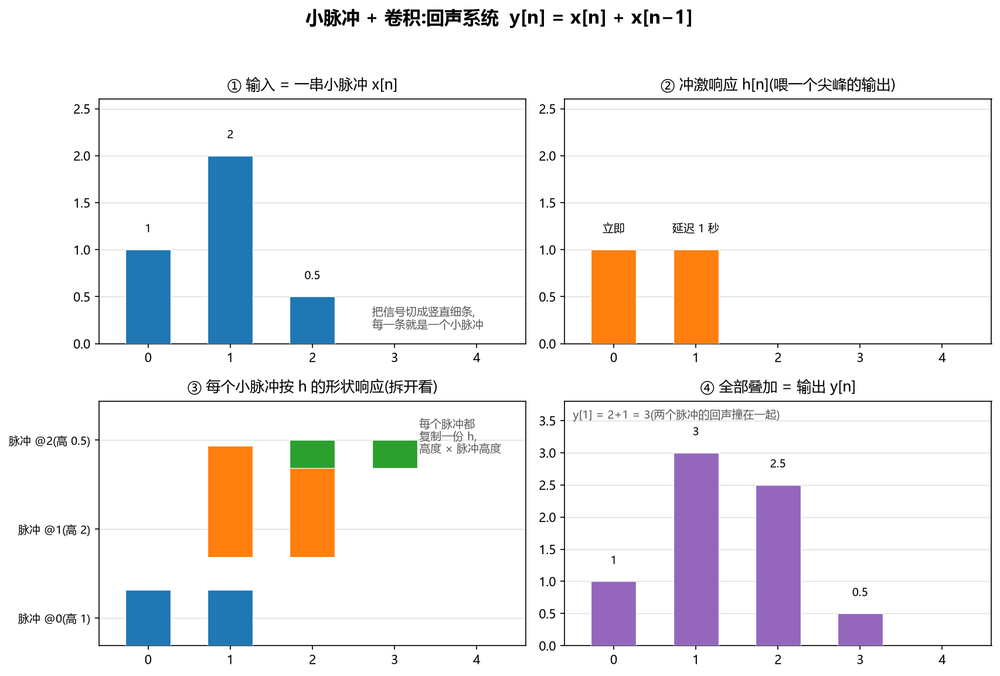
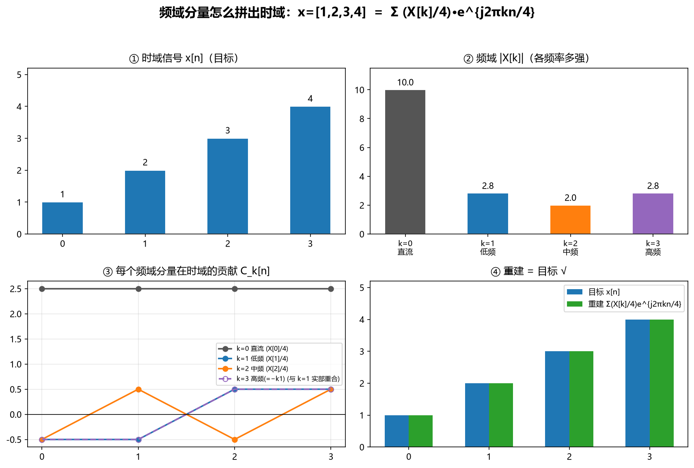

# 无线信号如何变成数字：傅里叶变换 / FFT 与数字信号处理

> 记录日期：2026-09-11
> 整理重排：2026-09-22
> 讲解人：AI（Claude）
> 前置：线性代数基础（矩阵乘法）、复数基本运算
> 关联：`computer-vision`（同一个"从 0 推导 + 数字对账"的学习风格）
> 所有数字均已用 `numpy.fft` 实测验证

## 〇、总览：一条链

卫星和 WiFi 的信号是**电磁波（模拟、连续）**，计算机只能处理**离散数字**。把模拟波变成数字并读懂它，分三步：

```
电磁波（连续模拟）
  ↓ ① 采样 ADC（Nyquist 采样定理：连续 → 离散）
数字序列 x[0], x[1], …, x[N-1]
  ↓ ② 傅里叶变换（DFT / FFT：时域 → 频域，信息藏在频率里）
频域 X[0], X[1], …, X[N-1]
  ↓ ③ 解调（从每个频率分量读出比特）
比特 0101…
```

> **核心一句话**：DFT 是一个**矩阵乘法**，FFT 是把这个矩阵乘法**算快的算法**。所以下面你会看到——它和你手写过的 CNN 卷积一样，本质是"矩阵怎么乘、怎么对账"。

**阅读路线**：主线在前两章（采样 → 变换），第三章、第四章是数学地基（为什么用复指数、傅里叶级数从哪来），第五章起回到主线。

| 章 | 内容 | 在整条链里的角色 |
|---|---|---|
| 一 | 为什么非得做频率分析 | 动机 |
| 二 | 模拟 → 数字：采样与量化（Nyquist） | 链上 ① |
| 三 | 预备：为什么用复指数 | 数学地基·工具 |
| 四 | 傅里叶级数与连续傅里叶变换 | 数学地基·源头 |
| 五 | DFT：离散傅里叶变换 | 链上 ② |
| 六 | DFT 的矩阵形式 + N=4 完整算例 | 把 DFT 算熟 |
| 七 | FFT：把 O(N²) 变 O(N log N) | 链上 ② 的加速 |
| 八 | 回到真实系统：WiFi / 卫星 | 链上 ③ + 应用 |
| 九 | 计算机具体怎么处理 | 实现 |
| 十 | 小结：一条链 + 三个数 | 收束 |

---

## 一、为什么非得做"频率分析"

WiFi 载波在 2.4 GHz / 5 GHz，卫星在几 GHz~几十 GHz。但信息**不在"波有多高"，而在"波里有哪些频率、每个频率上叠了什么"**：

- WiFi 把 20 MHz 的频谱切成几十个**子载波**，每个子载波独立扛一路数据（OFDM，见 8.1）
- 接收端要回答："这堆叠在一起的信号里，第 $k$ 个子载波上到底是哪个符号？"
- 这就必须把**时域混合信号拆回各自的频率** → 傅里叶变换

**直觉**：任何波形 = 一堆正弦波叠加。傅里叶变换就是"拆开它，问每个频率有多少"。

---

## 二、模拟 → 数字：采样与量化（Nyquist）

模拟信号 $x(t)$ 每隔 $T_s$ 秒采一个点：

$$
x[n] = x(n\,T_s)
$$

**采样定理（Nyquist）**：采样率必须 ≥ 信号最高频率的 2 倍，否则高频会伪装成低频（**混叠 aliasing**）：

$$
\boxed{\ f_s \ge 2\,f_{\max}\ }
$$

### 2.1 为什么高频会"伪装"成低频（混叠是怎么发生的）

**第 1 步 · 采样到底做了什么：只看瞬间，中间全瞎**

采样就是每隔 $T_s$ 秒**看一眼**信号，把那一刻的值记下来，其余时间啥也看不见。所以有个铁律：

> **两个不同频率的信号，只要在"所有采样点"上恰好一样，你就永远分不出它们。** 这不是测量误差，是信息根本没被采到。

0.9 Hz 和 0.1 Hz 就是这么一对"双胞胎"——下面第 3 步的表格里，8 个采样点每个都一模一样。

**第 2 步 · 为什么一模一样：采样只看到"转圈的余数"**

把信号想成一个**转圈箭头**（这套工具第三章 3.5 会正式讲）。每秒采样一次（$f_s=1$）时：

- **0.1 Hz**：每秒转 **0.1 圈**
- **0.9 Hz**：每秒转 **0.9 圈** = 转到 1 圈还差 0.1 圈，也就是**往回退 0.1 圈**

关键：**采样点分不清"转满整圈"和"没转"**——转完一整圈箭头回到原点，和没转一模一样。所以"往前 0.9 圈"在采样点看来 ≡ "往回 0.1 圈"；而 $\cos$ 是偶函数（$\cos(-\theta)=\cos\theta$），**往前 0.1 圈和往回 0.1 圈的值又完全一样**。

所以 0.9 Hz ≡ "退 0.1 圈" ≡ 0.1 Hz。**高频伪装成低频，靠的就是"整圈看不见 + 前后分不清"。**

**第 3 步 · 数字演示**（$f_s=1$ Hz）：采样 $0.9$ Hz 和 $0.1$ Hz，每个采样点完全相同：

| n | 0 | 1 | 2 | 3 | 4 | 5 | 6 | 7 |
|---|---|---|---|---|---|---|---|---|
| $\cos(2\pi\cdot0.1n)$ | 1.000 | 0.809 | 0.309 | −0.309 | −0.809 | −1.000 | −0.809 | −0.309 |
| $\cos(2\pi\cdot0.9n)$ | 1.000 | 0.809 | 0.309 | −0.309 | −0.809 | −1.000 | −0.809 | −0.309 |

（如 $n=2$：0.9 Hz 转了 $1.8$ 圈 ≡ "退 $0.2$ 圈" ≡ 0.1 Hz 的 $0.2$ 圈，$\cos$ 分不清前后，都是 $0.309$。）

**用代数钉死**（关键恒等式）：第 $n$ 个采样点是 $\cos(2\pi f\frac{n}{f_s})$，把 $f+f_s$ 代进去：

$$
\cos\!\Big(2\pi\,(f+f_s)\frac{n}{f_s}\Big) = \cos\!\Big(2\pi f\frac{n}{f_s} + 2\pi n\Big) = \cos\!\Big(2\pi f\frac{n}{f_s}\Big)
$$

多了个 $2\pi n$——那是 $n$ **整圈**，$\cos$ 加整圈不变（$\cos(\theta+2\pi m)\equiv\cos\theta$），直接消失。**这就是"整圈看不见"的代数写法**：任何频率加上 $f_s$ 的整数倍，采样点全一样。这些频率彼此互为"别名"。

**第 4 步 · 折叠公式**：高于 $f_s/2$ 的频率会"折叠"回 $[0,\ f_s/2]$ 区间，对 $f\in[f_s/2,\ f_s]$：

$$
\boxed{\ f_{\text{alias}} = f_s - f\ }
$$

$f=0.9,\ f_s=1 \Rightarrow f_{\text{alias}}=1-0.9=0.1$ Hz ✓。把频率轴想成**手风琴/折纸**，在每个 $f_s/2$ 的整数倍处对折，所有频率都被折进 $[0,\ f_s/2]$：

| 真实频率 f | 采样后你看到的 | 原因 |
|---|---|---|
| 0.1 | 0.1 | 低于 0.5，安全 |
| 0.4 | 0.4 | 低于 0.5，安全 |
| 0.6 | 0.4 | 折回：1−0.6=0.4 |
| 0.9 | 0.1 | 折回：1−0.9=0.1 |
| 1.1 | 0.1 | 1.1=1+0.1，再折一次 |
| 1.6 | 0.4 | 1.6=1+0.6 → 0.4 |

（`numpy` 实测一致。）

**第 5 步 · 为什么天花板是 $f_s/2$**：采样能表示的最快振荡是每个采样点交替变号 $+1,-1,+1,\dots$，即 $\cos(2\pi\cdot\tfrac{f_s}{2}\cdot\tfrac{n}{f_s})=\cos(\pi n)=(-1)^n$——相邻两个采样点之间正好转**半圈**。比它更快，意味着两个点之间转了**超过半圈**；可你只有两个点，**中间"先上后下"还是"先下后上"根本看不出来**，于是它就和某个"转不到半圈"的慢频率撞车。

> 一句话：**两个点最多只能证明"转了半圈"；转超过半圈的东西，看起来都像转了不到半圈。**

**第 6 步 · 直觉类比：车轮**。电影 24 帧/秒采样，高速转动的车轮辐条看起来**倒转或慢转**——辐条每帧转 $7/8$ 圈（差 $1/8$ 圈到整圈），"整圈"被吞掉、只剩"退 $1/8$ 圈"，于是看起来慢慢倒转。这和 $0.9\to0.1$ Hz 是**同一个数学**（时域混叠）。

**第 7 步 · 为什么采样率要 ≥ 最高频率的 2 倍（而不是 1 倍或 1.5 倍）**

**计数直觉：一个周期至少需要 2 个采样点。** 波要先上去再下来，要看出来它在振，每个周期至少得采 2 个点（一个在上升途中、一个在下降途中）。用同一个 100 Hz 音调演示（`numpy` 实测）：

| 采样率 | 每周期点数 | 采样后你看到的 |
|---|---|---|
| 100 Hz（1×） | 1 | `[1,1,1,1,1,1]`：**变成直流了** |
| 150 Hz（1.5×） | 1.5 | 伪装成 50 Hz |
| 200 Hz（2×） | 2 | `[1,-1,1,-1,...]`：正确 |

1 点/周期 = 每次采到同一相位 → 波看起来是平的（100 Hz 响亮的音调被采成了一条直线）。所以 $f_s$ 个点/秒最多分辨 $f_s/2$ 个周期/秒——**最高可表示频率 = $f_s/2$**。想让信号里所有频率都被看清，就得让最高的 $f_{\max}$ 也不超过这个天花板 → $f_s \ge 2f_{\max}$。

**精确理由：天花板之下永不撞车。** 第 3 步的恒等式说，两个频率只有在**相差整数个 $f_s$** 时才无法区分（整圈看不见）：

$$
f_1 \text{ 和 } f_2 \text{ 混淆} \iff f_1 - f_2 = k\,f_s\ (k\text{ 为非零整数})
$$

若两个频率都在天花板以下（同在 $[0,\ f_s/2)$ 内）：$|f_1-f_2|<\tfrac{f_s}{2}<f_s$，它们的差连一个 $f_s$ 都不到，**更不可能是 $f_s$ 的整数倍** → 永不混淆。天花板以下的每个频率都保留自己的身份。

反之，一旦某个频率 $f>f_s/2$，它就被折回 $f_s-f$，和天花板下本来就存在的某个低频率**撞个正着**——你收到的信号里混进"真身 + 冒牌货"。

所以 $f_s\ge 2f_{\max}$ 等价于**把整个信号频谱都推到天花板以下**（安全区里没有撞车）。**2× 是"所有频率都不撞车"的最小采样率**：再小，最高那部分频谱探出天花板、被折叠下来污染真实内容；更大，只是余量更足、滤波器更好做。

> 更深一层（Nyquist–Shannon 采样定理）：只要信号不含超过 $f_s/2$ 的频率，采样点就**包含全部信息**，原波形可被**完美重建**（sinc 插值）。2× 是"信息无损"的阈值——少一点都不行，多采一点（过采样）只是锦上添花。

**真实系统怎么防**：在 ADC **之前**加**抗混叠低通滤波器**，先把所有 $>f_s/2$ 的分量滤掉再采样——既然高于天花板的东西一采样就伪装成别的，那就别让它进来。WiFi / 卫星接收机在下变频后、采样前都这么干。

- WiFi 基带带宽约 20 MHz → 采样率至少 40 MHz
- 卫星符号率几 Msps~几十 Msps → 采样率按同样规则取

采样之后，**ADC 量化**：把每个采样值四舍五入成 8~12 bit 的整数（位数越多，量化噪声越小，信噪比约 $6.02\times\text{bit}+1.76$ dB）。

> 采样给了你**离散的时间点**，但"一个点一个点"看不出频率。要看出频率，必须做下一步的变换。

---

## 三、预备 · 为什么用复指数 $e^{j2\pi f t}$，而不是 sin/cos？

在进入傅里叶级数和 DFT 之前，先解决一个更前面的问题：**为什么傅里叶的一切都用复指数 $e^{j2\pi f t}$，而不是 sin/cos？**

因为 $e^{j\theta}$ 不是"和 sin、cos 并列的另一种波"，它是 sin 和 cos 的**合体**——一个符号装下两路信息，一切运算都最简。这一章从三个层面把"最简"讲透：装信息（3.4）、变回真实波（3.5）、穿过系统（3.6）。

### 3.1 欧拉公式的推导（泰勒展开）

三个函数在 0 处的泰勒展开：

$$
e^{x}=1+x+\frac{x^2}{2!}+\frac{x^3}{3!}+\cdots,\quad
\cos x=1-\frac{x^2}{2!}+\frac{x^4}{4!}-\cdots,\quad
\sin x=x-\frac{x^3}{3!}+\frac{x^5}{5!}-\cdots
$$

把 $x=j\theta$ 代入 $e^x$，利用 $j^2=-1,\ j^3=-j,\ j^4=1$：

$$
e^{j\theta}=1+j\theta-\frac{\theta^2}{2!}-\frac{j\theta^3}{3!}+\frac{\theta^4}{4!}+\frac{j\theta^5}{5!}-\cdots
$$

按实部/虚部分组：

$$
e^{j\theta}=\underbrace{\Big(1-\frac{\theta^2}{2!}+\frac{\theta^4}{4!}-\cdots\Big)}_{\cos\theta} + j\underbrace{\Big(\theta-\frac{\theta^3}{3!}+\frac{\theta^5}{5!}-\cdots\Big)}_{\sin\theta}
$$

$$
\boxed{\ e^{j\theta}=\cos\theta+j\sin\theta\ }\quad\text{（欧拉公式）}
$$

### 3.2 反过来解出 cos、sin

用 $e^{-j\theta}=\cos\theta-j\sin\theta$ 与上式相加/相减：

$$
\cos\theta=\frac{e^{j\theta}+e^{-j\theta}}{2},\qquad \sin\theta=\frac{e^{j\theta}-e^{-j\theta}}{2j}
$$

### 3.3 数字示例

$\theta=\pi/3$：$e^{j\pi/3}=\cos 60°+j\sin 60°=0.5+j0.866$，验证

$$
\frac{e^{j\pi/3}+e^{-j\pi/3}}{2}=\frac{(0.5+j0.866)+(0.5-j0.866)}{2}=0.5=\cos 60°\ \checkmark
$$

### 3.4 一个复指数 = 幅值 + 相位（一个复数装两个信息）

实谐波

$$
A\cos(2\pi ft+\varphi)=\text{Re}\big(C\,e^{j2\pi ft}\big),\qquad C=A\,e^{j\varphi}
$$

推导：$C\,e^{j2\pi ft}=A\,e^{j(2\pi ft+\varphi)}=A\big(\cos(2\pi ft+\varphi)+j\sin(2\pi ft+\varphi)\big)$，取实部即得；而 $C=A(\cos\varphi+j\sin\varphi)$，所以 $|C|=A$（幅值）、$\angle C=\varphi$（相位）。示例：$A=3,\ \varphi=\pi/6 \Rightarrow C=3e^{j\pi/6}=3(0.866+j0.5)=2.598+j1.5$，$|C|=3$、辐角 $30°$。

**同一个波，四种等价写法**（波不只可以写成复指数，也可以写成 cos、sin 或 sin+cos 合体——它们是**同一个波**，只是"打包幅值和相位"的方式不同）：

| 写法 | 公式 | 怎么装"幅值+相位" |
|---|---|---|
| 振幅-相位（cos 形式） | $A\cos(2\pi ft+\varphi)$ | 两个数：幅值 $A$、相位 $\varphi$ |
| sin 形式 | $A\sin(2\pi ft+\varphi')$ | 就是 cos 移相 90°（$\sin\theta=\cos(\theta-\frac\pi2)$），不算新东西 |
| sin+cos 合体（正交分量） | $a\cos(2\pi ft)+b\sin(2\pi ft)$ | 两个数：cos 分量 $a$、sin 分量 $b$ |
| 复指数 | $\text{Re}(C\,e^{j2\pi ft})$，$C=A\,e^{j\varphi}$ | **一个复数 $C$ 同时装下 $A$ 和 $\varphi$** |

**它们怎么互相换**（同频合并 + 取实部）：

$$
a\cos\theta+b\sin\theta=A\cos(\theta+\varphi),\qquad A=\sqrt{a^2+b^2},\ \varphi=-\arctan\tfrac{b}{a}
$$

$$
a\cos\theta+b\sin\theta=\text{Re}\big((a-jb)\,e^{j\theta}\big)
$$

**数字示例**（$3\cos\theta+4\sin\theta$，正好是勾股数）：$A=\sqrt{3^2+4^2}=5$、$\varphi=-\arctan(4/3)\approx-53.13°$，所以

$$
3\cos\theta+4\sin\theta=5\cos(\theta-53.13°)=\text{Re}\big((3-4j)e^{j\theta}\big)
$$

验证：$5\cos(\theta-53.13°)=5[\cos\theta\cdot0.6+\sin\theta\cdot0.8]=3\cos\theta+4\sin\theta$ ✓（`numpy` 四种写法逐点一致，误差 1e-15）。

> 这就是傅里叶系数是**复数**的原因：一个 $c_k$ 同时告诉你"第 $k$ 个谐波多强、相位多少"。——复指数只是四种写法里最"浓缩"的一种：**一个复数 $C$ 就装下幅值和相位**，所以傅里叶全程用它，而不用 sin/cos。

### 3.5 旋转的圆怎么变回真实的波：正负频率成对抵消

> 3.4 里 $A\cos(2\pi ft+\varphi)=\text{Re}(C\,e^{j2\pi ft})$ 只是"说了能取实部"。这一条回答一个必然会冒出来的疑问：复指数在**转圈**，可真实信号是**上下振荡的波**，转着转着怎么变回波？——靠**成对的相反旋转**。

**复指数 = 两个波叠成的圆**。$e^{j2\pi ft}=\cos(2\pi ft)+j\sin(2\pi ft)$：实部是实轴上的前后振荡（cos），虚部是虚轴上的上下振荡（sin）。圆上的每个点，只是这两个振荡在某一刻的合体坐标。所以**一个转圈本身就装着两个波**——取实部（看它在实轴上的影子），就得到一个波。

**真实信号的频谱有共轭对称性**：$x(t)$ 为实信号时 $X(-f)=X^*(f)$（负频率是正频率的共轭）。于是每个正向转的 $+f$ 必然带一个反向转的 $-f$，两只箭头互为镜像：

- 转圈方向相反；
- 虚部（上下）永远一上一下、恰好抵消；
- 实部（左右）永远同向、加起来翻倍。

**为什么真实信号"必须"这样（看反例）**：如果正负频率**不是**镜像，两只箭头在某时刻加起来就会有虚部，信号就不是实的。`numpy` 验证：

| 情况 | 两只箭头 | 在 t=0 加起来 | 结果 |
|---|---|---|---|
| 共轭对（镜像） | $-2+2j$ 和 $-2-2j$ | $-4+0j$ | 虚部 0，纯实 ✓ |
| 非共轭（破坏镜像） | $-2+2j$ 和 $-2+1j$ | $-4+3j$ | 虚部 3 ✗ |

整条还原更明显：

$$
\text{共轭对称：ifft}([10,\ -2+2j,\ -2,\ -2-2j])=[1,\ 2,\ 3,\ 4]\ \text{纯实}\ \checkmark
$$

$$
\text{破坏对称：ifft}([10,\ -2+2j,\ -2,\ -2+1j])=[1{+}0.75j,\ 2.75,\ 3{-}0.75j,\ 3.25]\ \text{带虚部}\ \times
$$

**只要信号是实的，频谱就必须满足 $X(-f)=X^*(f)$**——否则重建会带虚部，就不是原来那个信号了。反过来，只要频谱共轭对称，重建必然纯实。

**三条弹头在说同一件事的几何**：设 $X(f)=a+jb$（正频率箭头偏右上），则镜像 $X(-f)=X^*(f)=a-jb$：
- **方向相反**：$e^{+j2\pi ft}$ 逆时针转、$e^{-j2\pi ft}$ 顺时针转；
- **上下抵消**：一支在实轴上方 $+b$、一支在下方 $-b$，任意时刻相加得 $0$；
- **左右相加**：两支箭头左右分量都是 $a$，同向相加得 $2a$。

两支箭头反着转，但上下永远抵消、左右永远相加 → 总和始终落在实轴上、来回振荡 = 纯实波（下面的数字对账表就是这个的实证）。

**剩下来的就是一条纯实余弦**。几何版就是 3.2 那条公式：

$$
\cos\theta=\frac{e^{j\theta}+e^{-j\theta}}{2}
$$

两个长度各 $\tfrac12$、反向旋转的箭头，虚部抵消、实部叠加，恰好走出一条余弦。用两只指针看：

| 时刻 θ | 正向箭头(长½) | 反向箭头(长½) | 虚部之和 | 实部之和 |
|---|---|---|---|---|
| 0 | → | → | 0 | **1** |
| π/2 | ↑ | ↓ | 0 | **0** |
| π | ← | ← | 0 | **−1** |
| 3π/2 | ↓ | ↑ | 0 | **0** |

实部走出 $1,0,-1,0$——就是 $\cos\theta$。**圆圈变成波，靠的是成对抵消。**

**数字对账**（N=4，就是第六节 6.3 那个 $x=[1,2,3,4]$ 的频谱 $X=[10,\ -2+2j,\ -2,\ -2-2j]$）：逆变换 $x[n]=\frac{1}{N}\sum_k X[k]\,e^{j2\pi\frac{kn}{N}}$，逐时刻看每项的虚部：

| n | k=1 的虚部 | k=3 的虚部 | 虚部总和 |
|---|---|---|---|
| 0 | $+2$ | $-2$ | **0** |
| 1 | $-2$ | $+2$ | **0** |
| 2 | $-2$ | $+2$ | **0** |
| 3 | $+2$ | $-2$ | **0** |

$k=1$ 与 $k=3$ 是共轭对（$-2+2j$、$-2-2j$）——反向旋转、每个时刻虚部都抵消；$k=0,k=2$ 本来就是实数。整个求和永远落在实轴上，重建回 $[1,2,3,4]$，虚部全 0。

**一句话**：频谱里正负频率成对出现、反向旋转，虚部抵消、实部叠加成纯实余弦。所以分析在复平面（转圈）做最干净，最后一步取实部/逆变换就回到真实波形——"频谱是复数、波形是实数"的秘密就在这里。

### 3.6 复指数是线性系统的"特征函数"（最深刻的理由）

这一条的道理，先一句话说清：**一个系统怎么处理信号，完全由它对"只响一下"的反应决定**。把这个搞懂，就会看到——复指数进系统，出来还是同一个频率，只是被乘了一个数。这正是傅里叶变换能在 WiFi、音频里用的根基。

**第 1 层 · 什么是"脉冲"和"冲激响应"（纯直觉，不碰数学）**

**脉冲**：日常里"只响一下"的东西——拍一下手、敲一下钟、往山谷里喊一嗓子。画成图：大部分时候是 0，只在某一刻"突"地冒一下。数学上把这个尖儿叫**冲激** $\delta$，你先不用记严格定义，记住三个字："**只响一下**"。

**冲激响应**：给一个系统喂一个这样的脉冲，看它吐出来什么。**吐出来的那个样子，就是系统的"冲激响应" $h$**——它是系统的"指纹"：

> 在空房间里拍一下手，听到"啪……啪"（原声 + 1 秒后的回声）——这就是这个房间的冲激响应；换一间铺满吸音棉的房间，拍手"啪"一声就没了，冲激响应就很短。房间不同、指纹不同。而"在房间里放音乐"，不过是很多次"拍手"叠在一起，每个音符都被房间的指纹染上颜色。

下面用一个数字例子把它算清楚。为了能数得过来，先用**采样后的离散序列**讲（每 1 秒一个点）；连续公式放到第 5 层自然浮出来。

**第 2 层 · 喂一个脉冲，得到 h**

回声系统：输出 = 输入 + 延迟 1 秒的输入，即
$$
y[n]=x[n]+x[n-1]
$$
输入一个脉冲 $x=[1,0,0,0]$（只在 $n=0$ 是 1）：
- $n=0$ 有**原声** → 输出 1；
- $n=1$ 有**回声** → 输出 1；
- 其余是 0。

输出 $y=[1,1,0,0]$——**这就是系统的冲激响应**：
$$
\boxed{\ h[0]=1,\quad h[1]=1,\quad\text{其余}=0\ }
$$
形状 = "立刻响一下 + 延迟 1 秒再响一下"。

**第 3 层 · 喂两个脉冲：每个都按 h 响一次，再叠加**

输入 $x=[1,0,1,0]$（$n=0$ 和 $n=2$ 各一个脉冲）：
- $n=0$ 的脉冲 → 在 $n=0,1$ 各贡献 1（自己的原声 + 回声）；
- $n=2$ 的脉冲 → 在 $n=2,3$ 各贡献 1；
- 叠加 → 输出 $y=[1,1,1,1,0]$（$n=0,1,2,3$ 有尖峰，$n=4$ 起安静）。

规律：**输入是"一串脉冲"，输出 = 每个脉冲各自按 h 响一遍，再加起来**。系统不用重新学——只要知道 $h$，任何输入都能算。

**第 4 层 · 普通信号怎么拆：看成高度不同的脉冲**

输入 $x=[1,2,0.5]$（$n=0,1,2$ 三个采样值）不是单脉冲，但能**看成三个高度不同的脉冲**：$n=0$ 处高 1、$n=1$ 处高 2、$n=2$ 处高 0.5。

每个脉冲都按 h 的形状响应（贡献 = 脉冲高度 × h）：
- $n=0$ 的脉冲（高 1）→ 在 $n=0,1$ 各加 $1$
- $n=1$ 的脉冲（高 2）→ 在 $n=1,2$ 各加 $2$
- $n=2$ 的脉冲（高 0.5）→ 在 $n=2,3$ 各加 $0.5$

全部叠加：
$$
y[0]=1,\quad y[1]=2+1=3,\quad y[2]=0.5+2=2.5,\quad y[3]=0.5
$$
即 $y=[1,\ 3,\ 2.5,\ 0.5]$。**注意 $y[1]=3$：两个脉冲的"回声"撞在一起，贡献是相加的**。

**一张图看懂**（① 输入拆成小脉冲 → ② 冲激响应 h → ③ 每个脉冲按 h 响应 → ④ 叠加成输出）：



**第 5 层 · 写成公式：这就是"卷积"**

第 4 层的做法归纳成一句话：**输出在某个时刻 = 所有脉冲在这个时刻的贡献之和**。写成求和（$m$ 扫过所有脉冲；$x[m]$ 是"时刻 $m$ 的脉冲高度"，$h[n-m]$ 是"这个脉冲过了 $n-m$ 秒后还剩多少"——$n-m=0$ 是当下、$n-m=1$ 是延迟 1 秒）：

$$
\boxed{\ y[n] = \sum_m x[m]\;h[n-m]\ }
$$

这就是**离散卷积**。用回声系统对账：$y[1]=x[0]h[1]+x[1]h[0]=1\cdot1+2\cdot1=3$ ✓

```python
import numpy as np
np.convolve([1, 2, 0.5], [1, 1])   # → [1, 3, 2.5, 0.5] ✓
```

连续信号想成脉冲**无限细、无限密**，求和变积分，$x[m]$ 变成每一条的"面积" $x(\tau)\,d\tau$：

$$
\boxed{\ y(t)=\int h(\tau)\,x(t-\tau)\,d\tau\ }
$$

同一个故事：把输入拆成一连串极细的尖峰，每个都按 h 的形状响应，叠加 = 输出。这也顺带补全了 $\delta$ 的严格定义：宽度→0、高度→∞、面积恒为 1 的尖峰。

**一个真实设备怎么用这个公式：卷积混响效果器**

有台真实设备专门干"混响"这回事——**混响效果器**（吉他效果器踏板、录音棚插件，还有你手机播放器里的"大厅/房间/音乐厅"音效选项）。它内部就存着一个 $h$：**某个真实房间的冲激响应**——工程师在房间里拍一下手、录下余音，就得到了这个 $h$。

它"怎么用"这个公式？你弹一段吉它（输入 $x$），它算的就是

$$
y[n]=\sum_m x[m]\,h[n-m]
$$

$y$ 就是"**在这间房间里弹吉它**"的声音。**换一个 $h$**（换一间大厅的冲激响应），同一段吉它听起来就像换了间大厅——这就是**卷积混响（convolution reverb）**，录音棚的标准工具。

数字对账：设房间的冲激响应 $h=[1,\ 0.6,\ 0.3]$（原声 + 延迟 1 秒、2 秒的回声，越来越弱），弹两个音符 $x=[1,\ 0.5]$：

$$
y[0]=1\cdot1=1,\qquad y[1]=1\cdot0.6+0.5\cdot1=1.1,\qquad y[2]=1\cdot0.3+0.5\cdot0.6=0.6,\qquad y[3]=0.5\cdot0.3=0.15
$$

$y=[1,\ 1.1,\ 0.6,\ 0.15]$。注意 $y[1]=1.1$：**第一个音符的回声 + 第二个音符的原声撞在一起**——和前面的回声系统是同一个道理，只是这个 $h$ 更长、来自真实房间的实测。

```python
import numpy as np
np.convolve([1, 0.5], [1, 0.6, 0.3])   # → [1, 1.1, 0.6, 0.15] ✓
```

> **"冲激响应 + 卷积"就是线性系统**（滤波器、回声、均衡器这类"输入→输出"设备）的通用描述：$h$ 描述系统本身，卷积算出系统对任意输入的输出。下面回到正题——它怎么证明"复指数穿过系统只被乘一个数"。

**第 6 层 · 推导：输入 $e^{j2\pi ft}$，输出只剩 $H(f)$ 倍**

**为什么偏偏喂复指数？** 第 1~5 层已经把"系统 = 卷积"讲透了。现在要找一种**穿过系统后形状不变、只是被放大/移相**的波形——这种波形叫系统的**特征函数**（就像找矩阵特征向量时，特意试满足 $Av=\lambda v$ 的 $v$）。所以这里**特意选最简单的波** $e^{j2\pi ft}$ 喂进去试试，看输出是不是"只被乘一个数"。**为什么不试 sin？** sin 穿过系统会被移相、变成 sin+cos 的混合（第 7 层会讲），形状变了、不是"只乘一个数"；复指数才是"只被乘一个数"的正主。现在把 $x(t)=e^{j2\pi ft}$ 代进卷积：

$$
y(t)=\int h(\tau)\,e^{j2\pi f(t-\tau)}d\tau
$$

**关键的一步代数**：用指数性质 $e^{a-b}=e^a\cdot e^{-b}$，拆成 $e^{j2\pi f(t-\tau)}=e^{j2\pi ft}\cdot e^{-j2\pi f\tau}$；而 $e^{j2\pi ft}$ 不含积分变量 $\tau$，**可以提出积分号**：

$$
y(t)=e^{j2\pi ft}\underbrace{\int h(\tau)e^{-j2\pi f\tau}d\tau}_{H(f)}
$$

括号里那个积分只和频率 $f$ 有关（$f$ 固定时就是一个复数），记为 $H(f)$，叫系统的**频率响应**：

$$
\boxed{\ y(t)=H(f)\,e^{j2\pi ft}\ }
$$

**输出 = 输入 × 复数 H(f)：频率不变，幅值被 $|H(f)|$ 缩放、相位被 $\angle H(f)$ 平移。** 每个频率独立穿过系统、不跟别的频率纠缠——这就是"频域分析"（WiFi 信道均衡）能成立的根基：知道每个频率被怎么处理，就能分开算、再叠加。

> 和矩阵类比：特征向量满足 $Av=\lambda v$（矩阵乘向量 = 标量乘向量），复指数满足"系统作用 → 乘个复数 $H(f)$"，所以它叫系统的**特征函数**。

**第 7 层 · 具体例子：回声系统**

取第 2 层那个系统 $y(t)=x(t)+x(t-1)$（即 $h(0)=1,\ h(1)=1$，其余为 0）。

**先走捷径（直接喂复指数，绕开积分）**：把 $x(t)=e^{j2\pi ft}$ 喂进系统，用指数性质 $e^{j2\pi f(t-1)}=e^{j2\pi ft}\cdot e^{-j2\pi f}$ 提出公因式：

$$
y(t)=e^{j2\pi ft}+e^{j2\pi f(t-1)}=e^{j2\pi ft}\big(1+e^{-j2\pi f}\big)
$$

括号里那个和 $t$ 无关的复数就是 $H(f)$（第 6 层结论：输出 = 输入 × H(f)）：

$$
\boxed{\ H(f)=1+e^{-j2\pi f}\ }
$$

> **注意这里喂的是复指数，不是第 2 层喂的脉冲**：第 2 层喂单个脉冲（只在 $t=0$ 有值），所以 $y[0]=1$（没有来自 $t=-1$ 的回声）；这里喂 $e^{j2\pi ft}$（**每个时刻都有值**），所以 $y(0)=1+e^{-j2\pi f}$——多出的 $e^{-j2\pi f}$ 正是"$t=-1$ 的输入经过 1 秒延迟准时到达的回声"。$e^{-j2\pi f}$ 一般不是 1，**只有 $f=0$（直流）时它才等于 1，那时 $y=2$——就是表格第一行"信号加倍"**。

（离散版喂 $x[n]=e^{j2\pi fn}$ 进 $y[n]=x[n]+x[n-1]$，会得到同一个 $H(f)$——离散、连续殊途同归。）

**再用通用定义核对**：$H(f)=\int h(\tau)e^{-j2\pi f\tau}d\tau$ 是 $h$ 的傅里叶变换、对所有系统成立。回声系统的 $h$ 只在 $\tau=0$、$\tau=1$ 有值（两个冲激），积分只剩两项，得到同一个答案：

$$
H(f)=1\cdot e^0+1\cdot e^{-j2\pi f}=1+e^{-j2\pi f}
$$

把三个频率代进去，得到这张表：

| 输入频率 f | H(f) | 输出 y(t) |
|---|---|---|
| f = 0（直流） | $1+1=2$ | $2e^0=2$：信号加倍 |
| f = 1/4 | $1+e^{-j\pi/2}=1-j$ | $(1-j)e^{j\pi t/2}$：幅值 $\sqrt2$、相位 $-45°$ |
| f = 1/2 | $1+e^{-j\pi}=0$ | $0$：这个频率被彻底消掉 |

**这表格里的数怎么算出来的**（三行同一个套路：代 $f$ → 欧拉公式 → 读出复数 $H$ 的模和辐角；下面以中间那行 $f=1/4$ 为例走一遍）：

**① 代入**：$2\pi\cdot\tfrac14=\tfrac{\pi}{2}$，所以
$$
H(\tfrac14)=1+e^{-j2\pi\cdot\frac14}=1+e^{-j\frac{\pi}{2}}
$$

**② $e^{-j\pi/2}=-j$**（用 3.1 的欧拉公式，$\theta=-\tfrac{\pi}{2}$ 时 $\cos=0$、$\sin=-1$）：
$$
e^{-j\frac{\pi}{2}}=\cos(-\tfrac{\pi}{2})+j\sin(-\tfrac{\pi}{2})=0+j(-1)=-j
$$
于是 $H(\tfrac14)=1-j$。

**③ 读模和辐角**：$1-j$ 是复平面上 $(1,-1)$ 这个点（第四象限），读"到原点的距离"和"与正实轴的夹角"：
$$
|1-j|=\sqrt{1^2+(-1)^2}=\sqrt2,\qquad \angle(1-j)=-45°\quad\Leftrightarrow\quad 1-j=\sqrt2\,e^{-j\pi/4}
$$

**④ 输出 = 输入 × H**（用上面推的结论 $y(t)=H(f)\,e^{j2\pi ft}$）：
$$
y(t)=(1-j)\,e^{j\frac{\pi}{2}t}=\sqrt2\,e^{j(\frac{\pi}{2}t-\frac{\pi}{4})}
$$
频率不变（还是 f=1/4），幅值乘 $\sqrt2$、相位平移 $-45°$——正是 $H$ 的模和辐角。

**直觉核对**：1/4 Hz 的周期是 4 秒，延迟 1 秒 = 相位落后 90°。"原声 + 落后 90° 的回声"就是两根**互相垂直的单位向量**相加——长度正好 $\sqrt2$、方向偏回 45°。

另外两行是同一个套路，只是 $e^{-j2\pi f}$ 这个"转圈因子"转到了不同位置：$f=0$ 时在 $e^0=1$（→ $H=2$，信号加倍）；$f=\tfrac12$ 时在 $e^{-j\pi}=-1$（→ $H=0$，频率被彻底消掉）。

> 数字对账（`numpy` 实测）：$f=\tfrac14\Rightarrow H=1-j$、$|H|=1.4142$、$\angle H=-45°$ ✓；$f=0\Rightarrow H=2$ ✓；$f=\tfrac12\Rightarrow H\approx0$ ✓。

同一个频率进来、同一个频率出去，只是缩放/移相不同——而"让某些频率过、挡掉另一些"，**正是滤波器的本质**（这个回声系统是个"梳状滤波器"，每两个频率消掉一个）。

**为什么用 sin 不行？** 若输入 $\sin(2\pi ft)$，输出是 $|H|\sin(2\pi ft+\angle H)$——**相位被平移**。相位平移会把 sin 变成 sin 和 cos 的混合（例：$\sin(\theta-\pi/4)=\frac{\sqrt2}{2}(\sin\theta-\cos\theta)$），你得同时追 sin、cos 两路才够，等于又绕回复数。用复指数，一个复数 $H(f)$ 就装下"幅值 + 相位"。

**现实里在哪用**：
- **音频均衡器（EQ）**：音箱/耳机对不同频率放大或衰减，每个频率对应一个 $H(f)$；调 EQ 就是在调这条复数曲线（哪个频段拉高、哪个拉低）；
- **WiFi 信道均衡**：信号在房间里反射、衰减，每个频率失真不一样；接收端估计出 $H(f)$，再乘 $1/H(f)$ 把它补偿回来；
- **电话/收音机滤波**：让语音频段过、挡掉其他频率——就是给每个频率定一个 $H(f)$（通带 $|H|=1$、阻带 $|H|=0$）。

### 3.7 求导只是乘个 $j2\pi f$

$$
\frac{d}{dt}e^{j2\pi ft}=j2\pi f\,e^{j2\pi ft}
$$

sin/cos 求导会在两者间换来换去（$(\sin)'=\cos$），复指数一次搞定。DFT 公式 $e^{-j2\pi\frac{kn}{N}}$ 也是复的——和上面同一套。

> 一句话：用复指数当基，是因为它**一个符号装下幅值+相位、穿过线性系统只被乘一个数、求导只是乘个常数**，把所有运算压到最简。后面的方波例子（4.1 ④）正体现了这点：复系数 $c_k=-\frac{2j}{\pi k}$ 一个数 = 幅值 $\frac{2}{\pi k}$ + 相位 $-\frac{\pi}{2}$，拼出实形式的 $\frac{4}{\pi k}\sin(2\pi k f_0 t)$。

---

## 四、傅里叶级数与连续傅里叶变换

上一章备好了复指数这个工具。这一章回答：**连续傅里叶变换从哪来？**——从**傅里叶级数**出发，让周期 $T\to\infty$，公式就长出来了。而傅里叶级数本身也有推导（4.1），先把这一层也挖到底。第五章的 DFT 就是这一章的"离散版"。

### 4.1 傅里叶级数本身怎么来的

核心问题：凭什么任何周期信号都能写成 $\sum_k c_k e^{j2\pi k f_0 t}$？系数又怎么求？——**靠正交性**，和第五章 DFT 的配方一模一样，只是求和变积分。

**打底 · 什么是"投影"和"共轭"（先把两个词喂饱）**

下面 ① 正交、③ 求系数里会出现"投影""共轭"两个词，这里先单独喂饱它们——都是你已经会的向量知识的复数版。

**投影 = 影子 = "沿这根轴占了多少"**。向量 $\vec v=(3,4)$ 在 x 轴上的投影是 3，因为它的 x 分量是 3。用公式算：点乘 x 轴单位向量 $\hat x=(1,0)$：

$$
\vec v\cdot\hat x = 3\cdot1+4\cdot0=3
$$

y 分量乘 0、被剔除——因为 y 轴**垂直**于 x 轴。核心原则：

> **在互相垂直（正交）的坐标轴里，"坐标" = "投影"**：$v=(v\cdot\hat x)\hat x+(v\cdot\hat y)\hat y$，$(v\cdot\hat x)$ 就是 x 轴坐标。

**共轭 = 复数世界的"内积工具"**。$z=a+jb$ 的共轭是 $z^*=a-jb$（关于实轴镜像；$e^{j\theta}$ 的共轭是 $e^{-j\theta}$）。为什么要它？复数的长度平方必须是实数：

$$
|z|^2=z\cdot z^*=(a+jb)(a-jb)=a^2+b^2
$$

若不取共轭，$z\cdot z=(a+jb)^2$ 还是个在转的复数，不是长度。所以复数世界里做"点乘（内积）"必须把其中一个取共轭。**这就是傅里叶公式里出现 $e^{-j\cdots}$ 的原因**：它在往 $e^{+j\cdots}$ 那根轴投影，取共轭 = 反着转回去，让同频率的项同向可加。

**① 正交性（一切的关键）**：复指数族 $\varphi_k(t)=e^{j2\pi k f_0 t}$（$k$ 整数）对 $T$ 周期函数构成**正交基**。先证正交性（$f_0=1/T$）。要算的积分，记 $d=m-k$、$a=\frac{j2\pi d}{T}$：

$$
\int_0^T e^{j2\pi d\,\frac{t}{T}}\,dt = \int_0^T e^{a t}\,dt,\qquad a=\frac{j2\pi d}{T}
$$

**第 1 步 · 求原函数**：$\int e^{at}\,dt = \frac{1}{a}e^{at}$（检验：$\frac{d}{dt}\big[\frac{1}{a}e^{at}\big]=\frac{1}{a}\cdot a e^{at}=e^{at}$ ✓）。代入 $a$：

$$
\text{原函数} = \frac{1}{a}e^{at} = \frac{T}{j2\pi d}\,e^{j2\pi d\,\frac{t}{T}}
$$

**第 2 步 · 微积分基本定理，代上下限**（$t=T$ 减 $t=0$）：

$$
\int_0^T e^{at}\,dt = \Big[\frac{1}{a}e^{at}\Big]_0^T = \frac{T}{j2\pi d}\Big(e^{j2\pi d\,\frac{T}{T}} - e^{j2\pi d\,\frac{0}{T}}\Big) = \frac{T}{j2\pi d}\big(e^{j2\pi d}-1\big)
$$

（这里 $\frac{T}{T}=1$、$e^0=1$，所以括号里是 $e^{j2\pi d}-1$，$d$ 即 $m-k$。）数值验证（$T=1$，黎曼和）：$d=0$ 时积分 $=1$，$d=\pm1,\pm2,\pm3$ 时积分 $=0$，和下面结论一致。

- $m\neq k$：$e^{j2\pi(m-k)}=\cos 2\pi(m-k)+j\sin 2\pi(m-k)=1$，括号 $=1-1=0$
- $m=k$：被积函数 $e^0=1$，积分 $=T$

$$
\boxed{\ \int_T e^{j2\pi(m-k)f_0 t}\,dt = T\,\delta(m-k)\ }
$$

**② 为什么能分解（完备性）**：这族复指数对 $T$-周期函数是**完备**的——任何（分段光滑、有界的，即满足 Dirichlet 条件）$T$-周期信号都能表示成它们的线性组合。这是无穷维版本的"任意向量 = 正交基的线性组合"。所以假设成立：

$$
x(t) = \sum_{k=-\infty}^{\infty} c_k\,e^{j2\pi k f_0 t}
$$

> 先认认这三个符号（后面 ③ 还有一张完整符号表 + "基频与谐波"详解）：**$k$** = 第几个谐波（整数：$k=0$ 是直流、$k=1$ 是基频、$k=2$ 是二次谐波…，负的 $k$ 是对应的反向旋转箭头）；**$f_0=1/T$** = 基频（每秒转几圈里最慢那一圈）；**$c_k$** = 第 $k$ 个频率的含量（一个复数，同时装幅值和相位）。

**③ 求系数（投影）＝完整推导**：给定原函数 $x(t)$，怎么把某一个 $c_m$ 单独抠出来？——**乘尺子 → 积分 → 正交性清零 → 除以 T**，四步推出来：

**假设**（这是 ② 完备性保证成立的）：原函数能分解
$$
x(t)=\sum_k c_k\,e^{j2\pi k f_0 t} \tag{1}
$$

**第 1 步 · 两边同乘"第 m 个频率的尺子" $e^{-j2\pi m f_0 t}$**（乘共轭，把 $m$ 从别的 $k$ 里挑出来；用 $e^a e^b=e^{a+b}$）：
$$
x(t)\,e^{-j2\pi m f_0 t}=\sum_k c_k\,e^{j2\pi (k-m) f_0 t} \tag{2}
$$

**第 2 步 · 两边对一个周期 $T$ 积分**：
$$
\int_T x(t)\,e^{-j2\pi m f_0 t}\,dt=\sum_k c_k\int_T e^{j2\pi (k-m) f_0 t}\,dt \tag{3}
$$

**第 3 步 · 正交性让和式塌缩成一项**（① 的结论：$k\neq m$ 时转整圈、积分为 0；$k=m$ 时是 $e^0=1$、积分 $=T$）：
$$
\int_T e^{j2\pi (k-m) f_0 t}\,dt = T\,\delta(k-m)
$$
于是 (3) 右边只剩 $k=m$ 一项：$\int_T x(t)\,e^{-j2\pi m f_0 t}\,dt=c_m\,T$。

**第 4 步 · 除以 $T$**：
$$
\boxed{\ c_m=\frac{1}{T}\int_T x(t)\,e^{-j2\pi m f_0 t}\,dt\ }\ \blacksquare
$$

**用"只有两项"的例子把"清零"演算一遍**：设 $x(t)=c_1 e^{j2\pi f_0 t}+c_2 e^{j2\pi 2f_0 t}$，求 $c_1$：
$$
\int_T x\,e^{-j2\pi f_0 t}\,dt=c_1\underbrace{\int_T e^{j2\pi(f_0-f_0)t}\,dt}_{=T}+c_2\underbrace{\int_T e^{j2\pi(2f_0-f_0)t}\,dt}_{=0}=c_1 T
$$
第二项一个周期内转一整圈、正负相抵为 0——$c_2$ 被"垂直"剔掉，只剩 $c_1 T$。✓

**为什么这就是"投影"**：左边 $\int_T x\,e^{-j2\pi m f_0 t}\,dt=\langle x,\varphi_m\rangle$（复数内积），除以 $T$ 是归一化——**"求系数=求投影"就是这么推出来的**：把函数当向量（信号 $x(t)$ 是"每时刻一个坐标"的向量，复指数族是互相垂直的坐标轴），系数就是信号投到第 $k$ 根频率轴上的分量。

**这些系数是"谁的"系数？——是"原函数" $x(t)$ 的。** 上面这条公式在**从原函数 $x(t)$ 求系数 $c_k$**（分解）；反过来，**从系数 $c_k$ 还原出原函数 $x(t)$**，用这条（重建）：

$$
\boxed{\ x(t)=\sum_{k=-\infty}^{\infty} c_k\,e^{j2\pi k f_0 t}\ }
$$

两条公式成对出现、互为逆运算，和第五章 DFT 正/逆变换完全对应：**给 $x$ 求 $c_k$ ↔ 给 $c_k$ 还原 $x$**，就像给向量求坐标 ↔ 给坐标还原向量。

**为什么投影只拿到 $c_k$**（这正是"坐标=投影"）：把 $x=\sum_m c_m\varphi_m$ 代进内积 $\langle x,\varphi_k\rangle$，正交性让 $m\neq k$ 的项全为 0（其余轴与这根轴垂直、一根毛都不贡献），只剩 $c_k T$：

$$
\langle x,\varphi_k\rangle=\sum_m c_m\underbrace{\langle\varphi_m,\varphi_k\rangle}_{T\,\delta(m-k)}=c_k\,T
$$

（除以 $T$ 是因为这根"轴"长度是 $\sqrt T$ 而非 1，归一化用；对应 DFT 里就是除以 $N$。）

**这个公式解剖**（它就是第五章 DFT 的连续版：积分 ↔ 求和，$\frac1T$ ↔ $\frac1N$）。它只干三个动作：

$$
c_k=\underbrace{\frac{1}{T}}_{\text{③ 归一化：总和变平均}}\underbrace{\int_T}_{\text{② 全周期加总}}\,x(t)\,\underbrace{e^{-j2\pi k f_0 t}}_{\text{① 乘上频率 }kf_0\text{ 的"尺子"}}\,dt
$$

| 符号 | 意思 | 例（周期 $T=2$ 秒） |
|---|---|---|
| $x(t)$ | 要分析的信号 | 方波、语音 |
| $T$ / $f_0=\frac1T$ | 周期 / 基频 | 2 秒 / 0.5 Hz |
| $k$ / $k f_0$ | 第几个谐波 / 第 k 个频率 | k=2 → 1 Hz |
| $e^{-j2\pi k f_0 t}$ | 量频率 $k f_0$ 的尺子（共轭=反着转） | — |
| $\int_T$ / $\frac1T$ | 全周期加总 / 归一化 | — |
| $c_k$ | **答案：这个频率的含量** | — |

**基频与谐波（先把这两个词喂饱）**

- **基频** $f_0=1/T$：信号每 $T$ 秒重复一次，基频就是"每秒转几圈"里**最慢那一圈**（一个周期转 1 圈）。例：周期 2 秒 → 0.5 Hz；A 调音叉的 440 Hz 就是它的基频。**现实里怎么量出基频？**——时域数周期可能被波纹骗到，可靠做法是 FFT：频谱里除直流外最低的峰就是基频（怎么从 $C_k$ 换成 Hz，见 5.2"从 Ck 读出基频"）。
- **谐波** = 基频的整数倍 $2f_0,3f_0,\dots$。为什么只能是整数倍？因为信号要"每 $T$ 秒重复一次"，里面每个频率都得在 $T$ 秒里转**整数圈**：$f_0$ 转 1 圈、$2f_0$ 转 2 圈……都行；$1.5f_0$ 转 1.5 圈就破坏重复，不行。所以能进周期信号的频率正好是 $k f_0$（$k=0,1,2,\dots$）——这就是符号表里 "$k$ / $k f_0$" 那格的意思。

**补充 · "不是只能选整数倍"，是"周期性逼出来的"**——你可能会想：难道不能把任意周期的波混在一起吗？能，但加完之后的结果分三种（`numpy` 实测）：

| 组合 | 结果 | 说明 |
|---|---|---|
| $0.5+1.5$ Hz | 周期 **2s** ✓ | 都是 0.5 的整数倍，直接成立 |
| $0.5+0.75$ Hz | 周期 **4s** ✓ | 0.75 不是 0.5 的整数倍，但合成后基频被挤到 0.25：$0.5=2\times0.25$、$0.75=3\times0.25$ |
| $0.5+0.5\sqrt2$ Hz | **永不重复** ✗ | 无理比，找不到公共单位，组合体根本不是周期信号 |

所以"整数倍"不是说"只能挑这些频率"，而是：**只要组合体真有周期，基频就会被挤到各分量频率的"最大公约数"上，于是所有分量自动都成了它的整数倍**（基频不一定等于某个分量本身）。分量之间不需要互为整数倍（0.75 和 0.5 就不是），但必须共享一个公共的频率单位，否则组合体永不重复。

- **音乐直觉**：拨一根弦，弦同时振出基频 + 一堆谐波；基频决定**音高**、谐波分布决定**音色**（同音高的笛子和喇叭，谐波不同）。方波（下面的 ④）只有奇次谐波 1、3、5…，所以形状是方的。

**两个例子**（`numpy` 实测一致）：

**例子 1 · $x(t)=2$（常数）**：没有波动，谐波全为 0，只有直流有含量：
$$
c_0=\frac1T\int_T 2\,dt=2\qquad\Rightarrow\qquad \text{c₀ 就是平均值}
$$

**例子 2 · $x(t)=3\cos(2\pi f_0 t)$（幅值 3 的纯音）**：只有基频、没有谐波。用 3.2 把余弦拆成两只**反向旋转的半箭头**（为什么是 3/2？幅值 3 是两只箭头在 $t=0$ 同向相加得到的，每只只有一半长）：
$$
3\cos(2\pi f_0t)=\frac32 e^{j2\pi f_0t}+\frac32 e^{-j2\pi f_0t}
$$
代进求系数公式（尺子 $e^{-j2\pi f_0t}$）：
$$
c_1=\frac1T\int_T\Big(\frac32 e^{j2\pi f_0t}+\frac32 e^{-j2\pi f_0t}\Big)e^{-j2\pi f_0t}\,dt
$$
第一项 $e^{j2\pi f_0t}e^{-j2\pi f_0t}=e^0=1$、积分 $=T$；第二项 $e^{-j2\pi f_0t}e^{-j2\pi f_0t}=e^{-j4\pi f_0t}$ 转 2 整圈、积分 $=0$，所以
$$
c_1=\frac1T\cdot\frac32\,T=\frac32
$$

**为什么 c₁ 有 $e^0$、c₂ 却没有（统一视角：相对速度）**："信号箭头 × 尺子"是两个转圈叠乘，结果转多快由**相对速度**（信号频率 − 尺子频率）决定：

- 相对速度 **0** → 乘积静止 $=e^0=1$ → 积分积累 $T$ → **有贡献**；
- 相对速度 ≠ 0 → 乘积转整圈 → 积分 0 → **无贡献**。

c₁ 时尺子 $e^{-j2\pi f_0t}$，信号里两个箭头：

| 信号箭头 | × 尺子 | 相对速度 | 结果 |
|---|---|---|---|
| $\frac32 e^{j2\pi f_0t}$ | $e^{j2\pi f_0t}e^{-j2\pi f_0t}=e^0$ | **0** | 积分 $=T$ → 贡献 $\frac32$ |
| $\frac32 e^{-j2\pi f_0t}$ | $e^{-j2\pi f_0t}e^{-j2\pi f_0t}=e^{-j4\pi f_0t}$ | −2f₀（2 圈） | 0 |

c₂ 时尺子 $e^{-j4\pi f_0t}$（探测 +2f₀），但**信号里根本没有 +2f₀ 的箭头**（3cos 只有 ±f₀ 两个箭头）：

| 信号箭头 | × 尺子 | 相对速度 | 结果 |
|---|---|---|---|
| $\frac32 e^{j2\pi f_0t}$ | $e^{j2\pi f_0t}e^{-j4\pi f_0t}=e^{-j2\pi f_0t}$ | −f₀（1 圈） | 0 |
| $\frac32 e^{-j2\pi f_0t}$ | $e^{-j2\pi f_0t}e^{-j4\pi f_0t}=e^{-j6\pi f_0t}$ | −3f₀（3 圈） | 0 |

> 所以 $e^0$ 不是"两个能相加"才出现，而是**"信号里恰好有和尺子同频的箭头"**才出现：同频 → 相对速度 0 → 乘积定住、整个周期积累；不同频 → 转圈归零。这就是正交性，也是 6.4"一种频率 → 只在对应 bin 有能量"的原因。

**顺便算 c₀（直流，= 平均值）**：c₀ 的尺子是 $e^{-j2\pi\cdot0\cdot t}=e^0=1$（不转的箭头），代进求系数公式：

$$
c_0=\frac1T\int_T 3\cos(2\pi f_0t)\,dt=\frac1T\int_T\Big(\frac32 e^{j2\pi f_0t}+\frac32 e^{-j2\pi f_0t}\Big)dt=0
$$

为什么是 0？拆开看两项：$e^{j2\pi f_0t}$ 和 $e^{-j2\pi f_0t}$ 在周期内各转 1 整圈、积分各 $=0$——**余弦上一半、下一半，平均值 = 0，没有直流**（对照例子 1 的常数 $x=2$，$c_0=2$：那才是有"恒定底色"的信号）。

`numpy` 实测：$c_{-1}=\frac32$、$c_1=\frac32$、$c_0=0$、其余全 0。**纯余弦只在 ±f₀ 各占一半（幅值的一半）**——和方波"±1、±3、±5…全有"形成对照。

**和 DFT 对照**（同一个结构，只是积分换求和；第五章会正式登场）：

| | 连续 $c_k$ | 离散 $X[k]$ |
|---|---|---|
| 取哪个频率 | $k f_0$ | $\frac{k}{N}f_s$ |
| 尺子 | $e^{-j2\pi k f_0 t}$ | $e^{-j2\pi\frac{kn}{N}}$ |
| 加总 / 归一化 | $\int_T$ / $\frac1T$ | $\sum_n$ / 逆变换的 $\frac1N$ |

> **认认离散版的两个下标**：$n$ = **时间坐标**（第几个采样点，$0..N{-}1$），$k$ = **频率坐标**（第几个 bin，$0..N{-}1$，换算成 Hz = $k\cdot\frac{f_s}{N}$）。**$\frac{k}{N}$ = 这个频率"占采样率的比例"**——三种等价看法：① 位置：$\frac{k}{N}f_s$ 就是它在频率轴上的 Hz；② 每步：每采一个点箭头转 $\frac{k}{N}$ 圈（相位前进 $2\pi\frac kN$）；③ 整段：$N$ 个采样点里正好转 $k$ 圈（所以 $k$ 必须是整数）。相位里那个 $\frac{kn}{N}$ 就是"频率编号 × 时间编号"——和连续版 $k f_0 t$（频率 × 时间）一一对应，因为 $f_sT_s=1$ 时 $k\frac{f_s}{N}\cdot nT_s=\frac{kn}{N}$。例：N=4 时 $x[n]$ 的 $n=0..3$ 是四个采样点，$X[k]$ 的 $k=2$ 对应 $f_s/2$（奈奎斯特）那个 bin。

**数字对账**（拿最简单的"恒定轴"验证）：$x=[1,2,3,4]$ 投到 DC 轴 $\varphi_0=[1,1,1,1]$（"恒定的那条轴"）：

$$
\langle x,\varphi_0\rangle=1+2+3+4=10
$$

10 就是后面 6.3 里 $X[0]$ 的值；除以 $N=4$ 得 2.5 = 信号平均值。所以 "X[0]=10" 的意思就是：信号往"直流轴"上投的影子长 10。每个 $X[k]$ 都是同一件事，只是往不同的频率轴投。

**④ 数字验证：方波**。$x(t)=+1\ (t\in[0,\tfrac T2))$，$-1\ (t\in[\tfrac T2,T))$。系数（$e^{-j\pi k}=(-1)^k$）：

$$
c_k = \frac{1}{T}\Big[\int_0^{T/2}e^{-j2\pi\frac{kt}{T}}dt - \int_{T/2}^{T}e^{-j2\pi\frac{kt}{T}}dt\Big] = \frac{2(e^{-j\pi k}-1)}{-j2\pi k}
$$

- **$k$ 偶**：$(-1)^k-1=0$ → $c_k=0$（偶次谐波不存在）
- **$k$ 奇**：$(-1)^k-1=-2$ → $c_k=-\frac{2j}{\pi k}$
- $c_0=0$（平均值为 0）

**配成实形式（把复指数展开拼成实的 sin）**——方波的系数是复数 $c_k=-\tfrac{2j}{\pi k}$，但方波是实数，怎么拼回去？完整 6 步：

**第 1 步 · 确认 $c_k$ 与 $c_{-k}$ 是共轭对**：对奇数 $k$，$c_k=-\tfrac{2j}{\pi k}$、$c_{-k}=\tfrac{2j}{\pi k}=\overline{c_k}$（例：$c_1=-0.6366j$、$c_{-1}=+0.6366j$）。

**第 2 步 · 把 $+k$、$-k$ 两项并到一起**：$x(t)=\sum_k c_k e^{j2\pi k f_0 t}$ 里每个频率有正反两项。令 $\theta=2\pi k f_0 t$，它们合起来是
$$
c_k e^{j\theta}+c_{-k}e^{-j\theta}
$$

**第 3 步 · 用共轭性质合并**：因 $c_{-k}=\overline{c_k}$，第二项是 $\overline{c_k e^{j\theta}}$，于是
$$
c_k e^{j\theta}+c_{-k}e^{-j\theta}=z+\overline z=2\,\text{Re}(z),\qquad z=c_k e^{j\theta}
$$
（"复数加自己的共轭 = 两倍实部、虚部抵消"——3.5 讲的"正负频率虚部抵消"。）

**第 4 步 · 算出 $2\,\text{Re}(c_k e^{j\theta})$**：代入 $c_k=-\tfrac{2j}{\pi k}$、$e^{j\theta}=\cos\theta+j\sin\theta$：
$$
c_k e^{j\theta}=\Big(-\frac{2j}{\pi k}\Big)(\cos\theta+j\sin\theta)=\frac{2\sin\theta}{\pi k}-j\,\frac{2\cos\theta}{\pi k}
$$
$$
2\,\text{Re}(c_k e^{j\theta})=\frac{4\sin\theta}{\pi k}
$$

**第 5 步 · 代回 $\theta=2\pi k f_0 t$**：$\pm k$ 这一对在 $x(t)$ 里的贡献是 $\dfrac{4}{\pi k}\sin(2\pi k f_0 t)$。

**第 6 步 · 对所有奇数 $k$ 求和**（$k=1,3,5,\dots$），得到实形式，所以

$$
x(t) = \frac{4}{\pi}\Big(\sin 2\pi f_0 t + \tfrac13\sin 6\pi f_0 t + \tfrac15\sin 10\pi f_0 t + \cdots\Big)
$$

**只含奇次谐波、幅值 $\frac{4}{\pi k}$ 递减**。数值重建（求和到 $K$ 个奇次项，$t=\tfrac T4$ 处方波 = 1）：

| K | 1 | 3 | 11 | 101 |
|---|---|---|---|---|
| 重建值 | 1.2732 | 0.8488 | 0.9473 | 1.0062 |

越来越多项 → 越来越接近 1（$t=\tfrac T4$ 处正好是莱布尼茨级数 $1-\tfrac13+\tfrac15-\tfrac17+\cdots=\tfrac\pi4$，乘 $\tfrac4\pi=1$）。

> **方波 = 一堆奇次正弦波的叠加**——这正是"任何波形都能拆成频率分量"这句话的实证。傅里叶级数就是把这个"拆"字写成了公式。

### 4.2 傅里叶级数（周期信号）

任何周期为 $T$（基频 $f_0=1/T$）的信号可分解成基频及其整数倍谐波的叠加：

$$
x(t) = \sum_{k=-\infty}^{\infty} c_k\,e^{j2\pi k f_0 t}
$$

系数 $c_k$ 用投影求（乘共轭、除以周期归一化，和 DFT 同一个配方）：

$$
c_k = \frac{1}{T}\int_T x(t)\,e^{-j2\pi k f_0 t}\,dt
$$

### 4.3 让周期 $T\to\infty$：连续傅里叶变换

（非周期 = 周期无穷大的信号）：

- 基频 $f_0 = 1/T \to 0$：离散谐波 $kf_0$ 变密，最终成**连续频率 $f$**
- 系数 $c_k$ 变成"频谱密度" $X(f)$（每单位频率有多少），定义 $X(f)=\lim_{T\to\infty} T\,c_k$：

$$
\boxed{\ X(f) = \int_{-\infty}^{\infty} x(t)\,e^{-j2\pi f t}\,dt\ }\quad\text{正变换}
$$

**为什么正变换要乘 T（不然系数被摊薄到看不见）**：同一个 1 秒矩形脉冲 $x(t)=1\ (0\le t\le1)$，把它当"周期 $T$ 的信号"，$c_0=\frac1T\int_T x\,dt=\frac1T$：

| T | 2 | 4 | 8 | 16 | 32 |
|---|---|---|---|---|---|
| $c_0$（每个格子里的量） | 0.50 | 0.25 | 0.12 | 0.06 | 0.03 |
| $T\,c_0$（每 Hz 的密度） | 1.00 | 1.00 | 1.00 | 1.00 | 1.00 |

$c_0\to0$（同样的内容被越来越大的周期"平均"掉了），但 $T\,c_0=1$ **恒定不变**，正好等于连续 FT 在 $f=0$ 的密度 $X(0)=\int x\,dt$。所以 $X(f)=\lim T\,c_k$ 定义成"密度"。

**为什么乘 T = 除以"每格多宽"**：谐波间隔 $f_0=1/T$ 就是每个频率格子的宽度。"每单位频率有多少"（密度）= 格子里的量 ÷ 格子宽度 = $\frac{c_k}{f_0}=T\,c_k$。**乘 T 不是凭空加的，是把"每个谐波有多少"换算成"每 Hz 有多少"**——就像"每格质量"（$c_k$）会被格子大小干扰，而"线密度"（$T c_k$）才恒定不变。

逆变换：把 $c_k=\frac{1}{T}X(kf_0)$ 代回级数，$1/T=f_0$ 恰好成为黎曼和的权重，$f_0\to0$ 时求和变积分：

$$
\boxed{\ x(t) = \int_{-\infty}^{\infty} X(f)\,e^{+j2\pi f t}\,df\ }\quad\text{逆变换}
$$

**"对 k 求和"怎么变成"对 f 积分"（k 没消失，是 $kf_0\to f$）**：求和是对整数 $k$，但每个 $k$ 对应频率轴上的点 $f=kf_0$。有限 $T$ 时 $f_0$ 不小、频率只有几个离散刻度（0, $f_0$, $2f_0$, …），只能逐格求和；$T\to\infty$ 时 $f_0\to0$、离散点密成连续轴，"逐格加" = "连续累加" = 积分。

代回级数后 $\sum_k X(kf_0)e^{j2\pi kf_0t}\,f_0$ 是一个**黎曼和**（每项 = 高度 × 间隔 $f_0$）。普遍规律 $\sum_k g(kf_0)\,f_0\to\int g(f)\,df$，例 $g(f)=f^2$：

| 间隔 $f_0$ | 0.25 | 0.10 | 0.02 | 真值 $\int_0^1 f^2 df$ |
|---|---|---|---|---|
| $\sum_k (kf_0)^2 f_0$ | 0.219 | 0.285 | 0.323 | 0.333 |

间隔越小越接近（`numpy` 实测）。所以 $f_0\to0$ 时求和收敛成积分——**k 没消失，是 $kf_0\to f$、求和步长 $f_0\to df$**。

> **注意：两条公式里为什么都没有 $T$？** 不是消失了，是"换了身份"：
>
> **正变换**：$X(f)=\lim_{T\to\infty}T\,c_k$（频谱密度），而 $c_k=\frac1T\int_T x\,e^{-j2\pi kf_0t}dt$，代进去 **$T\times\frac1T=1$ 抵消**：
> $$
> X(f)=\lim_{T\to\infty}T\cdot\frac1T\int_T x(t)e^{-j2\pi ft}dt=\int_{-\infty}^{\infty}x(t)\,e^{-j2\pi ft}dt
> $$
>
> **逆变换**：$c_k=\frac1T X(kf_0)$ 代回级数——**这个 $\frac1T$ 是必须的**：正变换把 $c_k$ 乘 T 变成了密度 $X(f)$，逆变换要先"除回去"（密度 → 每个谐波的分量）才能用级数重建。而 $\frac1T=f_0$ 恰好成为黎曼和的权重，$f_0\to0$ 时求和变积分、**$f_0$ 变成 $df$**：
> $$
> x(t)=\sum_k X(kf_0)\,e^{j2\pi kf_0t}\,f_0\ \xrightarrow{\ f_0\to0\ }\ \int_{-\infty}^{\infty}X(f)\,e^{j2\pi ft}\,df
> $$
>
> **和 DFT 对照**：连续 FT 管**非周期**信号、没有"周期 $T$"可言，所以 $T$ 在中途被抵消、或被 $df$ 吸收；DFT 管有限长 $N$ 个点、$N$ 就是它的"周期/长度"，所以逆变换保留 $1/N$（对应那个消失的 $1/T$）。

**投影/正交性视角**（和 DFT 完全平行）：复指数 $e^{j2\pi ft}$ 是连续正交基，正交性用狄拉克 $\delta$：

$$
\int_{-\infty}^{\infty} e^{j2\pi(f_0-f)t}\,dt = \delta(f_0-f)
$$

**DFT ↔ 连续 FT 对应表**（求和 ↔ 积分，$N\delta$ ↔ $\delta$）：

| DFT（离散，N 点） | 连续 FT |
|---|---|
| $X[k] = \sum_{n=0}^{N-1} x[n]\,e^{-j2\pi\frac{kn}{N}}$ | $X(f) = \int_{-\infty}^{\infty} x(t)\,e^{-j2\pi ft}\,dt$ |
| $x[n] = \frac{1}{N}\sum_k X[k]\,e^{+j2\pi\frac{kn}{N}}$ | $x(t) = \int_{-\infty}^{\infty} X(f)\,e^{+j2\pi ft}\,df$ |
| 正交 $\sum_n e^{j2\pi\frac{(k_0-k)n}{N}} = N\,\delta$ | 正交 $\int e^{j2\pi(f_0-f)t}\,dt = \delta$ |
| 频率离散 $k\frac{f_s}{N}$ | 频率连续 $f$ |

**数字验证**：矩形脉冲 $x(t)=1\ (\lvert t\rvert\le\frac12)$ 的 FT 是 $\text{sinc}(f)=\frac{\sin(\pi f)}{\pi f}$（数值积分与解析一致）：

| f | X(f)=sinc(f) | 数值积分 | 说明 |
|---|---|---|---|
| 0 | 1.0000 | 1.0001 | = 脉冲面积 |
| 0.5 | 0.6366 | 0.6366 | = 2/π |
| 1 | 0.0000 | ≈0 | 第一个零点 |
| 1.5 | −0.2122 | −0.2122 | 过零点变负 |
| 2 | 0.0000 | ≈0 | 第二个零点 |

> 矩形脉冲（数字符号的方波包络）的频谱就是 sinc——时域窄 ↔ 频域宽，这是不确定性原理的雏形。

---

## 五、DFT：离散傅里叶变换（核心公式）

第四章给了连续版。**DFT 是连续傅里叶变换的离散版**——把积分换成求和、频率离散成 $N$ 个 **bin**（bin = 频率格子：把频率轴均匀切成 N 格，第 $k$ 个 bin 就是输出 $X[k]$，装"频率 $k\cdot\frac{f_s}{N}$ 有多少"），公式就出来了。这一章先看公式怎么从连续版长出来（5.1），再给公式本体（5.2），最后证为什么能拆（5.3）。

### 5.1 公式从哪来：从连续傅里叶变换离散化

连续傅里叶变换：

$$
X(f) = \int_{-\infty}^{\infty} x(t)\,e^{-j2\pi f t}\,dt
$$

把积分离散化：采样 $x[n]=x(nT_s)$、频率取 $f_k=\frac{k}{N}f_s$、$dt\to T_s$：

**先认清这几个采样参数**（都来自第二章的采样）：$T_s$ = 采样间隔（相邻两个采样点隔几秒）、$f_s=1/T_s$ = 采样率（每秒采几个点）、$N$ = 采样点数。时域和频域是一面镜子的两边：

| 时域（采样） | 频域（DFT 后） | 关系 |
|---|---|---|
| 采样间隔 $T_s$ | 采样率 $f_s$ | $f_s=1/T_s$ |
| 采样率 $f_s$ | 频率天花板 $f_s/2$（奈奎斯特） | 每周期至少 2 点（第二章） |
| 采样点数 $N$ | 频率 bin 数 = N | 一一对应 |
| 总时长 $N\cdot T_s$ | 频率分辨率 $\frac{f_s}{N}=\frac1{NT_s}$ | 采得越久 → 分得越细 |

直觉：**采样快（$T_s$ 小、$f_s$ 大）→ 频率轴拉得开（天花板高）；采样久（$N\cdot T_s$ 大）→ 频率刻度刻得细（分辨率高）**。例：$f_s=1000$、$N=1000$ → 总时长 1 秒、最高 500 Hz、分辨率 1 Hz/bin，第 $k$ 个 bin = $k$ Hz。

$$
X(f_k) \approx \sum_{n} x[n]\,e^{-j2\pi\cdot\frac{k}{N}f_s\cdot nT_s}\cdot T_s
$$

**认认指数里那两个数**（它们是连续版"频率 f 和 时间 t"的离散替身）：

- $\frac{k}{N}f_s$ = **第 k 个 bin 的频率**（Hz）：频率轴 $[0,\ f_s)$ 切成 N 格，第 k 格 = $\frac{k}{N}f_s$（就是上面的 $f_k$）；
- $nT_s$ = **第 n 个采样点的时刻**（秒）：从 0 开始每隔 $T_s$ 秒采一个点，第 n 个点发生在 $n\cdot T_s$（就是 $x[n]=x(nT_s)$ 里那个时刻）。

两者相乘 × $2\pi$ = 这个频率在第 n 个时刻**转过的相位**——和连续版 $2\pi ft$（频率 × 时间）完全对应。例：$f_s=1000,\ N=100$ → $k=5$ 是 $50$ Hz、$n=3$ 是 $0.003$ s，相位 $=2\pi\times50\times0.003$。

注意 $f_s\cdot T_s = 1$（所以 $\frac{k}{N}f_s\times nT_s=\frac{kn}{N}$），指数变成 $e^{-j2\pi\frac{kn}{N}}$。丢掉常数 $T_s$ 得：

$$
X[k] = \sum_{n=0}^{N-1} x[n]\,e^{-j2\pi\frac{kn}{N}}
$$

**为什么能"丢掉常数 $T_s$"？** $T_s$（采样间隔）对**所有 $k$、所有 $n$ 都是同一个数**——丢掉它 = 把每个输出 $X[k]$ 整体乘同一个 $T_s$。而整体缩放**不改变任何信息**：峰值位置不变（哪个 bin 最大还是那个）、相对强弱不变（两频率比值不变）、频谱形状不变。DFT 要的正是"哪些频率有、相对多强"这些**比例信息**，跟绝对刻度无关。`numpy` 实测：信号含 50 Hz（强）和 120 Hz（弱），带/不带 $T_s$ 峰值都在 bin 50、两峰比值都是 6.0。需要真实幅值（物理量纲）就乘回 $T_s$（这是**正变换侧**的缩放，把 DFT 变成连续 FT 的近似）；**逆变换另有 $\frac1N$ 做还原归一化**——$T_s$ 和 $\frac1N$ 是两码事、数值一般不等，只有总时长 $N T_s=1$ 秒时才恰好相等。所以 DFT 按惯例定义成不带 $T_s$ 的纯求和，两个缩放因子都留到用时再补。

> **DFT 就是连续傅里叶变换在采样后的离散版本**——公式不是背的，是从积分近似来的。

### 5.2 DFT 公式与单位根

对 $N$ 个采样点 $x[0..N{-}1]$，DFT 输出 $N$ 个频域值：

$$
\boxed{\ X[k] = \sum_{n=0}^{N-1} x[n]\,e^{-j\frac{2\pi}{N}kn},\qquad k=0,1,\dots,N-1\ }
$$

逆变换（从频域还原时域，几乎同一个公式，指数取正号再除以 $N$）：

$$
x[n] = \frac{1}{N}\sum_{k=0}^{N-1} X[k]\,e^{+j\frac{2\pi}{N}kn}
$$

记**单位根** $W_N = e^{-j\frac{2\pi}{N}}$（满足 $W_N^N = 1$），公式简洁成：

$$
X[k] = \sum_{n=0}^{N-1} x[n]\,W_N^{kn}
$$

**$k$ 的含义**：$X[k]$ 是"频率 $\frac{k}{N}f_s$ 那个分量有多强"。
- $k=0$：直流（DC，恒定分量）
- $k$ 越大频率越高；$k=N/2$ 是**奈奎斯特频率**（最高可表示频率，即 $\frac{f_s}{2}$）

**从 Ck 读出基频**：FFT 输出的是每个 bin 的系数 $C_k$，但下标 $k$ 自带频率坐标——**频率 = $k\cdot\frac{f_s}{N}$**。要问"信号基频是多少"，就找**除直流外最大的 $|C_k|$ 在哪个 $k$**，再乘 $\frac{f_s}{N}$：

> 小注：**$|C_k|$ = 该频率的强度，找"最大" = 找主导频率**。对纯音/音调/方波，基频通常最强，所以"最大" = "基频"；严格说"基频"是**最低**的峰（谐波系列第一个，见 4.1），只有"某个谐波比基频还强"的罕见情况（某些乐器音色）才分道扬镳——那时要找"最低的峰"而非"最大的峰"。

$$
f_0=k_{\max}\cdot\frac{f_s}{N}
$$

**$k=\frac{f_0 N}{f_s}$ 怎么来的（和上面是同一公式的两面）**：$f=k\cdot\frac{f_s}{N}$ 是"已知 bin $k$ → 求频率"（正向）；反着解一次就是"已知频率 $f_0$ → 找它落在哪个 bin"：

$$
k=\frac{f_0 N}{f_s}\quad(\text{位置 }\div\text{ 每格宽 }=\text{ 第几格})
$$

频率轴 $[0,\ f_s)$ 切成 N 格、每格宽 $\frac{f_s}{N}$（分辨率），频率 $f_0$ 站在第几格 = $f_0\div\frac{f_s}{N}=\frac{f_0N}{f_s}$——像在刻度尺上找位置：**位置 ÷ 每格宽度 = 格子编号**，常常不是整数（落在两格之间，如 112.64），所以实际峰取最近的整数 bin。

数字对账（A=440 Hz 纯音，$f_s=8000$、$N=2048$）：频率分辨率 $\frac{f_s}{N}\approx3.9$ Hz/bin。**理论位置** $k=\frac{f_0 N}{f_s}=\frac{440\times2048}{8000}=112.64$（落在 bin 112 和 113 之间），FFT **实际峰值**落在最近的整数 bin $k=113$ → $f_0=113\times3.9\approx441.4$ Hz（真实 440，差 1.4 Hz——因为峰只能落在**整数 bin** 上，且能量会漏到相邻 bin）。

**分辨率限制**：测得的精确度 = $\frac{f_s}{N}$（每个 bin 多宽）。$N$ 越大 bin 越密、测得越准：想分辨 $\Delta f$，需要 $\frac{f_s}{N}<\Delta f$（即 $N>\frac{f_s}{\Delta f}$）。峰卡在两个 bin 中间时，能量会"散开"到相邻 bin——这正是引出"窗函数与频谱泄漏"话题的入口。

**怎么理解"频率分辨率" = 每格多宽 = 能分开的最小频率差 = $\frac{f_s}{N}=\frac1{\text{总时长}}$**。两个频率差 ≥ $\frac{f_s}{N}$ 才能落进不同 bin 被分开；差更小就挤进同一个格子、分不清。演示（$f_s=8000$，两个音 440 和 441 Hz，`numpy` 实测）：

| 采样点数 N | 总时长 | 分辨率 fs/N | 440 与 441 能分开吗 |
|---|---|---|---|
| 8000 | 1 s | 1 Hz | ✓ 落在 bin 440、441 两个峰 |
| 1000 | 0.125 s | 8 Hz | ✗ 都挤进 bin 55，糊成一个峰 |

**为什么"观察越久越细"**：N 个点覆盖总时长 $N T_s$，$\frac{f_s}{N}=\frac1{NT_s}=\frac1{\text{总时长}}$。想分辨 $\Delta f$ 就得看够 $\frac1{\Delta f}$ 秒——这就是"**时域长 ↔ 频域细**"，和 4.3 的 sinc（时域窄 ↔ 频域宽）是同一个"不确定性原理"的两面。

### 5.3 为什么能拆：正交性（DFT 的灵魂）

**探测视角**：要问"信号里频率 $k$ 有多少"，就把它和频率 $k$ 的复指数 $\varphi_k[n]=e^{+j2\pi\frac{kn}{N}}$ 做**内积**（共轭相乘再求和）——这就是 4.1 ③ 讲过的"投影"：

$$
X[k] = \sum_n x[n]\,\overline{\varphi_k[n]} = \sum_n x[n]\,e^{-j2\pi\frac{kn}{N}}
$$

指数取负 = 乘共轭，是为了让同频率的项**同相叠加**（得大数）、不同频率的项**互相抵消**（得 0）——像用"频率 $k$ 的梳子"梳信号。

**关键检验**：若信号是纯频率 $x[n]=e^{j2\pi\frac{k_0 n}{N}}$（只在 $k_0$ 有能量）：

$$
X[k] = \sum_{n=0}^{N-1} e^{j2\pi\frac{(k_0-k)n}{N}}
$$

- 当 $k_0=k$：每一项都是 1，共 $N$ 项 → $X[k_0]=N$（峰）
- 当 $k_0\neq k$：这是几何级数 $\sum r^n$（$r=e^{j2\pi\frac{k_0-k}{N}}$），求和公式：

$$
\sum_{n=0}^{N-1} r^n = \frac{1-r^{N}}{1-r} = \frac{1-e^{j2\pi(k_0-k)}}{1-r} = 0
$$

（因为 $e^{j2\pi(k_0-k)}=1$，分子为 0。）合并成**正交性**：

$$
\boxed{\ \sum_{n=0}^{N-1} e^{j2\pi\frac{(k_0-k)n}{N}} = N\,\delta(k_0-k)\ }
$$

> 不同频率的复指数互相"垂直"（内积 0），同频率内积为 $N$。所以 DFT 是把信号分解到一组**正交的频率轴**上，$X[k]$ 是信号在第 $k$ 根轴上的**投影坐标**——这就是 6.4 节"一种频率 → 只在一个 bin 有能量"的数学保证。

**逆变换为什么这样**：坐标还原 = 每个坐标乘回基向量再求和（除以 $N$ 归一化）。把 $X[k]=\sum_m x[m]e^{-j2\pi\frac{km}{N}}$ 代入验证：

$$
x'[n] = \frac{1}{N}\sum_{m} x[m]\ \underbrace{\sum_{k} e^{j2\pi\frac{k(n-m)}{N}}}_{N\,\delta(n-m)\ (\text{正交性})} = \frac{1}{N}\sum_m x[m]\cdot N\,\delta(n-m) = x[n]\ \checkmark
$$

完美还原——这就是 6.5"逆变换无损"和 6.6 Parseval 能量守恒的根源。

**数字验证**（N=4，`numpy`/手算一致）：正交表 $\langle\varphi_{k_0},\varphi_k\rangle$ 对角为 4、非对角为 0；几何级数 $\sum_{k=0}^{3}e^{j2\pi kd/4}=4$（$d=0$）、$=0$（$d\neq0$）。

---

## 六、DFT 的矩阵形式 + N=4 完整算例

### 6.1 矩阵形式

**求和式变成矩阵，不是新发明，是"写开 → 认出点乘 → 收拢"三步：**

**第 1 步 · 把 DFT 求和式写开成 $N$ 个方程**（每个 $k$ 一个，$W=W_N=e^{-j2\pi/N}$）：

$$
X[0]=x[0]W^{0}+x[1]W^{0}+\cdots+x[N-1]W^{0}
$$
$$
X[1]=x[0]W^{0}+x[1]W^{1}+\cdots+x[N-1]W^{N-1}
$$
$$
\vdots\qquad\qquad\qquad\qquad\qquad\qquad\vdots
$$
$$
X[N-1]=x[0]W^{0}+x[1]W^{N-1}+\cdots+x[N-1]W^{(N-1)^2}
$$

（第 $k$ 个方程的第 $n$ 项 = $x[n]\,W^{kn}$，就是求和式里那个 $W_N^{kn}$。）

**第 2 步 · 认出每一行都是"一行系数 × 信号向量"的点乘**：第 $k$ 行的系数 $[W^{k\cdot0},\,W^{k\cdot1},\,\dots,\,W^{k\cdot(N-1)}]$ 点乘 $x=[x[0],\dots,x[N-1]]$——这正是 5.3 讲的"信号投到第 $k$ 根频率轴上"的投影。

**第 3 步 · 把 $N$ 个方程收拢成一条矩阵乘法**：$N$ 行系数竖着排成矩阵、$X$ 和 $x$ 各成一列：

$$
\boxed{\ X = \mathbf{W}_N\,x\ }
$$

其中 $\mathbf{W}_N$ 是 $N\times N$ 的 **DFT 矩阵**，**第 $k$ 行第 $n$ 列 = $W_N^{kn}$**：

$$
\mathbf{W}_N =
\begin{bmatrix}
1 & 1 & 1 & \cdots & 1\\
1 & W_N & W_N^2 & \cdots & W_N^{N-1}\\
1 & W_N^2 & W_N^4 & \cdots & W_N^{2(N-1)}\\
\vdots & \vdots & \vdots & \ddots & \vdots\\
1 & W_N^{N-1} & W_N^{2(N-1)} & \cdots & W_N^{(N-1)^2}
\end{bmatrix}
$$

> 这和我们手写卷积是同一件事：**一个固定矩阵 × 信号向量**。所以"算 DFT"在数学上就是"乘一个矩阵"，在工程上就是"快速矩阵运算"。

### 6.2 N=4 的 DFT 矩阵（把 16 个元素全推出来）

$N=4$ 时单位根：

$$
W_4 = e^{-j\frac{2\pi}{4}} = e^{-j\frac{\pi}{2}} = \cos(-\tfrac{\pi}{2}) + j\sin(-\tfrac{\pi}{2}) = \boxed{-j}
$$

**算幂：前 4 个硬算，第 4 个发现"循环"**（$W_4=-j$，每次乘一个 $-j$）：

$$
W^0=1,\quad W^1=-j,\quad W^2=(-j)(-j)=-1,\quad W^3=W^2\cdot W=j,\quad W^4=W^2\cdot W^2=(-1)^2=1\ \leftarrow\text{回来了！}
$$

因为 $W^4=1$，之后全是循环（$W^5=W^1,\ W^6=W^2,\dots$；$-j$ 每次转 90°，4 个 90°= 一整圈）。高次幂直接归约回前四个，查表即可：

| n | 0 | 1 | 2 | 3 | 4 | 5 | 6 | 7 | 8 | 9 |
|---|---|---|---|---|---|---|---|---|---|---|
| $W_4^n$ | 1 | −j | −1 | j | 1 | −j | −1 | j | 1 | −j |

于是把 6.1 第 1 步的四个方程代进去（第 $k$ 行的系数 = $W_4^{k\cdot0}, W_4^{k\cdot1}, W_4^{k\cdot2}, W_4^{k\cdot3}$，逐行算，高次幂查上表）：

- 第 0 行（k=0）：$W^0,W^0,W^0,W^0 = 1,1,1,1$
- 第 1 行（k=1）：$W^0,W^1,W^2,W^3 = 1,-j,-1,j$
- 第 2 行（k=2）：$W^0,W^2,W^4,W^6 = 1,(-j)^2,(-j)^4,(-j)^6 = 1,-1,1,-1$
- 第 3 行（k=3）：$W^0,W^3,W^6,W^9 = 1,(-j)^3,(-j)^6,(-j)^9 = 1,j,-1,-j$

DFT 矩阵是：

$$
\mathbf{W}_4 =
\begin{bmatrix}
1 & 1 & 1 & 1\\
1 & -j & -1 & j\\
1 & -1 & 1 & -1\\
1 & j & -1 & -j
\end{bmatrix}
$$

### 6.3 算例：x = [1, 2, 3, 4]，把 16 次乘法全写出来

取信号 $\ x = [1,\ 2,\ 3,\ 4]^T$，算 $X = \mathbf{W}_4 x$：

$$
X[0] = 1\cdot1 + 1\cdot2 + 1\cdot3 + 1\cdot4 = 10
$$

$$
X[1] = 1\cdot1 + (-j)\cdot2 + (-1)\cdot3 + j\cdot4 = 1 - 2j - 3 + 4j = -2 + 2j
$$

$$
X[2] = 1\cdot1 + (-1)\cdot2 + 1\cdot3 + (-1)\cdot4 = 1 - 2 + 3 - 4 = -2
$$

$$
X[3] = 1\cdot1 + j\cdot2 + (-1)\cdot3 + (-j)\cdot4 = 1 + 2j - 3 - 4j = -2 - 2j
$$

结果（`numpy.fft.fft` 实测一致）：

$$
\boxed{\ X = [10,\ -2+2j,\ -2,\ -2-2j]\ }
$$

| k | $X[k]$ | 幅值 $\|X[k]\|$ | 含义 |
|---|--------|---------------|------|
| 0 | 10 | 10 | 直流分量（能量最大） |
| 1 | −2+2j | 2.83 | 低频分量 |
| 2 | −2 | 2 | 中频（奈奎斯特频率） |
| 3 | −2−2j | 2.83 | 高频分量 |

> `x=[1,2,3,4]` 是个"一路爬坡"的平坦信号，所以能量集中在直流，高频只有少量。**信号越平缓，越集中在低频。**

**一张图看懂"频域分量怎么拼出时域"**（① 时域目标 → ② 频域各分量多强 → ③ 每个分量的时域贡献 → ④ 叠加重建 = 目标；③ 里 k=1 与 k=3 实部重合——共轭对，见 3.5）：



### 6.4 频率定位：DFT 怎么"认出"纯频率

**交替信号** $\ x=[1,\ -1,\ 1,\ -1]$（最高频振荡）：

$$
X[0]=1-1+1-1=0,\quad X[1]=1+j-1-j=0,\quad X[2]=1+1+1+1=4,\quad X[3]=0
$$

$$
\boxed{\ X = [0,\ 0,\ 4,\ 0]\ }\quad\Rightarrow\quad \text{能量全部集中在 } k=2\ (\text{奈奎斯特频率})
$$

**常数信号** $\ x=[1,1,1,1]$：$X = [4,0,0,0]$（纯直流）。

> **DFT 的看家本领：一种频率的信号 → 只在对应那个 bin（频率格子，见 5.1 的注释）有能量。** 接收端就是靠这个，从混合信号里把每个子载波单独"捞"出来。

### 6.5 逆变换验证

用 $x[n] = \frac{1}{N}\sum_k X[k]W_N^{-kn}$ 把 $X=[10,-2+2j,-2,-2-2j]$ 还原回 $x=[1,2,3,4]$。展开一个点看（k=1 与 k=3 的虚部 $+2j$、$-2j$ 又抵消了——3.5 讲过的共轭对）：

$$
x[0]=\frac14\big(10+(-2+2j)+(-2)+(-2-2j)\big)=\frac14\cdot4=1\ \checkmark
$$

`numpy.fft.ifft` 实测一致。说明 DFT 无损、可逆。

### 6.6 Parseval 能量守恒

$$
\sum_{n}|x[n]|^2 = \frac{1}{N}\sum_{k}|X[k]|^2
$$

对 $x=[1,2,3,4]$：两边都等于 $1^2+2^2+3^2+4^2 = 30$（实测一致）。**时域能量 = 频域能量**，变换不丢信息。

### 6.7 DFT 矩阵的几个漂亮性质（对账用）

1. **逆矩阵**：$\mathbf{W}_N^{-1} = \frac{1}{N}\mathbf{W}_N^*$（共轭转置除以 N）——所以逆变换就是"乘共轭矩阵再除 N"，和正变换几乎一样，硬件好做。
2. **酉性（差个尺度）**：$\mathbf{W}_N\,\mathbf{W}_N^* = N\,\mathbf{I}$——这就是 Parseval 能量守恒的矩阵版本。
3. 这些性质你在手写时可以用来**对账**：算完 $X=\mathbf{W}x$ 后，再算 $\frac{1}{N}\mathbf{W}^*X$，应该原样得到 $x$。

---

## 七、FFT：怎么把 O(N²) 变成 O(N log N)

### 7.1 问题

直接算 DFT 是 $N$ 个输出 × $N$ 个乘法 = **$N^2$ 次复数乘法**。$N=1024$ 时约 100 万次，实时处理太慢。

### 7.2 Cooley–Tukey 奇偶分解（核心思想）

利用单位根的两条性质：

- **周期性**：$W_N^{2} = e^{-j\frac{2\pi}{N}\cdot 2} = e^{-j\frac{2\pi}{N/2}} = W_{N/2}$
- **对称性**：$W_N^{k + N/2} = W_N^k \cdot W_N^{N/2} = W_N^k \cdot (-1) = -W_N^k$

把 $x$ 按下标奇偶拆成两半：偶数位 $n=2m$、奇数位 $n=2m{+}1$（$m=0,1,\dots,\tfrac N2-1$）：

$$
X[k] = \sum_{m} x[2m]\,W_N^{2mk} + \sum_{m} x[2m{+}1]\,W_N^{(2m+1)k}
$$

**展开奇数项的指数**：$(2m{+}1)k = 2mk + k$，于是

$$
W_N^{(2m+1)k} = W_N^{2mk}\cdot W_N^{k}
$$

其中 $W_N^{k}$ 与 $m$ 无关，**提到求和号外面**：

$$
X[k] = \sum_{m} x[2m]\,W_N^{2mk} + W_N^{k}\sum_{m} x[2m{+}1]\,W_N^{2mk}
$$

**用上面的「周期性」** $W_N^{2mk}=W_{N/2}^{mk}$：两个求和各自恰好是一个 $\tfrac N2$ 点 DFT，记为

$$
E[k]\triangleq\sum_{m} x[2m]\,W_{N/2}^{mk},\qquad O[k]\triangleq\sum_{m} x[2m{+}1]\,W_{N/2}^{mk}
$$

> 记号说明：**$\mathrm E$ = Even（偶数位）、$\mathrm O$ = Odd（奇数位）**，就是“把原序列隔一个抽一个、拆成两半后各自算的 $\tfrac N2$ 点 DFT”。$E[k]$、$O[k]$ 都不是单个数值，而是各自一整条频谱（各有 $\tfrac N2$ 个值）。

于是**第一半**（$k=0,1,\dots,\tfrac N2-1$）：

$$
\boxed{\ X[k] = E[k] + W_N^k\,O[k]\ }
$$

**一个 $N$ 点 DFT 就此拆成两个 $\tfrac N2$ 点 DFT。** 后半段（$k=\tfrac N2,\dots,N-1$）不用重算，靠两个事实：

- $E[k]$、$O[k]$ 都是 $\tfrac N2$ 点 DFT，所以**以 $\tfrac N2$ 为周期**：$E[k{+}\tfrac N2]=E[k]$、$O[k{+}\tfrac N2]=O[k]$
- 旋转因子走半圈变负号（上面的「对称性」）：$W_N^{k+N/2}=-W_N^{k}$

把 $k{+}\tfrac N2$ 代入第一半的公式：

$$
\begin{aligned}
X[k+\tfrac N2] &= E[k+\tfrac N2] + W_N^{k+N/2}\,O[k+\tfrac N2]\\
&= E[k] + \big(-W_N^{k}\big)\,O[k]\\
&= E[k] - W_N^k\,O[k]
\end{aligned}
$$

前半段是 $E+W\,O$（加号），后半段是 $E-W\,O$（减号），用的**同一对** $E[k]$ 和 $W_N^k\,O[k]$——后半段只是把符号反过来，所以白得、不用再算。

**复杂度**：$T(N) = 2\,T(N/2) + N \Rightarrow \boxed{\ O(N\log_2 N)\ }$

| N | 直接 DFT（$N^2$） | FFT（$N\log_2 N$） | 加速比 |
|---|---|---|---|
| 64 | 4,096 | 384 | ~11× |
| 1024 | 1,048,576 | 10,240 | ~102× |
| 4096 | 16,777,216 | 49,152 | ~341× |

### 7.3 N=4 蝶形算例（同一个 x=[1,2,3,4]）

**第 1 级**：偶数位 $x[0]{=}1,\ x[2]{=}3$ 做 2 点 DFT → $E=[1+3,\ 1-3]=[4,\ -2]$；奇数位 $x[1]{=}2,\ x[3]{=}4$ → $O=[2+4,\ 2-4]=[6,\ -2]$。

**第 2 级**：用旋转因子 $W_4^0=1$、$W_4^1=-j$ 合并。每个 $E[k]$ 与 $O[k]$ 配成一对"蝴蝶"，产生两个输出：

```
         ┌ E[0] ═╤══════════→ X[0] = E[0] + W⁰·O[0]
         │      └──────────→ X[2] = E[0] − W⁰·O[0]
         └ O[0]（各带 ±W⁰）
         ┌ E[1] ═╤══════════→ X[1] = E[1] + W¹·O[1]
         │      └──────────→ X[3] = E[1] − W¹·O[1]
         └ O[1]（各带 ±W¹）
```

具体数字：

$$
X[0] = E[0] + W_4^0\,O[0] = 4 + 6 = 10
$$

$$
X[1] = E[1] + W_4^1\,O[1] = -2 + (-j)(-2) = -2 + 2j
$$

$$
X[2] = E[0] - W_4^0\,O[0] = 4 - 6 = -2
$$

$$
X[3] = E[1] - W_4^1\,O[1] = -2 - (-j)(-2) = -2 - 2j
$$

结果和第六节矩阵乘法**一模一样**，但复数乘法从 16 次降到 4 次（只在旋转因子处有乘法；2 点 DFT 只是加减）。

> FFT 就是把这个"拆半 + 旋转因子"递归做下去。工程实现里每个"×旋转因子"都省掉了一半乘法，这才是 $N^2 \to N\log N$ 的来源。

---

## 八、回到真实系统：WiFi 和卫星怎么用这套

### 8.1 WiFi（802.11，OFDM）——FFT 用得最典型

**发射端**：
1. 把 52 个**频域符号**（每个是 QAM 星座点，如 16-QAM 一个点 = 4 bit）放到子载波上
2. **64 点 IFFT**：频域 → 时域波形
3. 加**循环前缀（CP）**：把波形末尾复制一段到开头，防多径回波
4. DAC → 2.4 / 5 GHz 射频发射

**接收端**（正好反过来）：
1. ADC 采样 → 去掉循环前缀
2. **64 点 FFT**：时域 → 频域，得到 52 个频域值
3. 每个值映射回**星座图** → 解出比特

> **为什么用 OFDM**：信道有**多径**（信号撞墙反弹，收到好几个回波）。子载波足够窄时，每个子载波内的回波只是乘了一个常数（平坦衰落），用一次 FFT 同时处理全部子载波，比逐个子载波做均衡便宜得多。**FFT 是 WiFi 芯片里最贵的算力来源**，所以都有专用 FFT 硬件加速器。

### 8.2 卫星

**经典卫星（DVB-S2）**：单载波 + **QPSK / 8PSK / 16-APSK** 调制。接收链：

```
天线 → LNB 下变频(Ku/Ka 波段→1~2 GHz) → 调谐器 → ADC
  → 载波/符号同步 → 匹配滤波 → 星座解映射 → 纠错(LDPC) 解码 → 比特
```

**现代卫星（Starlink、5G 非地面网络 NTN）**：改用 **OFDM / OTFS**，FFT/IFFT 和 WiFi 是同一套数学，只是频段、带宽、帧结构不同。

> 不管哪种，**傅里叶变换出现的环节都是同一个**：把"混合在一起的不同频率"分开，让每个子载波/每路信号能被单独读出。

---

## 九、计算机具体怎么处理

| 环节 | 谁在做 |
|------|--------|
| 采样 + 量化 | **ADC 芯片**（硬件） |
| FFT | 专用 **FFT 硬件**（WiFi/卫星芯片内）、**GPU**（cuFFT）、**CPU 库**（FFTW / numpy.fft / scipy） |
| 解调 / 同步 | DSP 程序（软件）或硬件加速器 |
| 纠错解码 | LDPC / RS 解码器（硬件或软件） |

**软件验证**（延续"从 0 对账"风格）：

```python
import numpy as np
x = np.array([1, 2, 3, 4], dtype=complex)
X = np.fft.fft(x)          # = W4 @ x，得到 [10, -2+2j, -2, -2-2j]
x2 = np.fft.ifft(X)        # 还原回 [1, 2, 3, 4]
np.sum(np.abs(x)**2)       # 30 = 能量（Parseval）
```

---

## 十、小结：一条链 + 三个数

```
模拟波 →[ADC 采样]→ 数字 x[n] →[DFT/FFT]→ 频域 X[k] →[星座解映射]→ 比特
```

| 概念 | 内容 | 一句话 |
|------|------|--------|
| 采样 | $f_s \ge 2 f_{\max}$ | 连续 → 离散，别混叠 |
| DFT | $X = \mathbf{W}_N x$ | 时域 → 频域，一个矩阵乘法 |
| FFT | 奇偶分解 + 旋转因子 | 把 $O(N^2)$ 变 $O(N\log N)$ |
| 解调 | 星座映射 | 从频域分量读出比特 |

三个随手可验的数字：`fft([1,2,3,4]) = [10, -2+2j, -2, -2-2j]`；`fft([1,-1,1,-1]) = [0,0,4,0]`；`fft([1,1,1,1]) = [4,0,0,0]`。

---

## 对照

| 这里的数学 | 你在别处见过 |
|-----------|-------------|
| 矩阵乘法 $X = \mathbf{W}x$ | CNN 卷积、全连接层（`computer-vision`） |
| 从 0 推导 + 数字对账 | 反向传播工作示例（`backprop-worked-example.md`） |
| 复数运算 / 单位根 | 线性代数（`computer/math`） |

---

## 附录 · 缩写与术语速查表

文中出现不少英文缩写，这里集中列一遍。**核心思想：这些词大多只是"一个概念的名字"，背后都是本文推过的公式。**（本表同样适用于《卷积定理》笔记。）

### 信号处理核心

| 缩写 | 全称（英文） | 中文 | 一句话 |
|---|---|---|---|
| FT | Fourier Transform | 傅里叶变换 | 时域 ↔ 频域的桥梁（第四章） |
| DFT | Discrete Fourier Transform | 离散傅里叶变换 | 离散版 FT，一个矩阵乘法 $X=\mathbf{W}_N x$（第五章） |
| FFT | Fast Fourier Transform | 快速傅里叶变换 | DFT 的快速算法 $O(N\log N)$（第七章） |
| IFFT | Inverse FFT | 逆快速傅里叶变换 | FFT 的逆运算，把频域还原回时域（7/8 章） |
| Nyquist | — | 奈奎斯特 | 采样定理：$f_s\ge 2f_{\max}$（第二章） |
| DSP | Digital Signal Processing | 数字信号处理 | 用数字方法处理信号（全文主题） |
| DC | Direct Current | 直流 | 频率为 0 的分量（恒定部分，第五章 $k=0$） |
| $W_N$ | root of unity / twiddle factor | 单位根 / 旋转因子 | $e^{-j2\pi/N}$，DFT/FFT 的核心常数（5.2 / 6.2） |
| LTI | Linear Time-Invariant | 线性时不变系统 | 本文说的"线性系统"（3.6） |
| bin | frequency bin | 频率格子 | 把频率轴切成 N 格的每一格；第 $k$ 个 bin 就是输出 $X[k]$，装"频率 $k\cdot\frac{f_s}{N}$ 有多少"（5.1 / 6.4） |

### 硬件

| 缩写 | 全称（英文） | 中文 | 一句话 |
|---|---|---|---|
| ADC | Analog-to-Digital Converter | 模数转换器 | 模拟 → 数字采样（第二章） |
| DAC | Digital-to-Analog Converter | 数模转换器 | 数字 → 模拟（发射端，8.1） |
| LNB | Low Noise Block downconverter | 低噪声下变频器 | 卫星 Ku/Ka 波段降到 1~2 GHz（8.2） |

### 通信

| 缩写 | 全称（英文） | 中文 | 一句话 |
|---|---|---|---|
| OFDM | Orthogonal Frequency Division Multiplexing | 正交频分复用 | 把频谱切子载波并行传数据（8.1） |
| CP | Cyclic Prefix | 循环前缀 | 复制波形尾部到开头，防多径（8.1） |
| QAM | Quadrature Amplitude Modulation | 正交幅度调制 | 用幅度+相位组合编码比特，16-QAM = 4 bit/符号（8.1） |
| QPSK | Quadrature Phase Shift Keying | 正交相移键控 | 4 种相位编 2 bit（8.2） |
| 8PSK | 8-Phase Shift Keying | 八相移键控 | 8 种相位编 3 bit（8.2） |
| 16-APSK | 16-Amplitude and Phase Shift Keying | 十六幅相键控 | 幅度+相位一起编码（8.2） |
| EQ | Equalizer | 均衡器 | 对不同频率放大/衰减；信道补偿（3.6 / 8.1） |
| NTN | Non-Terrestrial Network | 非地面网络 | 5G 卫星网络（8.2） |
| DVB-S2 | Digital Video Broadcasting – Satellite 2 | 卫星数字广播标准 | 经典卫星用的标准（8.2） |
| 802.11 | IEEE 802.11 | WiFi 标准 | 无线局域网（8.1） |
| Msps | Mega-symbols per second | 兆符号每秒 | 每秒传多少符号（第二章） |

### 纠错

| 缩写 | 全称（英文） | 中文 | 一句话 |
|---|---|---|---|
| LDPC | Low-Density Parity-Check | 低密度奇偶校验码 | 一种强纠错码（8.2） |
| RS | Reed–Solomon | 里德-所罗门码 | 一种经典纠错码（8.2） |

### 软件

| 缩写 | 说明 | 一句话 |
|---|---|---|
| numpy / FFTW / cuFFT / scipy | FFT 软件库 | 第九章：算 FFT 直接调它们 |
