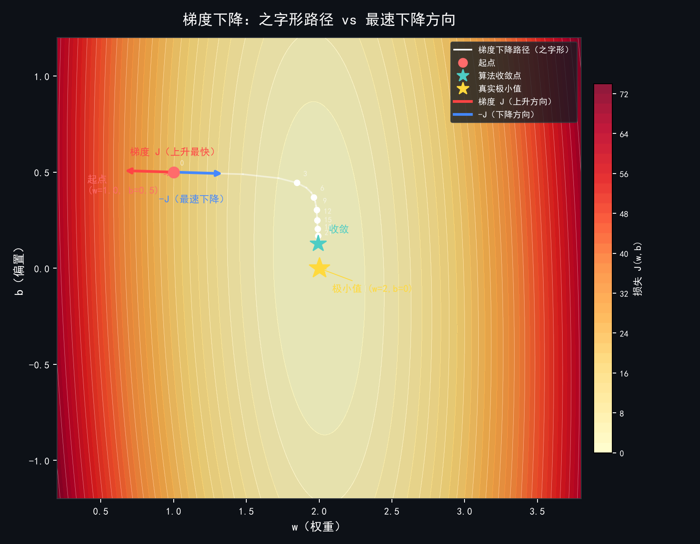

# 梯度下降法（Gradient Descent）

> 记录日期：2026-08-05
> 讲解人：AI（Claude）

## 一、直观理解

想象你站在一个**浓雾弥漫的山上**，目标是走到**山谷最低点**。你看不见全貌，但脚下有坡度。

**每一步的做法**：
1. 感受脚下往哪个方向最**陡**（这就是**梯度 gradient**）
2. 往**相反方向**走一步（上坡的反方向 = 下坡）
3. 重复，直到坡度趋于平 —— 你到达最低点

> **梯度指向损失函数增长最快的方向；我们减掉它，所以是往损失减小的方向走。**

---

## 二、数学公式

我们要**最小化一个损失函数** $J(\theta)$，$\theta$ 是模型参数。

### 核心更新公式

$$\theta \leftarrow \theta - \eta \cdot \nabla J(\theta)$$

| 符号 | 含义 |
|------|------|
| $\theta$ | 要学习的参数（权重/偏置） |
| $\nabla J(\theta)$ | **梯度**，损失对参数的导数，指向损失增长最快的方向 |
| $\eta$（学习率 / learning rate） | 每一步走多远（步长） |

> **为什么是减号？** 梯度指向损失**变大**的方向，我们要让损失**变小**，所以往反方向走。

### 梯度与导数的关系

| 维度 | 名称 | 形式 |
|------|------|------|
| 一维 | **导数** | $\frac{df}{dx}$，一个标量（数字） |
| 多维 | **梯度** | $\nabla f = [\frac{\partial f}{\partial x_1}, \frac{\partial f}{\partial x_2}, \dots]$，一个向量 |

> **一维中，梯度就是导数。** 之所以在算法里叫"梯度"不叫"导数"，是因为梯度下降本质上是**多维算法**（神经网络参数可能有成千上万个），导数只是梯度在 1 维的**特例**。

> 导数是一维的梯度，梯度是导数的高维推广。

---

## 三、一维手算例题

### 题目

求 $f(x) = x^2 + 4x + 4$ 的最小值，用梯度下降法。

- 起点：$x_0 = 5$
- 学习率：$\eta = 0.1$
- 迭代：5 步

### 步骤

**Step 0 — 求导数（梯度）**
$$\frac{df}{dx} = 2x + 4$$

**Step 1 — 迭代更新 $x \leftarrow x - \eta \cdot (2x+4)$**

| 迭代 | $x$ 当前值 | 梯度 $2x+4$ | 更新 | 新 $x$ |
|------|-----------|------------|------|---------|
| 0 | 5.000 | $2(5)+4 = 14$ | $5 - 0.1 \times 14$ | **3.600** |
| 1 | 3.600 | $2(3.6)+4 = 11.2$ | $3.6 - 0.1 \times 11.2$ | **2.480** |
| 2 | 2.480 | $2(2.48)+4 = 8.96$ | $2.48 - 0.1 \times 8.96$ | **1.584** |
| 3 | 1.584 | $2(1.584)+4 = 7.168$ | $1.584 - 0.7168$ | **0.867** |
| 4 | 0.867 | $2(0.867)+4 = 5.734$ | $0.867 - 0.5734$ | **0.294** |

**真解**：令 $2x+4=0$，得 $x = -2$。

> 可以看到每一步都在靠近 $-2$，梯度从 14 逐渐变小，步伐越来越短——"越走越细"。

## 四、深度解析：导数与更新公式的关系

导数 $f'(x)$ 告诉你：**$x$ 往右动一点点，$f(x)$ 会怎么变、变多快。** 它同时提供两个信息：

| 导数 $f'(x)$ | 方向含义 | 速度含义 |
|-------------|----------|----------|
| $f'(x) > 0$ | 往右走函数上升 → 应**往左**走 | $|f'(x)|$ 大 → 坡陡 → 该多走 |
| $f'(x) < 0$ | 往右走函数下降 → 应**往右**走 | $|f'(x)|$ 小 → 坡平 → 该少走 |
| $f'(x) = 0$ | 平了，到极值点 | — |

#### 泰勒展开：为什么更新公式有效

用**一阶泰勒展开**把函数近似成直线：

$$f(x + \Delta x) \approx f(x) + f'(x) \cdot \Delta x$$

我们要让 $f(x+\Delta x)$ 比 $f(x)$ **小**，即 $\Delta x$ 要让增量 $f'(x) \cdot \Delta x$ 为**负数**。

怎么选 $\Delta x$？让它与 $f'(x)$ **方向相反**，大小与 $|f'(x)|$ 成正比：

$$\Delta x = -\eta \cdot f'(x)$$

代入泰勒展开：

$$f(x + \Delta x) \approx f(x) + f'(x) \cdot (-\eta \cdot f'(x)) = f(x) - \eta \cdot [f'(x)]^2$$

> **$\eta \cdot [f'(x)]^2$ 一定是正数（平方非负），所以 $f$ 一定减小！** 这就是更新公式在数学上成立的保证。

#### 用例题数据看这个关系

```
迭代  x      导数 f'(x)  变化率含义                   步伐大小
 0    5       14        每向右 1，上升 14（极陡）    → 大步往左
 1    3.6     11.2      仍然很陡                     → 大步往左
 2    2.48    8.96      变缓                         → 步子缩短
 3    1.584   7.17      更缓                         → 步子更短
 4    0.867   5.73      接近坡底，很平了             → 步子很小
```

> **导数不仅告诉你方向，还自动告诉你步子该大该小**——越陡走得越快，越平走得越慢。这是梯度下降最巧妙的设计。

> **一句话：更新公式 = 用一阶泰勒近似，找出让函数值下降最多的方向，再用学习率控制步长。**

---

## 五、AI 训练中的多维例子（线性回归）

### 场景：预测房价

模型：$y = wx + b$（$w$ 是权重，$b$ 是偏置）

已知 2 个训练样本：

| 面积 $x$ | 真实房价 $y$ |
|----------|-------------|
| 1 | 2 |
| 2 | 4 |

### Step 1 — 定义模型
$$\hat{y} = wx + b$$

### Step 2 — 定义损失函数（均方误差 MSE）
$$J(w,b) = \frac{1}{2}\sum_{i=1}^{m}(\hat{y}^{(i)} - y^{(i)})^2 = \frac{1}{2}[(w+b-2)^2 + (2w+b-4)^2]$$

> 这里 $m=2$，系数 $\frac{1}{2}$ 是为了求导时把平方消掉，方便计算。

### Step 3 — 随机初始化参数
设 $w_0 = 1$，$b_0 = 1$

### Step 4 — 计算预测值
- 样本 1：$\hat{y}_1 = 1 \times 1 + 1 = 2$，误差 $= 2-2 = 0$
- 样本 2：$\hat{y}_2 = 1 \times 2 + 1 = 3$，误差 $= 3-4 = -1$

### Step 5 — 求梯度（链式法则）

$$\frac{\partial J}{\partial w} = \sum_{i}(\hat{y}^{(i)} - y^{(i)}) \cdot x^{(i)}$$
$$\frac{\partial J}{\partial b} = \sum_{i}(\hat{y}^{(i)} - y^{(i)})$$

### Step 5.1 — 推导详解（链式法则）

这是从损失函数到梯度公式的**完整推导**，是理解神经网络反向传播的基础。

**推导起点**：损失函数

$$J(w,b) = \frac{1}{2}\sum_{i=1}^{m}(\hat{y}^{(i)} - y^{(i)})^2,\quad \text{其中 } \hat{y}^{(i)} = w\cdot x^{(i)} + b$$

注意：$w$ 和 $b$ 并不直接出现在损失函数里，而是**藏在 $\hat{y}^{(i)}$ 里面**。所以求偏导要走两步（链式法则）。

#### 求 $\frac{\partial J}{\partial w}$

**第一步 — 求导进入求和号**

$$\frac{\partial J}{\partial w} = \frac{1}{2}\sum_{i=1}^{m}\frac{\partial}{\partial w}(\hat{y}^{(i)} - y^{(i)})^2$$

**第二步 — 链式法则拆分**

$$\frac{\partial}{\partial w}(\hat{y}^{(i)} - y^{(i)})^2 = \underbrace{\frac{\partial}{\partial \hat{y}^{(i)}}(\hat{y}^{(i)} - y^{(i)})^2}_{\text{外层：误差→损失}} \cdot \underbrace{\frac{\partial \hat{y}^{(i)}}{\partial w}}_{\text{内层：w→预测}}$$

- **外层**：令 $u = \hat{y}^{(i)} - y^{(i)}$，则 $u^2$ 对 $u$ 求导 = $2u$
  $$\frac{\partial}{\partial \hat{y}^{(i)}}(\hat{y}^{(i)} - y^{(i)})^2 = 2(\hat{y}^{(i)} - y^{(i)})$$

- **内层**：$\hat{y}^{(i)} = w \cdot x^{(i)} + b$ 对 $w$ 求偏导
  $$\frac{\partial \hat{y}^{(i)}}{\partial w} = x^{(i)}$$

**第三步 — 拼回并约掉系数**

$$\frac{\partial J}{\partial w} = \frac{1}{2}\sum_{i=1}^{m}\left[2(\hat{y}^{(i)} - y^{(i)}) \cdot x^{(i)}\right] = \sum_{i=1}^{m}(\hat{y}^{(i)} - y^{(i)}) \cdot x^{(i)}$$

> $\frac{1}{2}$ 和 $2$ 约掉，得到最终公式。

#### 求 $\frac{\partial J}{\partial b}$

流程完全相同，仅内层导数不同：

$$\frac{\partial \hat{y}^{(i)}}{\partial b} = \frac{\partial}{\partial b}(w\cdot x^{(i)} + b) = \mathbf{1}$$

$$\frac{\partial J}{\partial b} = \frac{1}{2}\sum_{i=1}^{m}2(\hat{y}^{(i)} - y^{(i)}) \cdot 1 = \sum_{i=1}^{m}(\hat{y}^{(i)} - y^{(i)})$$

#### 链式法则逻辑图

```
                    J = ½Σ(ŷⁱ − yⁱ)²    ← 损失 = 误差的平方和
                    │
                    │ 外层导数: 2·(ŷⁱ−yⁱ)
                    ▼
                ŷⁱ = w·xⁱ + b           ← 预测 = 线性函数
                │               │
         对 w 求导 (xⁱ)    对 b 求导 (1)  ← 内层导数
```

> **对 w 求偏导 = [误差怎么影响损失] × [w 怎么影响预测] = 2·误差 · xⁱ**
> **对 b 求偏导 = [误差怎么影响损失] × [b 怎么影响预测] = 2·误差 · 1**

---

代入数值：
- $\frac{\partial J}{\partial w} = (0)\cdot 1 + (-1)\cdot 2 = \mathbf{-2}$
- $\frac{\partial J}{\partial b} = 0 + (-1) = \mathbf{-1}$

### Step 6 — 更新参数（$\eta = 0.1$）

$$w_1 = 1 - 0.1 \times (-2) = 1 + 0.2 = \mathbf{1.2}$$
$$b_1 = 1 - 0.1 \times (-1) = 1 + 0.1 = \mathbf{1.1}$$

### Step 7 — 重复 Step 4 ~ 6，直到损失足够小

> 这就是 AI "学习"的本质：不断调整参数，让预测越来越准。

---

## 六、多维梯度证明：为什么负梯度是最快下降方向

### 梯度 = 偏导数组成的向量

本例有两个参数 $w$ 和 $b$，梯度是偏导数拼成的向量：

$$\nabla J = \left[\frac{\partial J}{\partial w},\ \frac{\partial J}{\partial b}\right] = [-2,\ -1]$$

每个偏导数**独立地**衡量那个方向有多陡，拼起来就是梯度的完整图像。

### 几何直觉：梯度垂直于等高线

等高线 = 损失相同的点的连线。在等高线图上：



*图中红色箭头 **∇J** 指向损失上升最快的方向（梯度方向），蓝色箭头 **−∇J** 指向损失下降最快的方向（负梯度方向）。白色曲线为梯度下降算法实际走过的**之字形路径**，每走一步都沿着 −∇J 方向迈出一步。黄色星号为最优点 $(w=2, b=0)$。*

### 方向导数：任意方向的变化率

**第一步 — 定义**：函数 $f(\vec{x})$ 在单位方向 $\vec{v}$ 上的变化率（方向导数）：

$$D_{\vec{v}}f(\vec{x}) = \left.\frac{d}{dt}f(\vec{x} + t\vec{v})\right|_{t=0} = \nabla f \cdot \vec{v}$$

> 方向导数 = 梯度与方向向量的**点积**（由链式法则得出）。

#### 推导详解：为什么方向导数等于梯度·方向？

**问题 1：这个定义本身怎么来的？**

公式里的每个符号：

| 符号 | 意思 |
|------|------|
| $\vec{x}$ | 你当前站的位置 $(x_1,\ x_2,\ \dots,\ x_n)$ |
| $\vec{v}$ | 你想走的方向（一个向量） |
| $t$ | **时间参数**，代表"走了多远" |
| $\vec{x} + t\vec{v}$ | 从 $\vec{x}$ 出发，沿 $\vec{v}$ 方向走 $t$ 步后的位置 |
| $f(\vec{x} + t\vec{v})$ | 在那个位置上的函数值 |
| $\frac{d}{dt}$ | 随时间变化的速度 |
| $\left.\right|_{t=0}$ | 取在**起点**（刚出发那一刻） |

**$\vec{x} + t\vec{v}$ 画成图：**

```
         沿着 ⃗v 方向走的轨迹

              y
              ↑
              │    ·⃗v 方向
              │   /
              │  /
              │ /
              │/
    (0,0) ────*──→ x
             ⃗x
```

> **$\vec{x} + t\vec{v}$ 就是一条从 $\vec{x}$ 出发、沿 $\vec{v}$ 方向的直线。** $t$ 增大，就沿着这条线越走越远。

**$f(\vec{x} + t\vec{v})$ 随 $t$ 变化：**

```
        f 值（海拔）
        ↑
        │    *  f(⃗x + t⃗v)
        │   /
        │  /
        │ /  ← 沿方向 ⃗v 走过的路径上的函数值
        │/
        *────────────→ t
      f(⃗x)  (起点 t=0)
```

> **方向导数 = 你往某个方向走，在刚出发那一刻（$t=0$），函数值变化的速度。**

---

**问题 2：为什么它等于 $\nabla f \cdot \vec{v}$？**

这是**链式法则**的推导，从定义一步步算。

**第一步 — 把 $f(\vec{x} + t\vec{v})$ 看成复合函数**

设 $u_i = x_i + t \cdot v_i$，则：

$$f(\vec{x} + t\vec{v}) = f(u_1,\ u_2,\ \dots,\ u_n)$$

设 $g(t) = f(u_1,\ u_2,\ \dots,\ u_n)$，这是一个复合函数：

$$t \xrightarrow{\text{变成 }u_i} \xrightarrow{代入 f} g(t)$$

**第二步 — 用链式法则求 $\frac{dg}{dt}$**

$$\frac{dg}{dt} = \frac{\partial f}{\partial u_1}\cdot\frac{du_1}{dt} + \frac{\partial f}{\partial u_2}\cdot\frac{du_2}{dt} + \dots + \frac{\partial f}{\partial u_n}\cdot\frac{du_n}{dt}$$

> 链式法则：外层（$f$ 对每个 $u_i$ 的偏导）乘以 内层（$u_i$ 对 $t$ 的导数），再相加。

**第三步 — 计算 $\frac{du_i}{dt}$**

$$u_i = x_i + t \cdot v_i$$

$x_i$ 是常数，对 $t$ 求导：

$$\frac{du_i}{dt} = v_i$$

**第四步 — 代入链式法则**

$$\frac{dg}{dt} = \frac{\partial f}{\partial u_1}\cdot v_1 + \frac{\partial f}{\partial u_2}\cdot v_2 + \dots + \frac{\partial f}{\partial u_n}\cdot v_n$$

在 $t=0$ 时，$u_i = x_i$，所以 $\frac{\partial f}{\partial u_i} = \frac{\partial f}{\partial x_i}$：

$$\left.\frac{dg}{dt}\right|_{t=0} = \frac{\partial f}{\partial x_1}\cdot v_1 + \frac{\partial f}{\partial x_2}\cdot v_2 + \dots + \frac{\partial f}{\partial x_n}\cdot v_n$$

**第五步 — 写成点积形式**

$$\left.\frac{dg}{dt}\right|_{t=0} = \left[\frac{\partial f}{\partial x_1},\ \frac{\partial f}{\partial x_2},\ \dots,\ \frac{\partial f}{\partial x_n}\right] \cdot \left[v_1,\ v_2,\ \dots,\ v_n\right] = \nabla f \cdot \vec{v}$$

> **证毕。方向导数 = 梯度 · 方向向量。**

#### 推导逻辑链

$$\vec{x} + t\vec{v} \text{（沿方向的直线）} \xrightarrow{\text{定义方向导数}} \frac{d}{dt}f(\vec{x}+t\vec{v})|_{t=0}$$
$$\xrightarrow{\text{链式法则}} \sum_i \frac{\partial f}{\partial x_i}\cdot v_i \xrightarrow{\text{点积}} \nabla f \cdot \vec{v}$$

#### 用一维例子验证

$f(x) = x^2$，在 $x=1$ 处往方向 $v=1$ 走：

- $\vec{x} + t\vec{v} = 1 + t$
- $f(1+t) = (1+t)^2 = 1 + 2t + t^2$
- $\frac{d}{dt}f(1+t) = 2 + 2t$
- $\left.\right|_{t=0} = \mathbf{2}$

另一方面：$\nabla f = f'(1) = 2$，$\nabla f \cdot \vec{v} = 2 \cdot 1 = \mathbf{2}$

> **两边算出来完全一样。** ✅

---

**第二步 — 点积展开**（$\vec{v}$ 是单位向量，$\theta$ 是夹角）：

$$\nabla f \cdot \vec{v} = ||\nabla f|| \cdot \cos\theta$$

> **为什么 $\vec{v}$ 要是单位向量（$||\vec{v}|| = 1$）？**
>
> 点积的完整展开其实是：
>
> $$\nabla f \cdot \vec{v} = ||\nabla f|| \cdot ||\vec{v}|| \cdot \cos\theta$$
>
> 注意多了一个 $||\vec{v}||$。只有当 $||\vec{v}|| = 1$ 时，这一项才能消掉，才得到上面那个简洁公式。
>
> 这不只是"公式好看"，它**改变了我们问的问题**：
>
> **如果不限制 $||\vec{v}|| = 1$**：想让你下降最快，直接让 $\vec{v}$ 变得无穷大就行了——$||\vec{v}||$ 越大，$||\nabla f|| \cdot ||\vec{v}|| \cdot \cos\theta$ 越小（越负）。但这不是在找"最陡的方向"，而是在比"走得有多远"。就像问"怎么走下山最快"，答案是"跑着走"——回答的是速度，不是方向。
>
> **限制了 $||\vec{v}|| = 1$ 后**：$||\vec{v}||$ 被锁死为 1，变量只剩 $\cos\theta$。问题真正变成了"哪个**方向**最陡"，答案是 $\cos\theta = -1$（与梯度反向）。
>
> 一句话总结：
>
> | 限制 | 在比什么 | 答案 |
> |------|---------|------|
> | 不限制 $||\vec{v}||$ | 走得多快（速度） | 无穷快，无意义 |
> | $||\vec{v}|| = 1$ | 方向有多陡 | $-\nabla f$，最陡 |
>
> **方向导数的定义本身就是"朝这个方向走 1 个单位长度，函数值变多少"**——所以单位化不是可有可无的约定，而是"找最陡方向"这个问题的前提条件。
>

**第三步 — 分析夹角**

| 夹角 $\theta$ | $\cos\theta$ | 方向导数 $D_{\vec{v}}f$ | 含义 |
|-------------|-------------|----------------------|------|
| $0°$（与梯度同向） | $1$ | $||\nabla f||$（最大） | **上升最快** |
| $90°$（与梯度垂直） | $0$ | $0$ | 不变（沿等高线走） |
| $180°$（与梯度反向） | $-1$ | $-||\nabla f||$（最小） | **下降最快** |

**第四步 — 结论**

$$\max_{\vec{v},\ ||\vec{v}||=1} D_{\vec{v}}f = ||\nabla f|| \quad\text{当 }\theta = 0°$$

> **当且仅当 $\vec{v}$ 与 $\nabla f$ 同方向时，函数值上升最快。反之，$-\nabla f$ 是下降最快的方向。**

#### 大白话详解：为什么 cosθ = -1 就最快？

如果你看到上面的公式觉得跳跃，用大白话一步步想：

**先搞清楚我们在算什么：** 站在山坡上某一点，问"往哪个方向走下山最快"。

**方向导数 = 往某个方向走，函数值变化的快慢。**

比如：
- 往正东走，每 1 米降 2 米 → 方向导数 = **-2**
- 往正北走，每 1 米不变 → 方向导数 = **0**
- 往正西走，每 1 米升 3 米 → 方向导数 = **+3**

**方向导数越小（越负），下降越快。** 这就是要找的目标。

**方向导数怎么算？** 它等于梯度与方向向量的点积：

$$\nabla f \cdot \vec{v} = ||\nabla f|| \cdot \cos\theta$$

点积有两个等价写法：
- **分量写法**：$a_x b_x + a_y b_y$（逐分量相乘再相加）
- **几何写法**：$||\vec{a}|| \cdot ||\vec{b}|| \cdot \cos\theta$（长度 × 余弦）

$\vec{v}$ 是单位向量，所以 $||\vec{v}|| = 1$，几何写法简化为：

$$\nabla f \cdot \vec{v} = ||\nabla f|| \cdot \cos\theta$$

**到这里结论已经出来了。** 因为在某一点上：

- **梯度长度 $||\nabla f||$ 是固定的**（某一点上它是个常数，不会变）
- **唯一能变的就是 $\cos\theta$**（改变行走方向，夹角就变）

**cosθ 能取什么值？**

| cosθ 取值 | 夹角 $\theta$ | 方向导数 | 你在往哪走 |
|-----------|-------------|----------|-----------|
| **+1**（最大） | $0°$ | $+||\nabla f||$ | 顺着梯度，**上升最快** |
| $0$ | $90°$ | $0$ | 垂直于梯度，**不走高也不走低**（等高线方向） |
| **-1**（最小） | $180°$ | $-||\nabla f||$ | 逆着梯度，**下降最快** |
| $0.5$ | $60°$ | $+0.5||\nabla f||$ | 斜着往上爬 |
| $-0.5$ | $120°$ | $-0.5||\nabla f||$ | 斜着往下走 |

> **cosθ 的范围是 $[-1,\ 1]$。-1 是它能取的最小值，只能在 $\theta = 180°$ 时取到。**

**所以整个逻辑是：**

1. 要找最小的方向导数（下降最快）
2. → 要找最小的 cosθ
3. → cosθ 最小 = **-1**（三角函数性质，最大值 1，最小值 -1）
4. → cosθ = -1 时 $\theta = 180°$
5. → $\theta = 180°$ 就是**与梯度方向完全相反**
6. → 相反方向 = **负梯度方向 $-\nabla f$**

**证毕。**

> **一句话：方向导数 = 梯度长度 × cosθ。梯度长度在某点是固定的，要让方向导数最小（下降最快），就要让 cosθ 最小。cosθ 最小值是 -1，在 180°（完全相反）时取到——这就是负梯度方向。**

### 证明的完整逻辑链

$$\text{方向导数} = \nabla f \cdot \vec{v} = ||\nabla f|| \cdot \cos\theta \quad\text{（点积展开）}$$

> 要让方向导数**最小**（下降最快）→ 让 $\cos\theta$ 最小 → $\cos\theta = -1$（$\theta=180°$）→ 方向 = **负梯度方向**。证毕。

### 用本例数字验证

梯度 $\nabla J = [-2,\ -1]$，长度 $||\nabla J|| = \sqrt{4+1} = \sqrt{5} \approx 2.24$

**方案 A — 只往 w 方向走** $\vec{v} = [1,\ 0]$：
$$D_{\vec{v}}J = [-2,\ -1] \cdot [1,\ 0] = \mathbf{-2}$$

**方案 B — 沿负梯度方向** $\vec{v} = -\frac{1}{\sqrt{5}}[-2,\ -1] = [2/\sqrt{5},\ 1/\sqrt{5}]$：
$$D_{\vec{v}}J = ||\nabla J|| \cdot \cos180° = -\sqrt{5} \approx \mathbf{-2.24}$$

> **-2.24 < -2**：负梯度方向下降得确实比只走 w 方向更快。这就是"最陡下降"的数学保证。

---

## 七、三种变体（面试常考）

| 类型 | 每次用多少数据算梯度 | 优点 | 缺点 |
|------|---------------------|------|------|
| **批量梯度下降（BGD）** | 全部 $m$ 个样本 | 稳定收敛到最低点 | 数据量大时每一步都很慢 |
| **随机梯度下降（SGD）** | 1 个样本 | 快，能跳出局部最优 | 震荡大，路径不稳定 |
| **小批量梯度下降（Mini-batch）** | 几十个样本（如 32、64） | 折中，最常用 | — |

> **AI 训练（神经网络）几乎都用 Mini-batch**，并配合 Adam 等自适应优化器（自动调节学习率）。

---

## 八、关键概念与注意点

### 学习率 $\eta$

**学习率不是越小越好，而是要"足够小以保证收敛，又足够大以保证效率"。**

#### 三种情况的对比（以例题 $f(x) = x^2+4x+4$ 为例）

| 情况 | 学习率 | 现象 | 结果 |
|------|--------|------|------|
| 太大 | $\eta = 2.0$ | $5 \to 5-2.0\times14 = -23$，跨过最低点飞出去 | **发散** ❌ |
| 太小 | $\eta = 0.001$ | $5 \to 4.986$，每步几乎不动 | **极慢** ❌ |
| 合适 | $\eta = 0.1$ | $5 \to 3.6 \to 2.48 \to \dots$ 稳步收敛 | **最优** ✅ |

#### 数学分析：例题中的收敛条件

例题中 $f'(x) = 2x+4$，更新为 $x \leftarrow x - \eta(2x+4)$，化简：

$$x_{\text{new}} = x(1 - 2\eta) - 4\eta$$

这是一个线性递推。要收敛，系数 $|1-2\eta| < 1$，即：

$$0 < \eta < 1$$

- $\eta > 1$ → 系数绝对值 > 1 → **发散**
- $\eta = 1$ → 系数 = -1 → **在两点间来回振荡**，永远到不了最低点
- $\eta < 0$ → 往反方向走 → **发散**

> **学习率必须在合理范围内，既保证收敛又保证效率。** 实践中常用 0.01 ~ 0.0001 起步。

#### 实际训练中的学习率策略

| 策略 | 做法 |
|------|------|
| **手动调参** | 试 0.01 / 0.001 / 0.0001，选收敛最快的 |
| **学习率衰减** | 训练中逐步减小学习率（先大步找方向，再小步精调） |
| **自适应优化器** | Adam 等为每个参数单独学习率，自动适应 |
| **学习率预热** | 一开始用小学习率，慢慢加大，避免初期震荡 |

### 局部最优（Local Minimum）

可能停在**不是全局最低**的地方。在非凸函数（如深度神经网络）中非常普遍，但实践证明通常影响不大——大多数局部最优的质量已经很好。

### 梯度消失（Vanishing Gradient）

梯度变得极小，参数几乎不动，训练停滞。深层网络中常见，解决方案包括：
- 使用 **ReLU** 等激活函数
- 使用 **残差连接**（ResNet）
- 使用 **Layer Normalization**

### 鞍点（Saddle Point）

梯度为 0，但不是最低点（如马鞍的中间点）。高维空间中比局部最优更常见，Adam 等优化器能更好地跳过。

---

## 九、与学科的联系

| 学科 | 对应概念 |
|------|----------|
| **数学（微积分）** | 求导、偏导数、链式法则、多元函数极值 |
| **数学（线性代数）** | 梯度是向量，参数是向量，矩阵乘法求梯度 |
| **计算机科学** | 算法复杂度、迭代收敛性、工程实现（GPU 并行） |

---

## 十、总结

> **梯度下降 = 沿着损失函数的负梯度方向一步步走，每步长度 = 学习率 × 梯度大小，直到走到最低点。**
>
> 这就是 AI 训练"学习"的数学本质。
