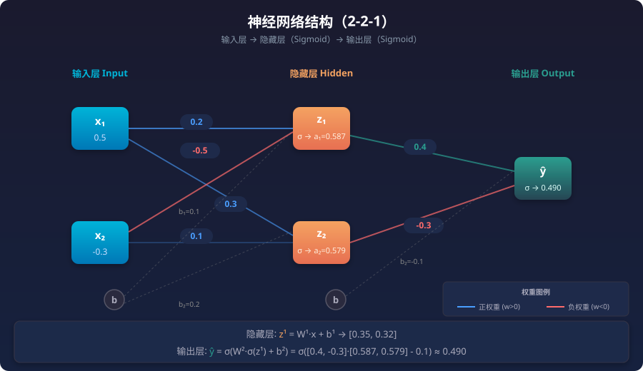

# 神经网络基础（Neural Network Basics）

> 记录日期：2026-08-07
> 讲解人：AI（Claude）

## 一、直观理解

### 从大脑到神经网络

人类大脑由约 **860 亿个神经元** 组成，神经元之间通过 **突触** 连接。当某些神经元被同时强烈刺激时，它们会**激活**，向其他神经元发送信号。

```
        ┌─突触(带权重)
        │
  输入──→● 神经元 ──→ 输出
        │
        └─突触(带权重)
```

**核心灵感**：能不能用一个**数学模型**模拟神经元的运作，然后把大量这样的模型**连接起来**，让它学会处理复杂的任务？

> **神经网络 = 用数学模拟神经元的连接网络，通过调整连接权重来学习。**

### 从线性回归到神经网络：进化的三步

你已经学过**线性回归** $y = wx + b$，这是最简单的"模型"。

| 进化步骤 | 做了什么 | 解决了什么 |
|---------|---------|-----------|
| **Step 1** | 把 $w \cdot x$ 推广为**向量点积** $w^T x + b$ | 从 1 个特征到多个特征 |
| **Step 2** | 把**单层**推广为**多层** | 从线性到非线性（可拟合复杂函数） |
| **Step 3** | 在每层之间加入**激活函数** | 让网络有真正的非线性表达能力 |

> **神经网络本质上是一个多层嵌套的线性回归 + 非线性激活函数。** 每一层都在做"加权求和 → 加偏置 → 激活函数"这三步。

---

## 二、单个神经元：感知器（Perceptron）

### 数学模型

一个神经元做的事情很简单：

$$y = \sigma(w_1 x_1 + w_2 x_2 + \cdots + w_n x_n + b) = \sigma\left(\sum_{i=1}^{n} w_i x_i + b\right)$$

| 符号 | 含义 |
|------|------|
| $x_1, x_2, \dots, x_n$ | 输入（来自上一层或原始数据） |
| $w_1, w_2, \dots, w_n$ | 权重（可学习，决定每个输入的重要性） |
| $b$ | 偏置（可学习，控制激活阈值） |
| $\sigma$ | 激活函数（决定神经元是否"激活"） |
| $y$ | 输出 |

### 核心计算

$$\boxed{y = \sigma(z), \quad z = w^T x + b = \sum_{i=1}^{n} w_i x_i + b}$$

### 神经元的三个计算步骤

```
输入 x₁, x₂, ..., xₙ
        ↓
  ① 加权求和  z = w₁x₁ + w₂x₂ + ... + wₙxₙ + b
        ↓
  ② 激活函数  y = σ(z)
        ↓
    输出 y
```

**为什么要有偏置 $b$？** 没有偏置时，$w_1 x_1 + w_2 x_2 = 0$ 代表一条**必过原点**的直线。加了偏置后，直线可以上下平移，能表示任意直线。同理，多维空间中也是同理。

> **偏置 = 让决策边界不必经过原点，增加灵活性。**

### 为什么单层不够：XOR 问题

单层感知器（不加激活函数，或只用阶跃函数）只能学习**线性可分**的问题。

**XOR（异或）问题**：

| $x_1$ | $x_2$ | 输出 |
|-------|-------|------|
| 0 | 0 | 0 |
| 0 | 1 | 1 |
| 1 | 0 | 1 |
| 1 | 1 | 0 |

画在二维平面上，(0,0) 和 (1,1) 是 0，(0,1) 和 (1,0) 是 1，**不存在一条直线能把它们分开**——这是 XOR 被称为"单层感知器的经典难题"的原因。

> **多层网络（隐藏层）+ 非线性激活函数**才能解决 XOR 这类非线性问题。这就是神经网络的强大之处。

---

## 三、多层神经网络：前向传播（Forward Propagation）

### 网络结构

以三层网络为例：

```
        输入层
    x₁ ──┬─────┬─────┬──→ h₁ → σ → a₁
    x₂ ──┼─────┼─────┼──→ h₂ → σ → a₂
    x₃ ──┴─────┴─────┴──→ h₃ → σ → a₃
                        (隐藏层)
                            ↓
                     h₄ → σ → a₄
                            ↓
                        输出层（ŷ）
```

### 分层计算

| 层 | 名称 | 计算 |
|----|------|------|
| 输入层 | — | $x$（原始数据，不计算） |
| 隐藏层 | 中间层 | $z^{[1]} = W^{[1]}x + b^{[1]}$，$a^{[1]} = \sigma(z^{[1]})$ |
| 输出层 | 最终层 | $z^{[2]} = W^{[2]}a^{[1]} + b^{[2]}$，$\hat{y} = \sigma(z^{[2]})$ |

**符号约定**（上标方括号表示第几层）：

| 符号 | 含义 | 维度 |
|------|------|------|
| $W^{[l]}$ | 第 $l$ 层的权重矩阵 | $n^{[l]} \times n^{[l-1]}$ |
| $b^{[l]}$ | 第 $l$ 层的偏置向量 | $n^{[l]} \times 1$ |
| $z^{[l]}$ | 第 $l$ 层的加权和 | $n^{[l]} \times 1$ |
| $a^{[l]}$ | 第 $l$ 层的激活输出 | $n^{[l]} \times 1$ |

> **前向传播 = 从输入层开始，一层一层地"算"到输出层。** 每一层都用上一层的输出作为自己的输入。

---

## 四、激活函数：为什么必须有它

### 没有激活函数 = 线性回归的堆叠

假设网络没有激活函数，只有线性变换：

$$\hat{y} = W^{[2]}(W^{[1]}x + b^{[1]}) + b^{[2]} = W^{[2]}W^{[1]}x + W^{[2]}b^{[1]} + b^{[2]}$$

这等价于：

$$\hat{y} = \underbrace{W^{[2]}W^{[1]}}_{W'}x + \underbrace{W^{[2]}b^{[1]} + b^{[2]}}_{b'}$$

**两层线性层 = 一层线性层！** 无论加多少层，没有激活函数，网络就退化成了**线性回归**。

> **激活函数 = 给网络注入"非线性"，这是神经网络能拟合复杂函数的关键。**

### 常见激活函数

#### 1. Sigmoid

$$\sigma(z) = \frac{1}{1 + e^{-z}}$$

| 特性 | 说明 |
|------|------|
| 输出范围 | $(0, 1)$，适合二分类输出层 |
| 导数 | $\sigma'(z) = \sigma(z)(1 - \sigma(z))$ |
| 缺点 | **梯度消失**：$z$ 很大或很小时，导数趋近于 0，网络学不动 |

```
z → -∞ : σ(z) → 0   导数 → 0
z = 0   : σ(z) = 0.5 导数最大 = 0.25
z → +∞ : σ(z) → 1   导数 → 0
```

#### 2. Tanh（双曲正切）

$$\tanh(z) = \frac{e^z - e^{-z}}{e^z + e^{-z}}$$

| 特性 | 说明 |
|------|------|
| 输出范围 | $(-1, 1)$ |
| 导数 | $\tanh'(z) = 1 - \tanh^2(z)$ |
| 优点 | 输出以 0 为中心，比 Sigmoid 效果好 |
| 缺点 | 仍有梯度消失问题 |

#### 3. ReLU（Rectified Linear Unit）⭐ 最常用

$$\text{ReLU}(z) = \max(0, z) = \begin{cases} z & \text{if } z > 0 \\ 0 & \text{if } z \le 0 \end{cases}$$

| 特性 | 说明 |
|------|------|
| 输出范围 | $[0, +\infty)$ |
| 导数 | $1$（当 $z > 0$），$0$（当 $z \le 0$） |
| 优点 | **计算简单、无梯度消失**（正区间导数恒为 1）、训练快 |
| 缺点 | **死亡 ReLU**：$z < 0$ 时梯度为 0，神经元可能"死亡"不再更新 |

```
ReLU 导数图：
          导数
          ↑
   1 ─────●──────────→ z
          │
   0 ─────●
        z=0
```

### 隐藏层 vs 输出层：激活函数选择

| 层类型 | 推荐激活函数 | 原因 |
|--------|-------------|------|
| 隐藏层 | **ReLU** | 简单、快、避免梯度消失 |
| 输出层（二分类） | Sigmoid | 输出概率 $(0,1)$ |
| 输出层（多分类） | Softmax | 输出各类概率，和为 1 |
| 输出层（回归） | 线性（无激活） | 输出任意实数 |

---

## 五、手算例题：完整的前向传播

### 场景：分类任务

假设有一个简单的神经网络，要判断一个样本属于"类别 A"还是"类别 B"。

**网络结构**：
- 输入层：2 个神经元（$x_1, x_2$）
- 隐藏层：2 个神经元（用 Sigmoid 激活）
- 输出层：1 个神经元（用 Sigmoid 激活）



*图中蓝色连线为正权重（$w > 0$），红色连线为负权重（$w < 0$），虚线为偏置连接。每个圆角矩形内的数字为节点的中间计算值。*

**输入**：$x_1 = 0.5, x_2 = -0.3$

**参数（手算用简化值）**：

隐藏层权重和偏置：
$$W^{[1]} = \begin{bmatrix} 0.2 & -0.5 \\ 0.3 & 0.1 \end{bmatrix}, \quad b^{[1]} = \begin{bmatrix} 0.1 \\ 0.2 \end{bmatrix}$$

输出层权重和偏置：
$$W^{[2]} = \begin{bmatrix} 0.4 & -0.3 \end{bmatrix}, \quad b^{[2]} = -0.1$$

### Step 1 — 隐藏层计算

#### 计算隐藏层的加权和 $z^{[1]} = W^{[1]} x + b^{[1]}$

$$z^{[1]} = \begin{bmatrix} 0.2 & -0.5 \\ 0.3 & 0.1 \end{bmatrix} \cdot \begin{bmatrix} 0.5 \\ -0.3 \end{bmatrix} + \begin{bmatrix} 0.1 \\ 0.2 \end{bmatrix}$$

**第一个神经元 $z_1^{[1]}$**：
$$z_1^{[1]} = 0.2 \times 0.5 + (-0.5) \times (-0.3) + 0.1 = 0.1 + 0.15 + 0.1 = \mathbf{0.35}$$

**第二个神经元 $z_2^{[1]}$**：
$$z_2^{[1]} = 0.3 \times 0.5 + 0.1 \times (-0.3) + 0.2 = 0.15 - 0.03 + 0.2 = \mathbf{0.32}$$

$$z^{[1]} = \begin{bmatrix} 0.35 \\ 0.32 \end{bmatrix}$$

#### 通过 Sigmoid 激活

$$a^{[1]} = \sigma(z^{[1]}) = \begin{bmatrix} \sigma(0.35) \\ \sigma(0.32) \end{bmatrix}$$

**计算 Sigmoid**：

$$\sigma(z) = \frac{1}{1 + e^{-z}}$$

- $\sigma(0.35) = \frac{1}{1 + e^{-0.35}} = \frac{1}{1 + 0.705} = \frac{1}{1.705} \approx \mathbf{0.587}$
- $\sigma(0.32) = \frac{1}{1 + e^{-0.32}} = \frac{1}{1 + 0.726} = \frac{1}{1.726} \approx \mathbf{0.579}$

$$a^{[1]} = \begin{bmatrix} 0.587 \\ 0.579 \end{bmatrix}$$

### Step 2 — 输出层计算

#### 计算输出层的加权和 $z^{[2]} = W^{[2]} a^{[1]} + b^{[2]}$

$$z^{[2]} = \begin{bmatrix} 0.4 & -0.3 \end{bmatrix} \cdot \begin{bmatrix} 0.587 \\ 0.579 \end{bmatrix} + (-0.1)$$

$$z^{[2]} = 0.4 \times 0.587 + (-0.3) \times 0.579 + (-0.1) = 0.235 - 0.174 - 0.1 = \mathbf{-0.039}$$

#### 通过 Sigmoid 激活得到预测

$$\hat{y} = \sigma(-0.039) = \frac{1}{1 + e^{0.039}} = \frac{1}{1 + 1.040} = \frac{1}{2.040} \approx \mathbf{0.490}$$

### 结果

| 层 | 计算 | 值 |
|----|------|----|
| 输入 | $x$ | $[0.5, -0.3]$ |
| 隐藏层加权和 | $z^{[1]}$ | $[0.35, 0.32]$ |
| 隐藏层激活输出 | $a^{[1]}$ | $[0.587, 0.579]$ |
| 输出层加权和 | $z^{[2]}$ | $[-0.039]$ |
| 最终预测 | $\hat{y}$ | **0.490** |

> **预测结果 0.490 ≈ 50%**：模型对这个样本的分类很犹豫（接近 0.5）。这通常意味着模型还没训练好，需要反向传播来调整参数。

---

## 六、损失函数（Loss Function）：衡量"错得有多离谱"

### 为什么要损失函数？

前向传播算出预测值 $\hat{y}$ 后，需要知道**预测和真实值差多少**。损失函数就干这个事：

$$\text{损失越大 → 预测越差}$$

训练的目标就是**让损失最小化**（用梯度下降）。

### 二分类交叉熵损失

二分类任务（输出层 Sigmoid）的损失函数：

$$\mathcal{L} = -[y \cdot \log(\hat{y}) + (1-y) \cdot \log(1-\hat{y})]$$

| 符号 | 含义 |
|------|------|
| $y$ | 真实标签（0 或 1） |
| $\hat{y}$ | 预测概率（0 到 1 之间） |

### 用例题数据计算损失

真实标签 $y = 1$（这个样本属于类别 A），预测 $\hat{y} = 0.490$：

$$\mathcal{L} = -[1 \cdot \log(0.490) + 0 \cdot \log(1-0.490)]$$
$$\mathcal{L} = -[\log(0.490) + 0] = -\log(0.490) = \mathbf{0.713}$$

> **损失 0.713 说明模型预测"不太准"**。如果预测是 1.0，损失 = $-\log(1) = 0$（完美预测）。

### 为什么用交叉熵而不是 MSE？

在二分类中，用 MSE（均方误差）也可以，但**交叉熵效果更好**：

| 损失函数 | 梯度特性 | 训练效果 |
|---------|---------|---------|
| **MSE** | 预测错时梯度可能很小（Sigmoid 两端的梯度趋近 0） | 训练慢 |
| **交叉熵** | 预测错时梯度大，推力强 | 训练快 |

**原因**：交叉熵的梯度刚好消掉了 Sigmoid 导数中的分母，得到更简洁的梯度形式：

$$\frac{\partial \mathcal{L}}{\partial z^{[2]}} = \hat{y} - y$$

### 完整推导：为什么梯度刚好是 $\hat{y} - y$？

这个"消掉"的过程，就是**链式法则**的魔术时刻。我们一步步把每一步的导数算出来，看看它们如何消掉。

#### 整个计算链

反向传播要算的是 $\frac{\partial \mathcal{L}}{\partial z^{[2]}}$，从 $z^{[2]}$ 到 $\mathcal{L}$ 的完整路径是：

```
z² → ŷ = σ(z²) → L(ŷ, y)
```

用链式法则拆开：

$$\frac{\partial \mathcal{L}}{\partial z^{[2]}} = \frac{\partial \mathcal{L}}{\partial \hat{y}} \cdot \frac{\partial \hat{y}}{\partial z^{[2]}}$$

| 部分 | 含义 |
|------|------|
| $\frac{\partial \mathcal{L}}{\partial \hat{y}}$ | 损失函数对预测值的导数 |
| $\frac{\partial \hat{y}}{\partial z^{[2]}}$ | Sigmoid 激活函数的导数 |

#### 第一部分：$\frac{\partial \mathcal{L}}{\partial \hat{y}}$（损失函数对 ŷ 的导数）

交叉熵损失：
$$\mathcal{L} = -[y \cdot \log(\hat{y}) + (1-y) \cdot \log(1-\hat{y})]$$

对 $\hat{y}$ 求导：
$$\frac{\partial \mathcal{L}}{\partial \hat{y}} = -\left[y \cdot \frac{1}{\hat{y}} + (1-y) \cdot \frac{1}{1-\hat{y}} \cdot (-1)\right]$$

$$= -\left[\frac{y}{\hat{y}} - \frac{1-y}{1-\hat{y}}\right] = -\frac{y}{\hat{y}} + \frac{1-y}{1-\hat{y}}$$

通分：
$$= \frac{-y(1-\hat{y}) + \hat{y}(1-y)}{\hat{y}(1-\hat{y})} = \frac{-y + y\hat{y} + \hat{y} - y\hat{y}}{\hat{y}(1-\hat{y})} = \frac{\hat{y} - y}{\hat{y}(1-\hat{y})}$$

$$\frac{\partial \mathcal{L}}{\partial \hat{y}} = \frac{\hat{y} - y}{\hat{y}(1-\hat{y})}$$

> **分子出现了 $\hat{y} - y$，分母是 $\hat{y}(1-\hat{y})$。注意这个分母，它就是 Sigmoid 导数的关键！**

#### 第二部分：$\frac{\partial \hat{y}}{\partial z^{[2]}}$（Sigmoid 的导数）

$$\hat{y} = \sigma(z^{[2]}) = \frac{1}{1 + e^{-z^{[2]}}}$$

Sigmoid 的导数有一个很漂亮的恒等式：

$$\frac{\partial \sigma(z)}{\partial z} = \sigma(z)(1 - \sigma(z))$$

证明（用链式法则）：

$$\frac{d}{dz}\left(\frac{1}{1 + e^{-z}}\right) = \frac{d}{dz}(1 + e^{-z})^{-1} = -1 \cdot (1 + e^{-z})^{-2} \cdot (-e^{-z})$$

$$= \frac{e^{-z}}{(1 + e^{-z})^2} = \frac{1}{1 + e^{-z}} \cdot \frac{e^{-z}}{1 + e^{-z}} = \sigma(z) \cdot (1 - \sigma(z))$$

> 推导核心：$\frac{e^{-z}}{1 + e^{-z}} = 1 - \frac{1}{1 + e^{-z}} = 1 - \sigma(z)$

所以：
$$\frac{\partial \hat{y}}{\partial z^{[2]}} = \hat{y}(1 - \hat{y})$$

#### 第三部分：两部分相乘——见证"消掉"的时刻

$$\frac{\partial \mathcal{L}}{\partial z^{[2]}} = \underbrace{\frac{\hat{y} - y}{\hat{y}(1-\hat{y})}}_{\text{损失的导数}} \cdot \underbrace{\hat{y}(1-\hat{y})}_{\text{Sigmoid 的导数}}$$

**$\hat{y}(1-\hat{y})$ 上下抵消！**

$$\frac{\partial \mathcal{L}}{\partial z^{[2]}} = \frac{\hat{y} - y}{\hat{y}(1-\hat{y})} \cdot \hat{y}(1-\hat{y}) = \hat{y} - y$$

> **证毕！** $\hat{y}(1-\hat{y})$ 在交叉熵的梯度分母和 Sigmoid 的导数中完全一致，两者相乘后消掉，只剩最简洁的 $\hat{y} - y$。

#### 消掉之后的直观意义

| 公式 | 直观含义 |
|------|---------|
| $\hat{y} = 0.490$，$y = 1$，$\hat{y} - y = -0.510$ | 预测低了 0.51，梯度告诉权重"应该增大" |
| $\hat{y} = 0.95$，$y = 1$，$\hat{y} - y = -0.05$ | 预测已经很准了，梯度很小，微调即可 |
| $\hat{y} = 0.5$，$y = 0$，$\hat{y} - y = 0.5$ | 预测完全反了，梯度大，强力纠正 |

> **$\hat{y} - y$ 的直观含义就是"预测值与真实值的误差"。梯度 = 误差，所以参数会直接往"减小误差"的方向更新。**

---

### 对比：MSE 为什么会梯度消失？

如果用 MSE 损失 $\mathcal{L} = (\hat{y} - y)^2$ 来替代交叉熵：

$$\frac{\partial \mathcal{L}}{\partial z^{[2]}} = \frac{\partial \mathcal{L}}{\partial \hat{y}} \cdot \frac{\partial \hat{y}}{\partial z^{[2]}} = 2(\hat{y} - y) \cdot \hat{y}(1-\hat{y})$$

> **关键区别：MSE 保留了 $\hat{y}(1-\hat{y})$，而交叉熵把这一项消掉了。**

| 情况 | $\hat{y}$ | $\hat{y}(1-\hat{y})$ | 梯度大小 |
|------|----------|---------------------|---------|
| 预测接近 0 或 1（极端错误） | 0.01 或 0.99 | 0.01 | **梯度接近 0，学不动** |
| 预测接近 0.5（很犹豫） | 0.5 | 0.25 | 梯度较大，能学 |

**这意味着**：
- 用 MSE，**预测越错，梯度越小，训练越慢**——正好反过来
- 用交叉熵，**预测越错，梯度越大，推得越猛**——训练越慢的情况被避免

> **一句话：交叉熵和 Sigmoid 的组合，让"预测越错、推力越大"，这就是交叉熵在二分类中更好的数学原因。**

---

> **交叉熵 + Sigmoid = 训练二分类的黄金组合。**

---

## 七、反向传播（Backpropagation）：计算梯度的核心

### 核心思想

反向传播 = **链式法则**在神经网络上的应用。

**目标**：计算损失 $\mathcal{L}$ 对每个参数的梯度，然后用梯度下降更新参数。

需要计算的梯度：
- $\frac{\partial \mathcal{L}}{\partial W^{[l]}}$ — 权重梯度
- $\frac{\partial \mathcal{L}}{\partial b^{[l]}}$ — 偏置梯度

### 链式法则回顾

$$\frac{\partial \mathcal{L}}{\partial W} = \frac{\partial \mathcal{L}}{\partial z} \cdot \frac{\partial z}{\partial W}$$

神经网络前向传播的完整计算链：

```
前向：  x → z¹ → a¹ → z² → a² → ... → ŷ → L

反向：  x ← δ¹ ← a¹ ← δ² ← a² ← ... ← ŷ ← ∂L/∂z
       ↑                    ↑
    更新 W,b¹          更新 W,b²
```

### 反向传播的四个关键步骤

以两层网络为例（隐藏层 + 输出层）：

#### 第一层（输出层梯度）

从损失开始，计算输出层的梯度：

$$\delta^{[2]} = \frac{\partial \mathcal{L}}{\partial z^{[2]}} = \hat{y} - y$$

> 这就是上面提到的"交叉熵消掉了 Sigmoid 分母"后的简洁结果。

#### 第二层（隐藏层梯度）

把梯度**反传**到隐藏层：

$$\delta^{[1]} = (W^{[2]T} \cdot \delta^{[2]}) \odot \sigma'(z^{[1]})$$

| 符号 | 含义 |
|------|------|
| $W^{[2]T}$ | 输出层权重的转置（把梯度从输出层**回传**到隐藏层） |
| $\odot$ | 哈达玛积（逐元素相乘） |
| $\sigma'(z^{[1]})$ | 隐藏层激活函数的导数 |

### 详细解释："回传到隐藏层"到底在做什么？

这是反向传播中最难理解的一步。我们从**直观**和**数学**两个层面来拆解。

#### 直观理解：误差是如何"倒流"的？

**前向传播时**，信息从输入层流向输出层：

```
前向传播（信息流动方向）：
    x → W¹ → a¹ → W² → ŷ
    输入  隐藏层  输出
```

每个神经元把信息**按权重**传递给下一层：
- $a_1^{[1]}$ 乘以 $W_{11}^{[2]} = 0.4$，贡献给输出
- $a_2^{[1]}$ 乘以 $W_{12}^{[2]} = -0.3$，也贡献给输出

**反向传播时**，误差从输出层**倒流**回输入方向：

```
反向传播（误差流动方向）：
    x ← W¹ ← a¹ ← W² ← ŷ ← L
    输入  隐藏层  输出
           ↑
       误差从输出层"倒流"
       到这里后需要分配给隐藏层
```

> **核心问题：输出层的误差（$\delta^{[2]} = -0.510$）只有一个数，但隐藏层有两个神经元（$a_1^{[1]}$ 和 $a_2^{[1]}$），这个误差该怎么分给它们？**

答案：**按前向传播时"各神经元对输出的贡献比例"来分。**

前向传播时：
- $a_1^{[1]}$ 对输出的贡献系数是 $W_{11}^{[2]} = \mathbf{0.4}$（权重绝对值大，贡献大）
- $a_2^{[1]}$ 对输出的贡献系数是 $W_{12}^{[2]} = \mathbf{-0.3}$（权重绝对值小，贡献小）

所以反向传播时：
- $a_1^{[1]}$ 应该承担 $0.4 \times (-0.510) = -0.204$ 的误差
- $a_2^{[1]}$ 应该承担 $(-0.3) \times (-0.510) = 0.153$ 的误差

> **谁前向传播时"贡献"多，反向传播时"背锅"就多。这是梯度回传最核心的对称思想。**

#### 数学推导：为什么是 $W^{[2]T}$？

让我们用**链式法则**一步步推导 $\frac{\partial \mathcal{L}}{\partial z_j^{[1]}}$。

**目标**：计算损失对隐藏层第 $j$ 个加权和的梯度。

**计算链**（从 $z_j^{[1]}$ 到 $\mathcal{L}$）：

```
zⱼ¹ → aⱼ¹ → z² → ŷ → L
```

用链式法则：

$$\frac{\partial \mathcal{L}}{\partial z_j^{[1]}} = \sum_i \frac{\partial \mathcal{L}}{\partial z_i^{[2]}} \cdot \frac{\partial z_i^{[2]}}{\partial z_j^{[1]}}$$

> 这里用了**求和**（因为隐藏层的 $z_j^{[1]}$ 会通过所有 $z_i^{[2]}$ 影响到损失——输出层有多个神经元时，一个隐藏层神经元会贡献给多个输出神经元）。本例输出层只有 1 个神经元，所以求和只有一项。

**第一步 — 算 $\frac{\partial z_i^{[2]}}{\partial z_j^{[1]}}$**

输出层的加权和：

$$z_i^{[2]} = \sum_k W_{ik}^{[2]} \cdot a_k^{[1]} + b_i^{[2]}$$

而 $a_k^{[1]} = \sigma(z_k^{[1]})$，所以 $a_k^{[1]}$ 依赖于 $z_k^{[1]}$。

对 $z_j^{[1]}$ 求导：

$$\frac{\partial z_i^{[2]}}{\partial z_j^{[1]}} = W_{ij}^{[2]} \cdot \frac{\partial a_j^{[1]}}{\partial z_j^{[1]}} = W_{ij}^{[2]} \cdot \sigma'(z_j^{[1]})$$

> **关键：$W_{ij}^{[2]}$ 是从隐藏层第 $j$ 个神经元到输出层第 $i$ 个神经元的权重。它直接出现在这里。**

**第二步 — 代入链式法则**

$$\frac{\partial \mathcal{L}}{\partial z_j^{[1]}} = \sum_i \frac{\partial \mathcal{L}}{\partial z_i^{[2]}} \cdot W_{ij}^{[2]} \cdot \sigma'(z_j^{[1]})$$

$$= \left( \sum_i W_{ij}^{[2]} \cdot \delta_i^{[2]} \right) \cdot \sigma'(z_j^{[1]})$$

**第三步 — 识别矩阵形式**

$\sum_i W_{ij}^{[2]} \cdot \delta_i^{[2]}$ 正好是 **$W^{[2]}$ 的第 $j$ 列与 $\delta^{[2]}$ 的点积**。

写成矩阵形式：

$$\sum_i W_{ij}^{[2]} \cdot \delta_i^{[2]} = \text{第 } j \text{ 列} \cdot \delta^{[2]} = (W^{[2]T} \cdot \delta^{[2]})_j$$

> **$W^{[2]T}$ 把 $W^{[2]}$ 的行变成列，列变成行。所以原来按"输出神经元"排列的 $\delta^{[2]}$，乘以 $W^{[2]T}$ 后，按"隐藏神经元"排列——每个隐藏神经元得到一个"分到的误差"。**

**完整公式**：

$$\boxed{\delta^{[1]} = (W^{[2]T} \cdot \delta^{[2]}) \odot \sigma'(z^{[1]})}$$

### 用例题数字看"回传"过程

**已知**：
- $\delta^{[2]} = -0.510$（输出层误差）
- $W^{[2]} = \begin{bmatrix} 0.4 & -0.3 \end{bmatrix}$
- $W^{[2]T} = \begin{bmatrix} 0.4 \\ -0.3 \end{bmatrix}$

**Step 2a — 乘以 $W^{[2]T}$（误差分配）**：

$$W^{[2]T} \cdot \delta^{[2]} = \begin{bmatrix} 0.4 \\ -0.3 \end{bmatrix} \times (-0.510) = \begin{bmatrix} 0.4 \times (-0.510) \\ (-0.3) \times (-0.510) \end{bmatrix} = \begin{bmatrix} -0.204 \\ 0.153 \end{bmatrix}$$

逐神经元解释：

| 隐藏层神经元 | $W^{[2]}$ 权重 | 分到误差 | 含义 |
|-------------|---------------|---------|------|
| $a_1^{[1]}$ | 0.4（正） | $0.4 \times (-0.510) = \mathbf{-0.204}$ | $a_1$ 对输出**正向贡献**，但输出错了 → $a_1$ **应该减小**（梯度为负） |
| $a_2^{[1]}$ | -0.3（负） | $(-0.3) \times (-0.510) = \mathbf{+0.153}$ | $a_2$ 对输出**负向贡献**，但输出错了 → $a_2$ **应该增大**（梯度为正，因为负×负=正） |

> **$W^{[2]T}$ 的作用 = 把输出层的误差，按照前向传播时的权重，反向分配回隐藏层的每个神经元。**

**Step 2b — 乘以激活导数 $\sigma'(z^{[1]})$（看"能背多少锅"）**：

$$\begin{bmatrix} -0.204 \\ 0.153 \end{bmatrix} \odot \begin{bmatrix} 0.242 \\ 0.244 \end{bmatrix} = \begin{bmatrix} \mathbf{-0.049} \\ \mathbf{0.037} \end{bmatrix}$$

> **激活导数 $\sigma'(z^{[1]}) \approx 0.24$ 是个很小的数**（Sigmoid 在 $z=0.35$ 处导数不到 0.25）。这意味着：隐藏层的 Sigmoid 激活函数**缩小了误差信号**。

这就是**梯度消失**的直观体现：每经过一层 Sigmoid，梯度就被缩小约 4 倍。如果网络有 10 层 Sigmoid，梯度会被缩小到 $(0.25)^{10} \approx 10^{-6}$——几乎消失。

> **这就是为什么现代网络用 ReLU（导数为 1）而不是 Sigmoid——ReLU 不会让梯度"越传越小"。**

### 完整图景：回传的三步

```
        输出层误差 δ² = -0.510
                    ↓
        ① 乘以 W²ᵀ（权重分配）
                    ↓
        每个隐藏神经元分到一部分误差
                    ↓
        ② 乘以 σ'(z¹)（激活导数）
                    ↓
        隐藏层的最终梯度 δ¹ = [-0.049, 0.037]
                    ↓
        ③ 用 δ¹ 计算隐藏层权重梯度，更新参数
```

> **回传的本质 = 用链式法则把输出层的误差，按权重反方向分配给上一层，再用激活导数缩放，得到上一层的梯度。然后这一过程可以继续往更早的层回传——这就是"反向"传播的名字来源。**

#### 权重和偏置的梯度

$$\frac{\partial \mathcal{L}}{\partial W^{[l]}} = \delta^{[l]} \cdot (a^{[l-1]})^T$$

$$\frac{\partial \mathcal{L}}{\partial b^{[l]}} = \delta^{[l]}$$

### 参数更新（梯度下降）

$$W^{[l]} \leftarrow W^{[l]} - \eta \cdot \frac{\partial \mathcal{L}}{\partial W^{[l]}}$$

$$b^{[l]} \leftarrow b^{[l]} - \eta \cdot \frac{\partial \mathcal{L}}{\partial b^{[l]}}$$

---

## 八、手算例题：完整的反向传播

**沿用上面的数据**：

- 输入：$x = [0.5, -0.3]$
- 隐藏层激活输出：$a^{[1]} = [0.587, 0.579]$
- 隐藏层加权和：$z^{[1]} = [0.35, 0.32]$
- 输出：$\hat{y} = 0.490$
- 真实标签：$y = 1$
- 损失：$\mathcal{L} = 0.713$
- 学习率：$\eta = 0.1$

### Step 1 — 输出层梯度 $\delta^{[2]}$

$$\delta^{[2]} = \hat{y} - y = 0.490 - 1 = \mathbf{-0.510}$$

> 预测值（0.490）比真实值（1）**小了 0.51**，所以梯度为负——告诉权重"应该增大"来让预测更接近 1。

### Step 2 — 隐藏层梯度 $\delta^{[1]}$

#### Step 2a — 回传误差（乘以权重转置）

$$W^{[2]T} = \begin{bmatrix} 0.4 \\ -0.3 \end{bmatrix}$$

$$W^{[2]T} \cdot \delta^{[2]} = \begin{bmatrix} 0.4 \\ -0.3 \end{bmatrix} \times (-0.510) = \begin{bmatrix} -0.204 \\ 0.153 \end{bmatrix}$$

#### Step 2b — 乘以激活函数导数

Sigmoid 导数：$\sigma'(z) = \sigma(z)(1 - \sigma(z))$

- 第 1 个神经元：$\sigma'(0.35) = \sigma(0.35)(1-\sigma(0.35)) = 0.587 \times (1-0.587) = 0.587 \times 0.413 \approx \mathbf{0.242}$
- 第 2 个神经元：$\sigma'(0.32) = \sigma(0.32)(1-\sigma(0.32)) = 0.579 \times (1-0.579) = 0.579 \times 0.421 \approx \mathbf{0.244}$

#### Step 2c — 逐元素相乘

$$\delta^{[1]} = \begin{bmatrix} -0.204 \\ 0.153 \end{bmatrix} \odot \begin{bmatrix} 0.242 \\ 0.244 \end{bmatrix} = \begin{bmatrix} -0.204 \times 0.242 \\ 0.153 \times 0.244 \end{bmatrix} = \begin{bmatrix} \mathbf{-0.049} \\ \mathbf{0.037} \end{bmatrix}$$

### Step 3 — 计算权重梯度

#### 输出层权重梯度 $\frac{\partial \mathcal{L}}{\partial W^{[2]}}$

$$\frac{\partial \mathcal{L}}{\partial W^{[2]}} = \delta^{[2]} \cdot (a^{[1]})^T = (-0.510) \cdot \begin{bmatrix} 0.587 & 0.579 \end{bmatrix} = \begin{bmatrix} -0.299 & -0.295 \end{bmatrix}$$

#### 输出层偏置梯度 $\frac{\partial \mathcal{L}}{\partial b^{[2]}}$

$$\frac{\partial \mathcal{L}}{\partial b^{[2]}} = \delta^{[2]} = \mathbf{-0.510}$$

#### 隐藏层权重梯度 $\frac{\partial \mathcal{L}}{\partial W^{[1]}}$

$$\frac{\partial \mathcal{L}}{\partial W^{[1]}} = \delta^{[1]} \cdot x^T = \begin{bmatrix} -0.049 \\ 0.037 \end{bmatrix} \cdot \begin{bmatrix} 0.5 & -0.3 \end{bmatrix}$$

$$= \begin{bmatrix} (-0.049)\times 0.5 & (-0.049)\times(-0.3) \\ 0.037 \times 0.5 & 0.037 \times (-0.3) \end{bmatrix} = \begin{bmatrix} -0.025 & 0.015 \\ 0.019 & -0.011 \end{bmatrix}$$

#### 隐藏层偏置梯度 $\frac{\partial \mathcal{L}}{\partial b^{[1]}}$

$$\frac{\partial \mathcal{L}}{\partial b^{[1]}} = \delta^{[1]} = \begin{bmatrix} -0.049 \\ 0.037 \end{bmatrix}$$

### Step 4 — 参数更新

#### 更新输出层权重 $W^{[2]}$

$$W^{[2]}_{\text{new}} = W^{[2]} - \eta \cdot \frac{\partial \mathcal{L}}{\partial W^{[2]}} = \begin{bmatrix} 0.4 & -0.3 \end{bmatrix} - 0.1 \times \begin{bmatrix} -0.299 & -0.295 \end{bmatrix}$$

$$= \begin{bmatrix} 0.4 - (-0.030) & -0.3 - (-0.030) \end{bmatrix} = \begin{bmatrix} 0.430 & -0.270 \end{bmatrix}$$

#### 更新输出层偏置 $b^{[2]}$

$$b^{[2]}_{\text{new}} = -0.1 - 0.1 \times (-0.510) = -0.1 + 0.051 = \mathbf{-0.049}$$

#### 更新隐藏层权重 $W^{[1]}$

$$W^{[1]}_{\text{new}} = \begin{bmatrix} 0.2 & -0.5 \\ 0.3 & 0.1 \end{bmatrix} - 0.1 \times \begin{bmatrix} -0.025 & 0.015 \\ 0.019 & -0.011 \end{bmatrix}$$

$$= \begin{bmatrix} 0.2-(-0.003) & -0.5-0.002 \\ 0.3-0.002 & 0.1-(-0.001) \end{bmatrix} = \begin{bmatrix} 0.203 & -0.502 \\ 0.298 & 0.101 \end{bmatrix}$$

#### 更新隐藏层偏置 $b^{[1]}$

$$b^{[1]}_{\text{new}} = \begin{bmatrix} 0.1 \\ 0.2 \end{bmatrix} - 0.1 \times \begin{bmatrix} -0.049 \\ 0.037 \end{bmatrix} = \begin{bmatrix} 0.105 \\ 0.196 \end{bmatrix}$$

### 更新结果汇总

| 参数 | 旧值 | 新值 | 变化 |
|------|------|------|------|
| $W^{[2]}_{11}$ | 0.400 | 0.430 | +0.030 |
| $W^{[2]}_{12}$ | -0.300 | -0.270 | +0.030 |
| $b^{[2]}$ | -0.100 | -0.049 | +0.051 |
| $W^{[1]}_{11}$ | 0.200 | 0.203 | +0.003 |
| $W^{[1]}_{12}$ | -0.500 | -0.502 | -0.002 |
| $W^{[1]}_{21}$ | 0.300 | 0.298 | -0.002 |
| $W^{[1]}_{22}$ | 0.100 | 0.101 | +0.001 |
| $b^{[1]}_{1}$ | 0.100 | 0.105 | +0.005 |
| $b^{[1]}_{2}$ | 0.200 | 0.196 | -0.004 |

> **所有参数都往"让预测更接近真实值"的方向移动了一小步。** 这就是训练的本质——重复这个前向+反向的过程，直到损失足够小。

---

## 九、训练全流程

### 完整训练循环

```
┌─────────────────────────────────────────┐
│            训练开始（随机初始化参数）         │
│                 ↓                        │
│    ① 前向传播：输入 → 预测 ŷ            │
│                 ↓                        │
│    ② 计算损失：L(ŷ, y)                  │
│                 ↓                        │
│    ③ 反向传播：计算所有参数的梯度          │
│                 ↓                        │
│    ④ 参数更新：W ← W - η·∂L/∂W         │
│                 ↓                        │
│    ⑤ 损失够小？ ├─ 是 → 训练完成 ✓      │
│           │                              │
│           └─ 否 → 回到步骤①              │
│                      ↓                    │
│              重复 N 个 epoch              │
└─────────────────────────────────────────┘
```

### 关键概念

| 概念 | 含义 |
|------|------|
| **Epoch** | 把所有训练数据完整遍历一遍 |
| **Batch** | 一次迭代中使用的数据子集 |
| **Batch Size** | 每个 Batch 的样本数（如 32、64） |
| **迭代次数** | 一个 Epoch 中需要执行的更新次数 = $\lceil\frac{m}{\text{batch size}}\rceil$ |

> **训练 = 前向传播（算预测）+ 计算损失（算误差）+ 反向传播（算梯度）+ 参数更新（学东西），不断重复。**

### 从梯度下降到神经网络

| 环节 | 梯度下降笔记 | 神经网络笔记 |
|------|------------|------------|
| 前向计算 | 线性回归 $ŷ = wx + b$ | 多层神经网络前向传播 |
| 损失函数 | MSE（均方误差） | 交叉熵 / MSE |
| 梯度计算 | 直接求导 | **反向传播**（链式法则逐层反传） |
| 参数更新 | $W \leftarrow W - \eta \cdot \nabla W$ | 完全相同！ |

> **反向传播只是高效地计算梯度，梯度下降只是更新参数——两者是不同层面的东西。**

---

## 十、与之前学习的联系

### 知识点回顾

| 知识点 | 来自 | 在神经网络中的作用 |
|--------|------|------------------|
| 梯度下降 | 梯度下降笔记 | 更新参数的**引擎** |
| 链式法则 | 梯度下降笔记 | 反向传播的**数学基础** |
| 注意力机制 | 注意力笔记 | 现代网络的**核心模块** |
| 激活函数 | 本篇 | 网络表达能力的**来源** |

### 学习路径

```
梯度下降（优化算法）
    ↓
神经网络基础（本篇）← 你现在在这里
    ↓
反向传播深度理解（链式法则推导）
    ↓
CNN / RNN / Transformer
    ↓
大语言模型
```

---

## 十一、总结

> **神经网络 = 多层"加权求和 → 加偏置 → 激活函数"的结构，通过前向传播计算预测，通过反向传播计算梯度，用梯度下降更新参数，直到预测足够准确。**

### 一句话记住

**神经网络 = 多个神经元串联，前向算预测，反向算梯度，梯度下降来学习。**

### 关键要点

| 要点 | 内容 |
|------|------|
| **神经元** | 加权求和 + 偏置 + 激活函数 |
| **前向传播** | 从输入到输出的逐层计算 |
| **激活函数** | 注入非线性，ReLU 最常用 |
| **损失函数** | 衡量预测误差，二分类用交叉熵 |
| **反向传播** | 用链式法则逐层反传误差，计算梯度 |
| **梯度下降** | 用梯度更新参数，让损失变小 |