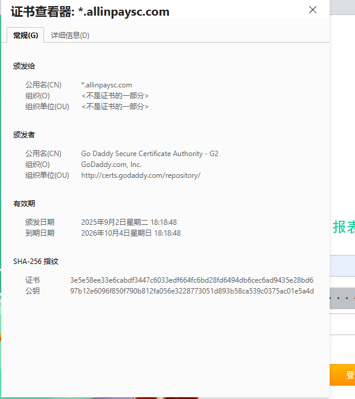
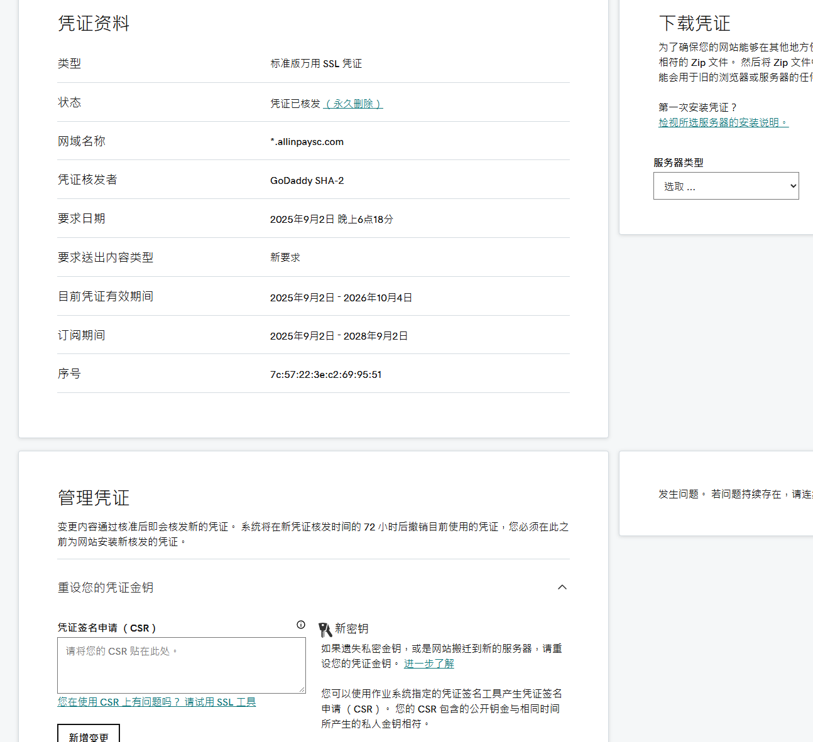
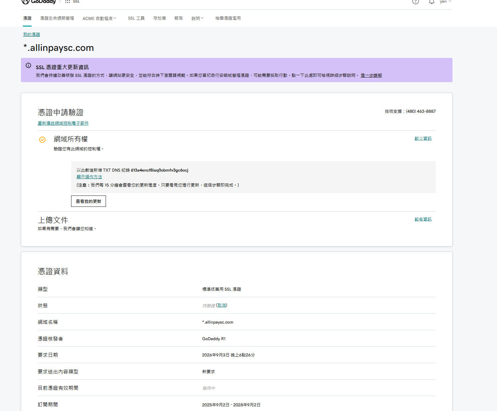
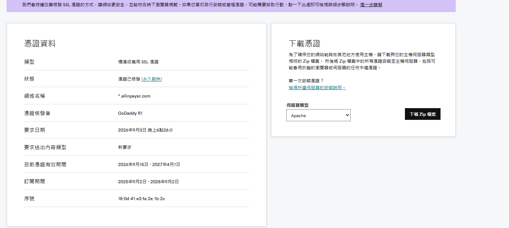

# GoDaddy SSL 证书续期与 Nginx 部署实战记录

> **记录时间**：2026-09-15
> **涉及域名**：*.allinpaycsc.com（通配符证书）
> **CA 机构**：GoDaddy R1 / GoDaddy Secure Certificate Authority - G2
> **订阅周期**：2025.9.2 – 2028.9.2（3年期，仍在有效期内）

---

## Q1: 这是域名的有效期还是证书的有效期？



**A**: 这是 **SSL/TLS 证书的有效期**。

从证书查看器中的字段可以明确判断：
- **颁发日期**：2025年9月2日
- **到期日期**：2026年10月4日
- **签发者**：Go Daddy Secure Certificate Authority - G2
- **SHA-256 指纹**和**公钥**信息均属于数字证书的技术特征

这些都是 X.509 数字证书的标准字段。域名本身的注册有效期通常以"年"为单位，不会精确到具体的时分秒，也不会出现在证书查看器中。

---

## Q2: 需要重新购买这个证书吗？之前是在 GoDaddy 购买的。



**A**: **不需要重新购买**。

从管理后台的"订阅期间"字段可以看到：**2025年9月2日 - 2028年9月2日**，说明你们已经在 GoDaddy 购买了3年期的证书订阅，当前正在有效期内。

| 字段 | 值 | 含义 |
|---|---|---|
| **目前凭证有效期间** | 2025.9.2 – 2026.10.4 | 当前这张已签发证书的有效期（约13个月） |
| **订阅期间** | 2025.9.2 – 2028.9.2 | 购买的GoDaddy证书订阅总时长（3年） |

**关键区别**：
- **订阅期间** = 付费购买的时间窗口，期间可免费重新签发/续期
- **凭证有效期** = 当前具体证书的生命周期，到期前需重新签发但不用额外付费

**操作建议**：在 **2026年10月4日之前**，回到 GoDaddy 管理页面点击"新增变更"或"重新签发"，生成新 CSR 并部署即可，全程免费。

---

## Q2-1: 这个截图是什么意思？



**A**: 这张截图显示的是 SSL 证书正在等待验证的状态。

**关键信息解读**：

| 字段 | 值 | 含义 |
|---|---|---|
| 状态 | 待验证（取消） | 新证书申请已提交，但域名所有权尚未验证通过 |
| 网域名称 | *.allinpaycsc.com | 通配符证书，覆盖所有子域名 |
| 凭证核发者 | GoDaddy R1 | 新的签发机构（与之前的 GoDaddy SHA-2 不同） |
| 要求日期 | 2026年9月3日 | 这次重新签发的申请时间 |
| 目前凭证有效期间 | 等待中 | 验证通过后才会签发新证书 |
| 订阅期间 | 2025.9.2 – 2028.9.2 | 你的3年订阅仍在有效期内，无需额外付费 |

**你需要做什么**：

GoDaddy 要求你通过 **DNS TXT 记录** 证明你对 `*.allinpaycsc.com` 域名的控制权。具体步骤：

1. 登录你们的 DNS 管理后台（可能是阿里云、腾讯云、Cloudflare 等）
2. 为 allinpaycsc.com 添加一条 TXT 记录：
   - 主机名/名称：`_dnsauth.allinpaycsc.com`（或按页面提示的具体值）
   - 记录类型：`TXT`
   - 记录值：`613a4encf8iaq0obmfv3gc6ocj`（截图中灰色框内的字符串）
3. 保存后回到 GoDaddy 页面点击"查看我的更新"
4. 系统每15分钟自动检测一次，验证通过后证书会自动签发

验证通过后，你就可以下载新证书并部署到服务器上了。整个过程在订阅期内是免费的。

---

## Q3: 配置 DNS 验证后，为什么新证书有效期没有一年了？



**A**: 这是正常的，不是配置问题。

新证书显示：**2026年9月15日 – 2027年4月1日**（约6个半月），原因如下：

1.  **行业强制规定**：CA/Browser Forum 要求单张证书有效期最长不超过 **398天**（约13个月）。
2.  **签发策略调整**：GoDaddy R1 作为新的签发机构，可能采用了更保守的默认有效期策略。
3.  **密钥轮换检测**：如果重新签发时检测到某些安全条件变化，CA 可能主动缩短单次有效期。

**无需担心**：订阅期到 **2028年9月2日** 才结束，在此之前可随时免费重新签发。等到2027年4月1日前再回来操作一次即可。

---

## Q4: 下载了三个文件，Nginx 如何更换证书？

**A**: 三个文件的角色与部署步骤如下：

### 文件角色
| 文件名 | 类型 | 作用 |
|---|---|---|
| `180d41e3fa2e1b2c.crt` | 服务器证书 | 包含域名、公钥、CA签名 |
| `180d41e3fa2e1b2c.pem` | PEM格式证书 | 通常与 .crt 内容相同 |
| `gd_bundle_dv-r1-g2.crt.pem` | 中间证书链 | GoDaddy R1 → Root 的信任桥梁 |

### Nginx 部署步骤

```bash
# 1. 合并证书链（服务器证书 + 中间证书）
cat 180d41e3fa2e1b2c.crt gd_bundle_dv-r1-g2.crt.pem > fullchain.crt

# 2. 上传到服务器
sudo mkdir -p /etc/nginx/ssl/allinpaycsc.com
sudo cp fullchain.crt /etc/nginx/ssl/allinpaycsc.com/

# 3. 修改 Nginx 配置
# ssl_certificate     /etc/nginx/ssl/allinpaycsc.com/fullchain.crt;
# ssl_certificate_key /etc/nginx/ssl/allinpaycsc.com/private.key;

# 4. 验证并重载
sudo nginx -t && sudo systemctl reload nginx

# 5. 验证生效
echo | openssl s_client -connect allinpaycsc.com:443 2>/dev/null | openssl x509 -noout -dates
```

**注意**：私钥文件（`.key`）不需要更换，除非重新签发时重置了密钥。

---

## Q5: `openssl pkcs12 -export ...` 这个命令是干嘛的？

**A**: openssl pkcs12 -export -in fullchain.crt -inkey private.key -out server.p12 -name "1" 该命令将 PEM 格式的证书和私钥打包成 **PKCS#12 (.p12) 格式**。

| 参数 | 含义 |
|---|---|
| `-in fullchain.crt` | 输入的服务器证书（含中间链） |
| `-inkey private.key` | 对应的私钥文件 |
| `-out server.p12` | 输出的 .p12 文件名 |
| `-name "1"` | 证书条目的别名 |

**使用场景**：Java (Tomcat/Jetty)、Windows IIS、macOS 钥匙串、部分云平台负载均衡器。

**Nginx 不需要此步骤**：Nginx 直接使用分离的 `.crt` + `.key` 文件即可。

---

## Q6: 证书链有什么用？私钥是用来干嘛的？这几个文件扮演什么角色？

**A**: SSL 证书体系是一个**信任链验证机制**，三者缺一不可：

### 私钥 (private.key) —— "身份证的防伪印章"
- **作用**：证明服务器身份的唯一凭证。TLS 握手时用私钥签名，客户端用公钥验证。
- **特点**：**绝对不能泄露**，只保存在服务器上，不参与网络传输。
- **类比**：手写签名，别人可复印身份证，但无法伪造亲笔签名。

### 服务器证书 (.crt/.pem) —— "你的身份证"
- **作用**：包含域名、公钥、有效期等信息，由 CA 签发并盖章。
- **内容**：CN=*.allinpaycsc.com + 公钥 + GoDaddy 的数字签名。

### 证书链 (gd_bundle...) —— "介绍信/担保书"
- **作用**：解决**信任传递**问题。浏览器内置根 CA 信任列表，但不认识所有中间 CA。证书链把"服务器证书 → 中间 CA → 根 CA"串起来。
- **为什么需要**：GoDaddy R1 不是根 CA，浏览器不认识它，但认识它的上级（GoDaddy Root），所以需要中间证书搭桥。

### 协作流程
```
客户端请求 HTTPS
    ↓
服务器返回：服务器证书 + 证书链
    ↓
浏览器逐级验证签名至内置根 CA
    ↓
验证通过 → 建立加密连接
    ↓
后续通信用私钥解密/签名，公钥验证
```

---

## Q7: 服务器证书怎么生成的？是中间机构随机生成的吗？证书里是公钥吗？浏览器怎么验证有效？

**A**:

### 证书生成流程（非随机）
1.  **你在服务器生成密钥对**（私钥 + 公钥）
2.  **用私钥生成 CSR**（包含域名 + 公钥 + 公司信息）
3.  **提交 CSR 给 GoDaddy**，完成域名所有权验证（DNS/文件/邮箱）
4.  **GoDaddy R1 用其私钥对 CSR 进行数字签名** → 生成服务器证书
5.  **下载证书部署到服务器**

**关键点**：公钥和私钥是你自己生成的，CA 从未接触你的私钥。CA 只是用它的私钥给你的"公钥+域名信息"盖个章。

### 证书内容
证书 = **公钥 + 身份信息 + CA 防伪印章**（X.509 结构化数据）。

### 浏览器验证流程
```
收到证书链：[服务器证书] → [GoDaddy R1] → [GoDaddy Root]
    ↓
① CN/SAN 匹配当前域名？ ✓
② 用 R1 公钥验证服务器证书签名？ ✓
③ 用 Root 公钥验证 R1 证书签名？ ✓
④ Root 在浏览器信任列表中？ ✓
 有效期合法？ ✓
⑥ 未被吊销（CRL/OCSP）？ ✓
    ↓
全部通过 → 🔒 建立 HTTPS
```

---

## Q8: 这次公私钥没换，换的是什么？只是时间吗？

**A**: 换的不只是时间，而是**整张证书的所有元数据都更新了**。

| 字段 | 旧证书 | 新证书 | 是否变化 |
|---|---|---|---|
| 公钥 | RSA 2048-bit | RSA 2048-bit | ❌ 没变 |
| 私钥 | private.key | private.key | ❌ 没变 |
| 序列号 | 7c:57:22:3e:... | 18:0d:41:e3:... | ✅ 变了 |
| 有效期 | 2025.9.2–2026.10.4 | 2026.9.15–2027.4.1 | ✅ 变了 |
| 签发者 | GoDaddy SHA-2 | GoDaddy R1 | ✅ 变了 |
| 数字签名 | SHA-2 私钥签的 | R1 私钥签的 | ✅ 变了 |
| 指纹 | 3e5e58ee... | （新指纹） | ✅ 变了 |

**本质**：证书是一张"带有效期的授权书"。即使身份（公钥+域名）没变，但有效期到了、CA 策略变了，就必须重新签发。就像身份证照片没变，但证件到期了要换发新证——编号、有效期、防伪芯片都更新了。

**Nginx 影响**：私钥文件不用换，只需替换 `fullchain.crt`。部署前务必验证匹配性：
```bash
openssl x509 -noout -modulus -in fullchain.crt | md5sum
openssl rsa -noout -modulus -in private.key | md5sum
# 两个哈希值必须完全一致
```

---

## Q9: 浏览器请求时服务器先给证书，验证通过后会让服务器生成对称加密密钥对吗？新增 CA 机构会怎么样？

**A**:

### TLS 握手澄清
**对称密钥不是"服务器单方面生成后告诉浏览器"的，而是双方共同协商出来的**。

```
Client Hello → Server Hello + Certificate
    ↓
浏览器验证证书链 ✓
    ↓
浏览器随机生成 Pre-Master Secret (48字节)
用证书【公钥】加密后发送给服务器
    ↓
服务器用【私钥】解密得到 Pre-Master Secret
    ↓
双方各自推导：Master Secret = PRF(Pre-Master, ClientRandom, ServerRandom)
→ 两边算出完全相同的对称密钥（AES-256等）
    ↓
后续 HTTP 数据用对称密钥加密/解密
```

**核心**：对称密钥从未在网络上传输，非对称加密只用于安全传递"种子"。这就是"混合加密体系"。

### 如果新增一个 CA 机构会怎么样？
分两种情况：

**情况 A：新 CA 想被浏览器信任**
- 必须通过 **CA/Browser Forum** 的严格审计（WebTrust / ETSI EN 319 411）
- 审计通过后，其根证书会被纳入浏览器/操作系统的信任存储更新包
- 用户通过系统更新或浏览器自动更新获得新根证书
- 这个过程通常需要 **6-18 个月**，不是随时能加的

**情况 B：企业自建私有 CA（如公司内部 PKI）**
- 根证书不会进入公共浏览器的信任列表
- 需要手动部署到每台终端：
  - **Windows**：组策略推送 / SCCM 分发
  - **macOS**：MDM 配置描述文件
  - **Linux**：`update-ca-trust` 导入
  - **移动设备**：安装 `.cer` 文件到系统证书存储
- 未部署的终端访问该 CA 签发的证书时会报 `NET::ERR_CERT_AUTHORITY_INVALID`

**现实案例**：
- Let's Encrypt 的根证书 **ISRG Root X1** 在 2015 年创建，直到 2020 年才进入所有主流浏览器的信任列表
- 某些国家/地区的政府 CA（如中国的 **CFCA**）需要通过特定渠道单独导入

所以"新增 CA"不是一个简单的技术动作，而是一个涉及**安全审计、生态协调、终端部署**的系统工程。这也是为什么全球受信任的根 CA 只有约 150 个左右，而不是成千上万。浏览器内置了一个信任锚点列表（约 100-200 个根 CA 的公钥）。验证过程是逐级回溯的信任链校验：

浏览器收到服务器返回的证书链：

```
[服务器证书] → [GoDaddy R1 中间证书] → [GoDaddy Root 根证书]
```

验证步骤：
```
┌─────────────────────────────────────────────┐
│ ① 检查服务器证书的 CN/SAN 是否匹配当前域名？   │
│    *.allinpaycsc.com 匹配 allinpaycsc.com ✓  │
│                                             │
│ ② 用 GoDaddy R1 的公钥验证服务器证书的签名？   │
│    签名正确 → 证明 GoDaddy R1 确实签发了它 ✓  │
│                                             │
│ ③ 用 GoDaddy Root 的公钥验证 R1 证书的签名？   │
│    签名正确 → 证明 R1 是合法的中间 CA ✓       │
│                                             │
│ ④ GoDaddy Root 是否在浏览器的信任列表中？      │
│    在列表中 → 信任链完整 ✓                    │
│                                             │
│ ⑤ 检查有效期：当前时间是否在 notBefore~notAfter │
│    之间？2026.9.15 ≤ 现在 ≤ 2027.4.1 ✓       │
│                                             │
│ ⑥ 检查是否被吊销（CRL/OCSP）？                │
│    未被吊销 ✓                                 │
└─────────────────────────────────────────────┘
全部通过 → 地址栏显示 🔒，建立 HTTPS 连接
任一失败 → 显示红色警告页
```

**为什么需要中间证书？**
因为浏览器只内置了根 CA（如 GoDaddy Root），不认识成千上万个中间 CA。如果没有中间证书搭桥，浏览器无法验证"GoDaddy R1 是合法的"，就会报 `NET::ERR_CERT_AUTHORITY_INVALID` 错误。这就是为什么 Nginx 配置时必须把服务器证书和中间证书链合并成 `fullchain.crt`。

---

## 附录：常用验证命令

```bash
# 查看当前生效证书的有效期
echo | openssl s_client -connect allinpaycsc.com:443 -servername allinpaycsc.com 2>/dev/null | openssl x509 -noout -dates

# 验证证书与私钥匹配
openssl x509 -noout -modulus -in fullchain.crt | md5sum
openssl rsa -noout -modulus -in private.key | md5sum

# 查看证书详细信息
openssl x509 -in fullchain.crt -noout -text

# 检查证书链完整性
openssl verify -CAfile gd_bundle_dv-r1-g2.crt.pem 180d41e3fa2e1b2c.crt
```
