# 飞行原理：四种起飞方式详解

## 一、飞行的四大基本力

任何飞行器要飞起来，都必须处理四种力之间的平衡：

| 力 | 方向 | 作用 | 来源 |
|----|------|------|------|
| **升力 (Lift)** | 向上 | 克服重力，把飞行器托起来 | 机翼/旋翼推动空气 |
| **重力 (Weight)** | 向下 | 把飞行器拉向地面 | 地球引力 |
| **推力 (Thrust)** | 向前 | 推动飞行器前进 | 发动机 |
| **阻力 (Drag)** | 向后 | 阻碍飞行器前进 | 空气摩擦 + 压差 |

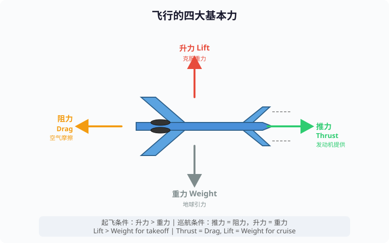

---

## 二、固定翼飞机

### 2.1 机翼升力原理

机翼截面（翼型）的形状是产生升力的关键：

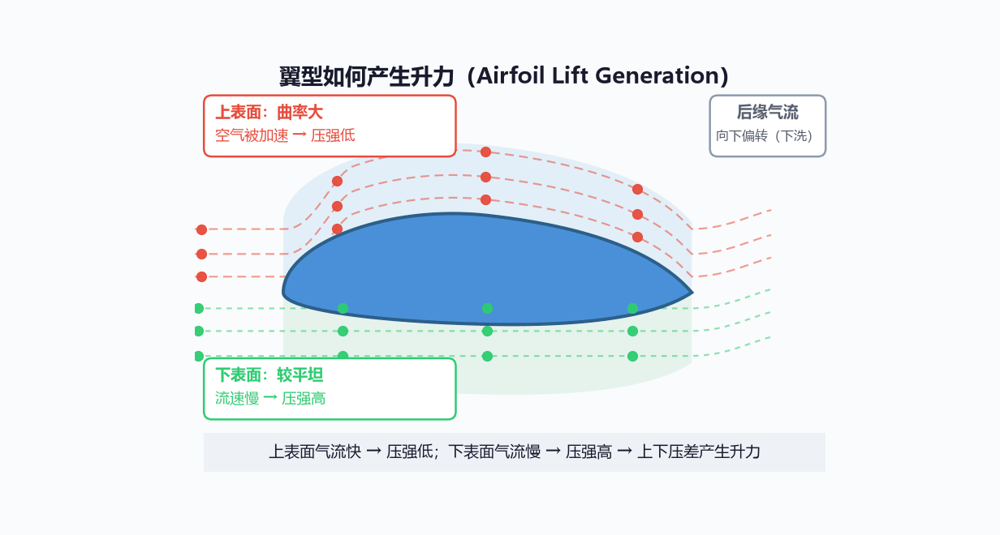

### 2.2 伯努利原理（Bernoulli's Principle）

```
核心公式：
  P + ½ρv² + ρgh = 常数

  P = 压强
  ρ = 空气密度
  v = 气流速度
  h = 高度

含义：气流速度越快，压强越小
```

机翼上方的空气流速快，压强低；下方的空气流速慢，压强高：

> 上下表面的气流速度差由翼型弯度和迎角产生（详见下图），
> 根据伯努利原理，速度差导致压强差，压强差产生升力。

#### 为什么上方气流更快？

最常见的解释是"等时到达"（上表面路程长，必须加速才能与下表面同时到达后缘），**这是错的**：

```
上表面路程 > 下表面路程  →  "必须跑得更快才能同时到达"
```

> ❌ **错误原因**：实验观测表明，上表面气流比下表面气流**早到达**后缘，
> 根本不存在"同时到达"的物理要求，这只是巧合，不是原因。

真正的原因是**翼型弯度 + 迎角 → 低压区 → 空气被加速**：

```
因果链:

  1. 翼型上表面弯曲 + 迎角
       │
       ▼
  2. 空气流过弯曲上表面时必须改变方向（被压着走曲线）
       │
       ▼
  3. 走曲线需要向心力 → 由压强差提供
       → 上方压强低于下方压强
       │
       ▼
  4. 上表面形成低压区
       → 后方高压空气被"抽"过来填补低压区
       → 空气被加速 → 流速更快
```

用高速公路类比：

```
正常路况:
  ═══════════════════════════  ← 均匀气流

前方道路变窄 + 弯曲:
  ══════════════╮
                ╰── 窄弯道 ───╮
                              ╰════
                气流被挤进窄弯道
                → 密度降低 → 速度加快

机翼同理:
  气流被翼型弯度"挤"进上表面
  → 低压区形成 → 空气被抽进来 → 加速
```

用更严谨的环量理论（Kutta-Joukowski）解释：

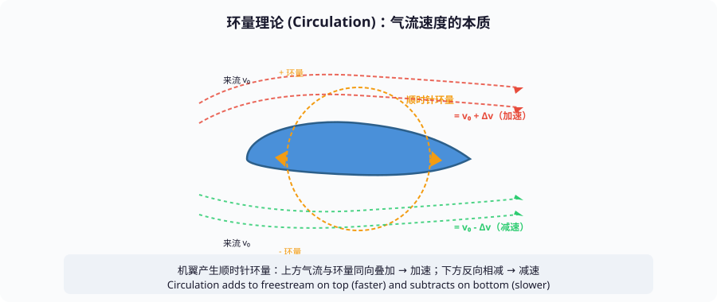

| 常见误区 | 正确理解 |
|---------|---------|
| 路程长所以要快 | 翼型弯度 + 迎角 → 低压 → 空气被吸进来加速 |
| 等时到达 | 不存在这个要求，是巧合不是原因 |
| 只有伯努利原理 | 伯努利 + 牛顿第三定律是同一现象的两种表述 |

核心结论：**不是"因为路程长所以快"，而是"因为弯度和迎角产生了低压，低压把空气吸进来加速"**。

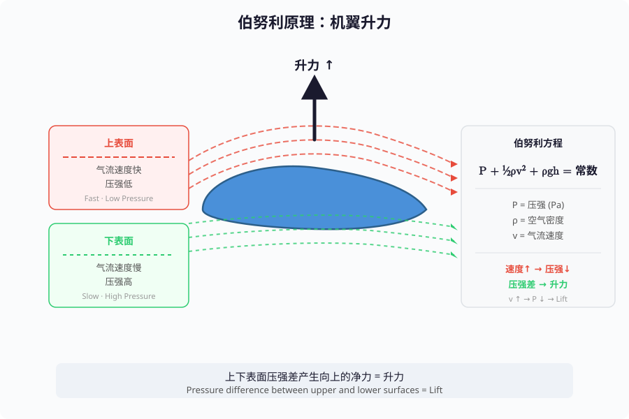

### 2.3 牛顿第三定律（Newton's Third Law）

升力不只有伯努利原理，还有更本质的解释：**机翼把空气向下推**。

> 机翼使气流发生向下的偏转 → 空气整体获得向下的动量 →
> 根据牛顿第三定律，机翼获得向上的反作用力 = 升力。

> **为什么是"整体的向下偏转"？**
>
> 机翼同时接触上表面和下表面的空气，确实两边都有力：
> - 上表面：空气被"吸"着贴弯曲表面走，先上后下，离开后缘时向下
> - 下表面：空气被直接压向下方
>
> 两股气流在机翼后缘汇合时**都向下走**，空气整体获得了向下的动量变化。
> 牛顿第三定律关心的是**净动量变化**，不是某一面的局部力。

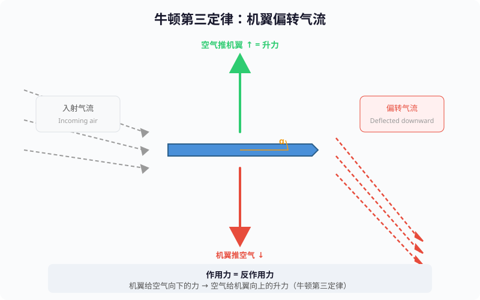

**迎角（Angle of Attack）**：机翼相对于气流的角度。

```
迎角增大 → 气流被向下偏转得更厉害 → 升力增大

但迎角过大（超过临界迎角，通常 15°~18°）→
→ 气流无法平滑流过机翼上表面 → 气流分离（失速）
→ 升力骤降 → 飞机下坠
```

### 2.4 升力公式

```
L = ½ × ρ × v² × S × CL

  L  = 升力 (N)
  ρ  = 空气密度 (kg/m³)，海平面约 1.225
  v  = 飞行速度 (m/s)
  S  = 机翼面积 (m²)
  CL = 升力系数（与翼型形状和迎角有关）
```

从这个公式可以看出起飞的关键：

| 变量 | 怎么增大？ | 实际做法 |
|------|-----------|---------|
| **ρ（空气密度）** | 低海拔空气密度大 | 高原机场起飞性能下降 |
| **v²（速度平方）** | 加速滑跑 | 跑道越长越好 |
| **S（机翼面积）** | 增大机翼 | 大型运输机机翼巨大 |
| **CL（升力系数）** | 增大迎角、用襟翼 | 起飞时放下襟翼 |

**起飞过程**：

```
发动机启动 → 飞机加速滑跑 → v 不断增大
    → L = ½ρv²SCL 不断增大
    → 当 L > 重力 时，飞机离地起飞！
```

### 2.5 辅助起飞装置

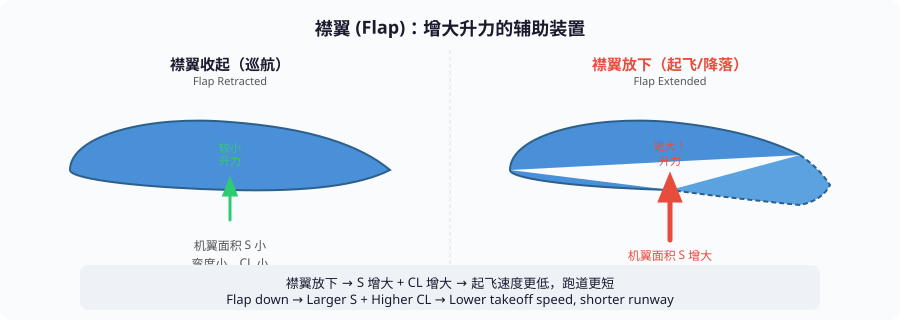

---

## 三、直升机

### 3.1 基本原理

直升机没有跑道，它靠**旋翼（旋转的机翼）**产生升力。

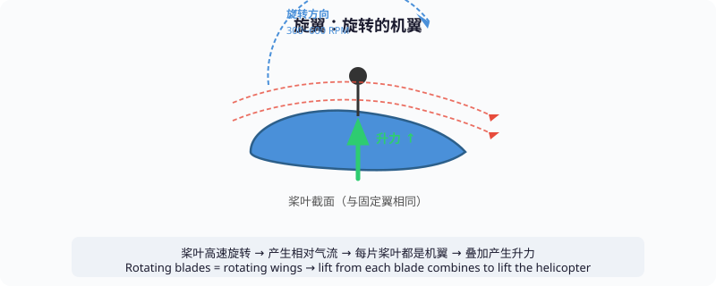

#### 旋翼 vs 固定翼的翼型区别

桨叶和固定翼**基本形状相同**（上表面弯曲 + 迎角），但设计上有三个关键区别：

| 特点 | 固定翼 | 直升机旋翼 |
|------|--------|-----------|
| **翼型** | 不对称（上弯下平） | 通常**对称**或接近对称 |
| **迎角** | 巡航时固定 | **时刻变化**（变距控制） |
| **扭转** | 少量或无 | 根部到尖部**大幅扭转** |

**为什么对称？** — 直升机前进时，前进桨叶和后退桨叶经历的空气来自**相反方向**。不对称翼型只在一个方向高效，换方向就失效；对称翼型两个方向都能工作。

**为什么扭转？** — 桨叶根部和尖部线速度差异巨大（尖部可能接近音速），如果角度一致，根部升力太小、尖部升力太大。通过扭转使根部角度大、尖部角度小，升力沿桨叶均匀分布。

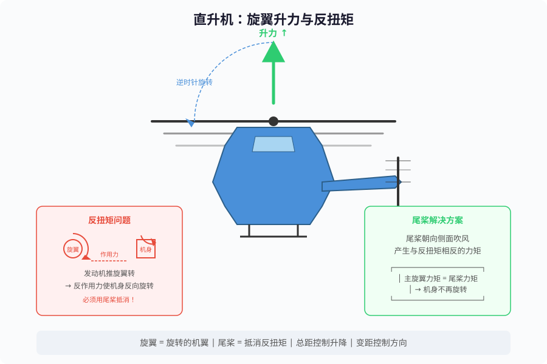

### 3.2 升力来源

> 旋翼高速旋转（约 300~600 RPM）→ 桨叶与空气产生相对运动 →
> 每片桨叶像机翼一样产生升力 → 所有桨叶的升力叠加 → 把直升机托起来。

### 3.3 反扭矩问题

这是直升机独有的难题：

```
发动机 → 驱动旋翼逆时针旋转
             │
             ▼
发动机对旋翼施加逆时针力矩
             │
             ▼
旋翼对发动机施加反作用力矩（顺时针）
             │
             ▼
机身想要顺时针旋转！

如果不处理，机身就会疯狂旋转，无法控制。
```

> 尾桨产生的侧向力形成与反扭矩方向相反的力矩，抵消主旋翼力矩，机身不再旋转。

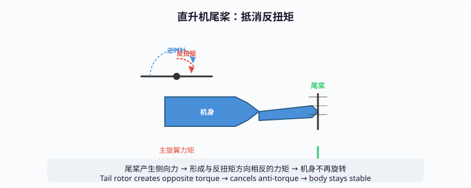

### 3.4 桨距控制

直升机有三种桨距控制方式，分别控制不同的飞行状态：

| 控制方式 | 中文 | 作用 | 操作杆 |
|----------|------|------|--------|
| **Collective Pitch** | 总距 | 同时改变所有桨叶的角度 | 左手总距杆 |
| **Cyclic Pitch** | 变距 | 在旋转过程中改变桨叶角度 | 右手操纵杆 |
| **Anti-Torque** | 反扭矩 | 改变尾桨角度 | 脚蹬 |

#### 总距（Collective Pitch）— 控制升降

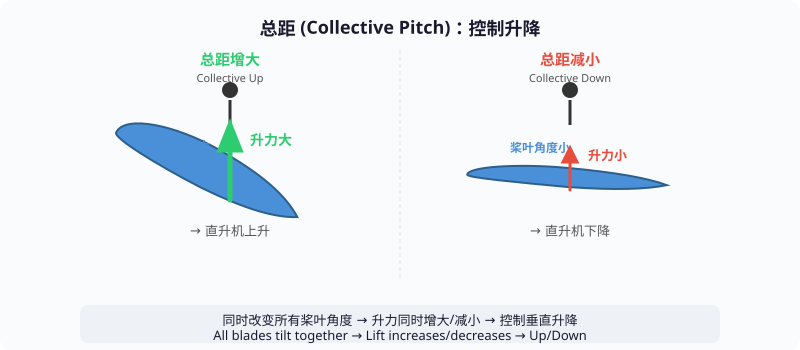

#### 变距（Cyclic Pitch）— 控制方向

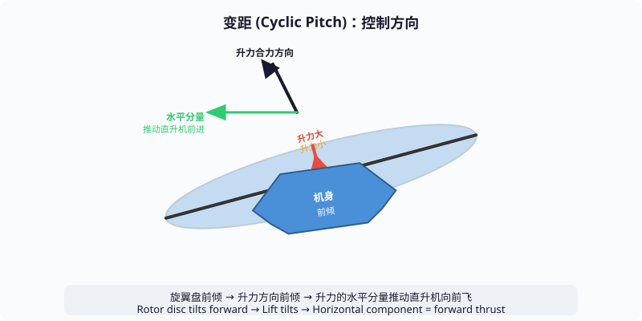

### 3.5 无动力自转降落（Autorotation）

```
如果发动机故障，直升机怎么办？

发动机失效 → 旋翼不再被发动机驱动
    │
    ▼
直升机下落 → 空气从下方向上穿过旋翼
    │
    ▼
空气推动旋翼继续旋转（就像风车被风吹转）
    │
    ▼
旋翼继续产生升力 → 减缓下降速度
    │
    ▼
接近地面时，向前拉操纵杆 → 利用旋翼动能
    → 最后一次"拍打" → 平稳接地
```

---

## 四、火箭

### 4.1 基本原理：牛顿第三定律

火箭不依赖空气，靠的是**喷出高温高压气体产生反作用力**。气体以 2000~4500 m/s 的速度从拉瓦尔喷管向下喷出，根据牛顿第三定律，火箭受到向上的推力。

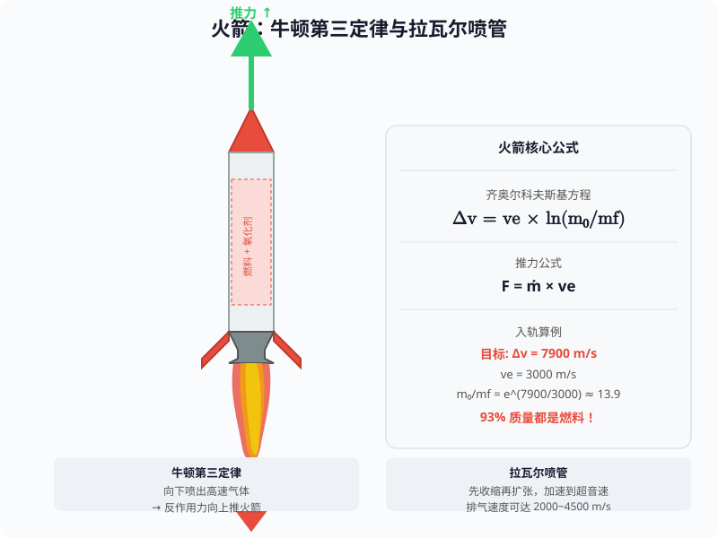

**关键**：火箭自带氧化剂，不需要空气中的氧气，所以可以在真空中飞行。

### 4.2 推力的计算

```
F = ṁ × ve + (pe - pa) × Ae

  F  = 推力
  ṁ  = 燃料质量流率（每秒喷出多少 kg）
  ve = 排气速度（m/s）
  pe = 喷管出口压强
  pa = 环境压强
  Ae = 喷管出口面积
```

简化理解：**推力 = 喷出的气体质量 × 喷出速度**

```
要增大推力：
  1. 增大 ṁ（每秒喷出更多气体）→ 烧更多燃料
  2. 增大 ve（喷得更快）→ 更高的燃烧温度 + 更好的喷管设计
```

### 4.3 齐奥尔科夫斯基火箭方程

这是火箭最核心的公式，决定了火箭能飞多快：

```
Δv = ve × ln(m₀ / mf)

  Δv  = 火箭速度变化量
  ve  = 排气速度（约 2000~4500 m/s）
  m₀  = 起飞时总质量（火箭 + 燃料 + 载荷）
  mf  = 燃料烧完后的质量（火箭壳 + 载荷）
  ln  = 自然对数
```

**这个公式揭示了火箭的残酷现实**：

```
例：假设排气速度 ve = 3000 m/s

要让火箭达到第一宇宙速度 7900 m/s（入轨）：

  7900 = 3000 × ln(m₀ / mf)
  ln(m₀ / mf) = 2.63
  m₀ / mf = e^2.63 ≈ 13.9

这意味着：
  起飞质量 = 13.9 × 最终质量
  即 93% 的起飞质量都是燃料！
```

### 4.4 多级火箭

> 单级火箭的困境：燃料烧完后，空油箱太重，继续浪费燃料推空壳。
> 解决方案：分级抛弃，一级烧完就扔掉。

| 级数 | 燃料量 | Δv 贡献 | 累计速度 |
|------|--------|---------|---------|
| 单级 (m₀/mf=20) | 最多 | 8294 m/s | 8294 m/s ❌ 不够 |
| 三级级-1 | 大量 | 3000×ln(10) = 6908 | 6908 m/s |
| 三级级-2 | 中量 | 3000×ln(8) = 6235 | 13143 m/s |
| 三级级-3 | 少量 | 3000×ln(5) = 4828 | 17971 m/s ✅ |

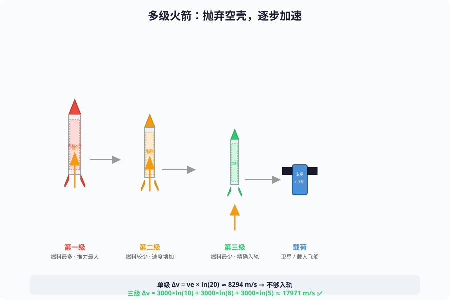

### 4.5 火箭 vs 飞机 的本质区别

```
飞机:
  需要空气
  依靠机翼产生升力
  发动机效率随高度下降（空气稀薄）
  速度受音速限制（传统飞机）

火箭:
  不需要空气（自带氧化剂）
  不依靠机翼（纯推力对抗重力）
  在真空中效率反而更高
  速度可达第一宇宙速度 7900 m/s
```

---

## 五、垂直起降（VTOL）

### 5.1 什么是 VTOL

```
垂直起降 = Vertical Take-Off and Landing

既能像直升机一样垂直起飞和降落，
又能像固定翼飞机一样高速巡航。

典型机型：鹞式战机、F-35B、中国的歼-15T
```

### 5.2 三种实现方式

#### 方式一：升力风扇（最直观）

> F-35B 战斗机在机头上部安装升力风扇，主发动机排气管可转向下方。
> 起飞时升力风扇 + 主发动机同时向下吹，合力向上 > 重力，垂直起飞；
> 巡航时关闭升力风扇，主发动机向前，转为固定翼飞行。

#### 方式二：矢量喷管（最经典）

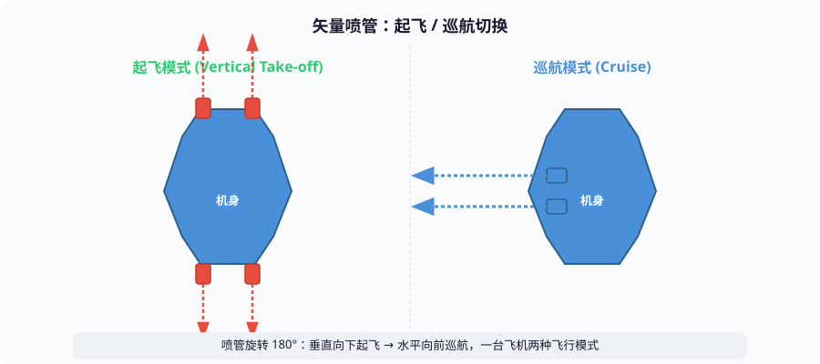

四具旋转喷管（两台发动机，每边两个）：起飞时喷管旋转 180° 向下喷气，巡航时喷管向前提供水平推力。

#### 方式三：复合升力（最新）

> 歼-35A 等新型战斗机采用主发动机矢量喷管 + 机身两侧小型升力发动机 + 机翼涡流的复合方案。
> 起飞时所有部件向下提供升力，巡航时关闭升力发动机，矢量喷管向前，高速飞行。

| 方式 | 优点 | 缺点 | 代表 |
|------|------|------|------|
| 升力风扇 | 结构简单 | 需要额外空间 | F-35B |
| 矢量喷管 | 无额外发动机 | 喷管结构复杂 | 鹞式 |
| 复合升力 | 升力最大化 | 系统最复杂 | 歼-35A |

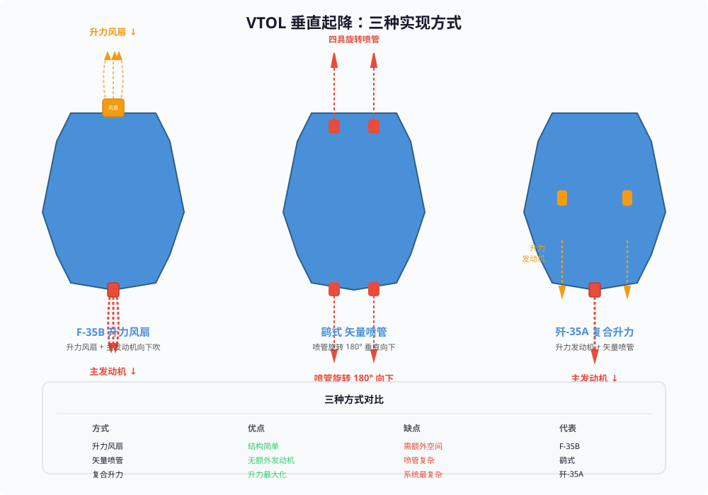

---

## 六、四种起飞方式对比总结

```
┌──────────────────────────────────────────────────────────────┐
│                四种飞行器的物理原理对比                         │
├──────────────────────────────────────────────────────────────┤
│                                                              │
│  对比项              固定翼        直升机        火箭       VTOL  │
│  ─────────────────────────────────────────────────────────   │
│  升力来源            机翼          旋翼          无（纯推力）│
│  起飞方式            跑道滑跑        原地垂直        原地垂直   垂直    │
│  核心原理            伯努利+牛顿    旋转机翼        牛顿第三定律 │
│  需要空气？           ✅            ✅            ❌        ✅    │
│  起飞速度要求         高            无            无        无    │
│  爬升速度            中等          慢            极快      中等  │
│  巡航速度            快            慢            极快      快    │
│  机动性              中等          好            差        中等  │
│  典型速度            800 km/h      300 km/h      25000+ km/h│
│                                                              │
└──────────────────────────────────────────────────────────────┘
```

### 各飞行器最核心的公式

| 飞行器 | 核心公式 | 含义 |
|--------|---------|------|
| **固定翼** | L = ½ρv²SCL | 速度够快，机翼面积够大，就能飞 |
| **直升机** | L = ½ρv²SCL（桨叶版）| 桨叶转速够快，角度够大，就能飞 |
| **火箭** | Δv = ve × ln(m₀/mf) | 燃料够多，喷速够快，就能飞到任意高度 |
| **VTOL** | L + T_vertical > W | 升力 + 垂直推力 > 重力，就能垂直起飞 |