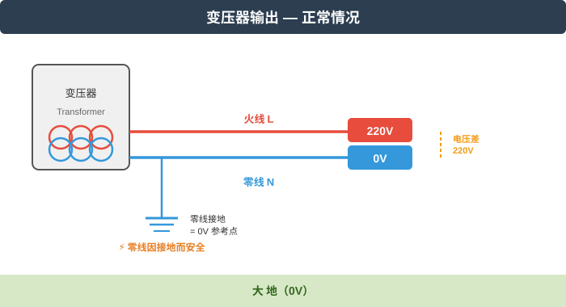
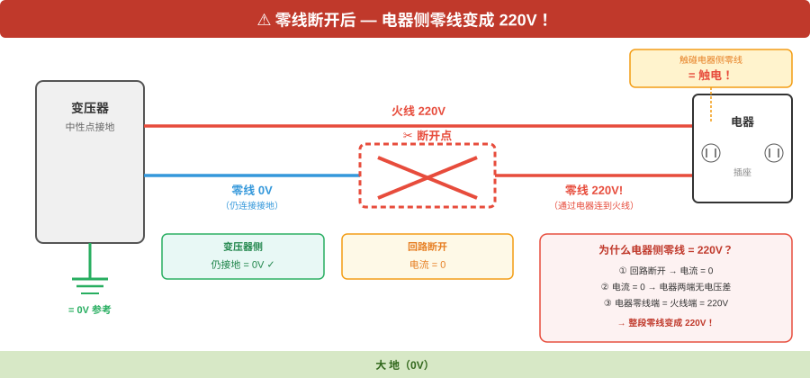
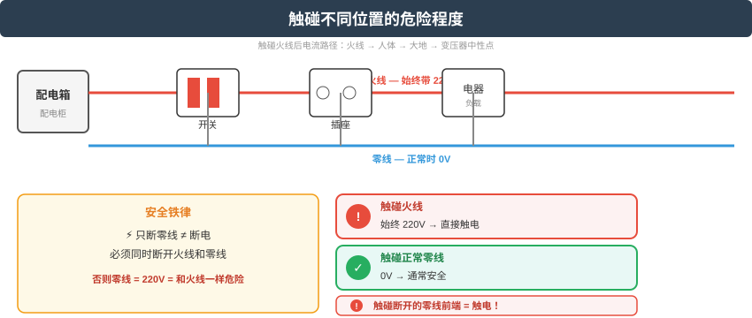

# 家用电知识完整指南
> 结合物理原理与生活实践的实用手册

---

## 一、基础概念篇

### 1.1 电压、电流、电阻——电学的三大核心

| 概念 | 类比 | 家用环境 |
|------|------|---------|
| **电压（V）** | 水压 — 推动水流的力量 | 家庭固定 220V |
| **电流（I）** | 水流 — 单位时间内通过的水量 | 由电器功率决定 |
| **电阻（R）** | 水管阻力 — 对水流的阻碍 | 导线低、电器适中 |

**欧姆定律（核心公式）**：
```
I = V / R
电流 = 电压 ÷ 电阻
```

**功率公式**：
```
P = V × I = I² × R = V² / R
功率 = 电压 × 电流
```

### 1.2 220V 电压从何而来？

家用 220V 电压的稳定供应，靠的是"发—输—配—用"全链条的协调配合：

```
发电厂 (10-20kV)
    ↓ 升压变压器（电压越高，传输损耗越小）
超高压输电网 (500kV)
    ↓ 降压变压器（逐级降低）
城市电网 (220kV/110kV)
    ↓ 配电变压器
小区/街道 (380V/220V)
    ↓ 进户线
家庭插座 (220V)
```

**电压稳定的保障机制**：
- ⚙️ **变压器分接开关**：根据负载自动微调输出电压
- 🔄 **发电厂实时调度**：负荷增加时自动增加发电功率
- ⚡ **无功功率补偿**：维持电压质量
- 📡 **电网调度中心**：24小时监控，实时调节

> 📌 **国家标准**：家用电压允许偏差范围为 198V ~ 242V（GB/T 12325-2008）

### 1.3 升压变压器的本质原理

升压变压器是整张电网里最关键的一环。很多人对它有一个根本性误解：**以为"升压"是直接把电线两端的电势差"拉长"了**。不是的。

#### 1.3.1 先纠正一个根本误解：电压不是电线的属性

> ❓ **你的疑问**：升压不是测电线两端得电势差吗？电线两端有什么要求吗，比如多长，电阻多大？

这个问题的根源在于把**电压**当成了**电线本身的属性**。实际上：

| 常见误解 | 真相 |
|---------|------|
| "电线两端有电压"→ 电线越长电压越高？ | ❌ 电压不是电线的属性，是**电源**的属性 |
| 电压像水流的高度，电线像水管 | ⚠️ 水管的高度是固定的，但电压不是"长在电线上的" |
| 电线电阻大→电压高？ | ❌ 电阻影响的是**损耗**，不影响电压大小 |

**正确理解**：

```
电压 = 电源（发电厂/变压器）在两端"建立"的电势差
电线 = 只是把这个电势差"传递"过去的通道

类比：
  水泵把水压加到管道两端
  → 管道的长度、粗细、材质，决定了"漏多少水"（损耗）
  → 但不决定"水泵产生了多少水压"（电压）

  同理：
  变压器在输出端建立了高电压
  → 导线的长度、粗细、材质，决定了"损耗多少功率"
  → 但不决定"变压器输出了多少电压"
```

**所以电线两端没有任何"电压要求"**——电压是多少，取决于电源（变压器/发电机）给你多少。电线只关心两件事：
- **绝缘够不够**：电压太高，绝缘层撑不住就会击穿（电弧放电）
- **载流够不够**：电流太大，电线发热熔化

#### 1.3.2 变压器到底怎么升压的？

升压的核心原理只有一个：**电磁感应 + 线圈匝数比**。

```
【变压器内部结构】

  初级线圈（输入端）                次级线圈（输出端）
  ┌─────────────┐                 ┌─────────────┐
  │ ╳ ╳ ╳ ╳ ╳ ╳ │                 │ ╳ ╳ ╳ ╳ ╳ ╳ │
  │ ╳ ╳ ╳ ╳ ╳ ╳ │                 │ ╳ ╳ ╳ ╳ ╳ ╳ │
  │ ╳ ╳ ╳ ╳ ╳ ╳ │  ← 铁芯 →      │ ╳ ╳ ╳ ╳ ╳ ╳ │
  │ ╳ ╳ ╳ ╳ ╳ ╳ │    ═══           │ ╳ ╳ ╳ ╳ ╳ ╳ │
  │ ╳ ╳ ╳ ╳ ╳ ╳ │                 │ ╳ ╳ ╳ ╳ ╳ ╳ │
  │ ╳ ╳ ╳ ╳ ╳ ╳ │                 │ ╳ ╳ ╳ ╳ ╳ ╳ │
  └─────────────┘                 └─────────────┘
  匝数少（比如100匝）              匝数多（比如1000匝）

  输入：10kV                      输出：100kV（升压10倍）
```

**三步走**：

```
Step 1：初级线圈通入交流电
  → 交流电方向不断变化
  → 产生**不断变化的磁场**（在铁芯中集中传导）

  为什么必须是交流电？
    → 直流电 → 恒定磁场 → 次级线圈中磁通量不变
    → 根据法拉第定律：感应电动势 ∝ 磁通量的**变化率**
    → 磁通量不变 → 感应电动势 = 0 → 变压器不工作

  ✅ 交流电 → 磁场不断变化 → 磁通量不断变化 → 次级线圈产生感应电动势

Step 2：变化的磁场穿过次级线圈
  → 次级线圈的每一匝都"切割"同样的磁通量
  → 每一匝产生一个感应电动势（微小电压）

Step 3：匝数决定电压
  → 每一匝感应出的电压是相同的（因为穿过同样的磁场）
  → N匝线圈的总电压 = 单匝电压 × N

  公式：V₁ / V₂ = N₁ / N₂

  升压变压器：N₂ > N₁ → V₂ > V₁（次级电压高）
  降压变压器：N₂ < N₁ → V₂ < V₁（次级电压低）
```

#### 1.3.3 升压的本质：不是"增加能量"，是"交换电压和电流"

这是最核心的一点：**变压器不能凭空增加能量。**

```
能量守恒定律：输入功率 ≈ 输出功率（理想情况下）

P₁ = P₂
V₁ × I₁ = V₂ × I₂

升压变压器做了什么？
  V₁ × I₁ = V₂ × I₂
  ↑低       ↑高     ↑高       ↑低

  电压升高了 → 电流等比例减小了
  不是"增加了电压"，而是"用减少电流换取了增加电压"
```

**通俗类比**：

```
变压器像一个"电压-电流交换机"：

  输入端：10kV, 1000A  → 功率 = 10,000,000W
  升压10倍：
  输出端：100kV, 100A  → 功率 = 10,000,000W

  电压 ×10，电流 ÷10，功率不变

  就像你用杠杆举重物：
    力小了，但距离远了 → 做功（能量）不变
    电压小了，但电流大了 → 功率不变
```

#### 1.3.4 为什么要升压传输？—— 电流才是损耗的元凶

```
输电线路的功率损耗公式：

  P损耗 = I² × R线路

  注意：是 I²（电流的平方），不是 V²！

为什么升压能减少损耗？

  同样传输 10,000,000W 功率，线路电阻 10Ω：

  【低压传输】10kV, 1000A
    P损耗 = 1000² × 10 = 10,000,000W  ← 损耗=功率本身！50%以上丢在路上！

  【高压传输】100kV, 100A
    P损耗 = 100² × 10 = 100,000W       ← 损耗只有功率的1%

  【超高压传输】500kV, 20A
    P损耗 = 20² × 10 = 4,000W          ← 损耗只有0.04%！
```

**关键洞察**：

| 变量 | 对损耗的影响 | 说明 |
|------|------------|------|
| 电流 I | I² 影响，**最关键** | 电流减半 → 损耗降为 1/4 |
| 线路电阻 R | 线性影响 | 电阻减半 → 损耗减半 |
| 电压 V | 不影响损耗本身 | 但高压→低电流→损耗降 |

所以升压的本质是：**用提高电压来降低电流，因为电流的平方才是损耗的元凶。**

#### 1.3.5 输电线的真实要求

回到你的问题——"电线两端有什么要求"：

```
输电线的真正要求有三个：

① 绝缘强度（由电压决定）
   → 500kV 的线，绝缘层必须能扛住 500kV 不击穿
   → 电压越高，绝缘要求越严格 → 需要更大间距、更好材料
   → 所以高压线塔那么大：不是为了"装更多线"，是为了"拉开距离防击穿"

② 载流能力（由电流决定）
   → 高压传输电流小，所以线可以做得细
   → 低压传输电流大，线必须很粗
   → 这就是为什么：高压线塔上的线不粗，但楼下入户线很粗

③ 线路电阻（由长度和截面积决定）
   → R = ρ × L / S （电阻率 × 长度 / 截面积）
   → 线越长、越细，电阻越大，损耗越大
   → 这就是为什么高压线用很粗的导线：降低电阻

注意：以上三个要求都不是"电压的要求"
      而是"传输这个电压+电流时的物理约束"
```

#### 1.3.6 全程图解：从发电厂到你家

```
发电厂                升压            高压传输          逐级降压          入户
  10kV    ──────────►  500kV    ────────────────►  220kV    ──►  220V
                   升压变压器            电流极小      降压变压器    变压器
                 (N₂≫N₁)            损耗极小       (N₂<N₁)   (N₂<N₁)
                   │                                     │          │
                   │ 电压×50         │ 电流小，          │ 电压↓      │ 电压↓
                   │ 电流÷50         │ 线可以细          │ 电流↑      │ 电流↑
                   │ 功率不变        │                   │ 功率不变   │ 功率不变
```

#### 1.3.7 升压的本质是加快电子流速吗？——恰恰相反

> ❓ **你的疑问**：升压的本质是加快电子的流速吗？

**答案：恰恰相反。升压后电子流速反而变慢了。**

#### 1.3.7.1 核心公式：电流就是电子流速

```
电流的微观定义：

  I = n × q × A × v_d

  I    = 电流（安培）
  n    = 导线中自由电子的密度（每立方米多少个）
  q    = 单个电子的电荷量（1.6×10⁻¹⁹ 库仑）
  A    = 导线的横截面积（平方米）
  v_d  = 电子的漂移速度（米/秒）  ← 这就是"电子流速"

同样一根导线（n、q、A 都不变）：
  I 越大 → v_d 越大（电子跑得越快）
  I 越小 → v_d 越小（电子跑得越慢）

  升压 → 电流减小 → 电子流速减慢 ✅
  降压 → 电流增大 → 电子流速加快
```

#### 1.3.7.2 数字对比：升压前后电子有多慢

```
假设一根铜导线，传输 10,000,000W 功率：

【升压前】10kV，1000A
  I = 1000A → 电子漂移速度约 0.00007 m/s
  = 每小时走 0.25 米
  = 一整天才走 6 米

【升压后】500kV，20A
  I = 20A → 电子漂移速度约 0.0000014 m/s
  = 每小时走 0.005 米
  = 走 1 米要 240 小时（整整 10 天）

结论：升压后，电子流速从"一天走6米"变成"十天走1米"
      电子不仅没变快，反而慢了 50 倍！
```

#### 1.3.7.3 那电压升高的本质到底是什么？

电压升高，本质是**电场强度变大**，不是电子跑得快了。

```
电场强度 E = V / L（电压差 / 距离）

【低压端】10kV，100m 线路
  E = 10000 / 100 = 100 V/m
  每个电子感受到 100V/m 的电场力

【高压端】500kV，100m 线路
  E = 500000 / 100 = 5000 V/m
  每个电子感受到 5000V/m 的电场力

  电压升高 = 电场强度增大
  = 每个电子被"推"得更用力
  = 每个电子携带的能量更多（能量 = 电荷 × 电压）

类比：
  低压：一群人挤在一起慢慢推一个重物（人多=电流大，每人力气小=电压低）
  高压：少数几个人用很大的力推同一个重物（人少=电流小，每人力气大=电压高）
  → 重物被推的距离一样（功率一样）
  → 但低压组人多跑得累（损耗大），高压组人少跑得轻松（损耗小）
```

#### 1.3.7.4 电场传递速度 vs 电子漂移速度——两个完全不同的东西

```
这里有一个极其重要的区分：

【电场传递速度（信号速度）】
  = 接近光速（3×10⁸ m/s）
  = 你按开关的瞬间，电场就"通知"到整条电路
  = 这就是为什么灯"瞬间"亮起来
  = 电压升高，电场传递速度不变（始终接近光速）

【电子漂移速度（实物运动速度）】
  = 毫米/秒级别（比蜗牛还慢）
  = 电子本身在导线中缓慢爬行
  = 电压升高，电流减小 → 电子漂移速度反而降低

这两个速度的关系：
  电场速度 ≈ 光速       → 决定"信号多快到达"
  电子速度 ≈ 蜗牛爬     → 决定"电荷多快通过"

  你按开关 → 电场以光速跑遍整个电路 → 每个电子同时被推动
  → 灯亮了（但推动它的电子，不是你刚按开关时那一个电子）
  → 真正到达灯泡的电子，是几小时后从发电厂慢慢爬过来的
```

#### 1.3.7.5 三个层次的"升压"本质——从浅到深

```
第一层（最表层）：
  升压 = 输出电压变高
  → 只是数字变了，没解释为什么

第二层（能量交换）：
  升压 = 用减少电流换取增加电压
  → 功率不变，能量守恒
  → 但没解释微观上发生了什么

第三层（物理本质）：
  升压 = 增大电场强度，让每个电子携带更多能量
  → 电子本身跑得慢了（电流小）
  → 但每个电子被电场"加持"得更厉害（电压高 = 能量大）
  → 总效果 = 同样功率，用更少的电子、更大的推力来完成
```

```
┌────────────────────────────────────────────────────────────┐
│                                                            │
│  ❌ 升压 ≠ 加快电子流速                                    │
│                                                            │
│  ✅ 升压 = 提高电场强度                                     │
│     = 每个电子携带更多能量                                  │
│     = 电子流速反而变慢（电流减小）                          │
│                                                            │
│  电场速度 ≈ 光速 → 不受升压影响                             │
│  电子速度 ≈ 蜗牛爬 → 升压后更慢                             │
│                                                            │
└────────────────────────────────────────────────────────────┘
```

#### 1.3.8 总结：升压的本质

```
┌─────────────────────────────────────────────────────────┐
│                                                         │
│  升压变压器的本质 = 电磁感应 + 匝数比 + 能量守恒         │
│                                                         │
│  ① 不是"把电线两端的电势差拉长"                         │
│    → 电压是变压器在输出端"重新建立"的                    │
│    → 初级和次级是两组独立的线圈，没有电的直接连接        │
│                                                         │
│  ② 不是"增加能量"                                      │
│    → 电压升高，电流等比例降低                            │
│    → 功率不变（理想情况）                               │
│                                                         │
│  ③ 升压的目的 = 降低电流 = 降低 I²R 损耗               │
│    → 电流的平方才是输电损耗的元凶                        │
│                                                         │
│  ④ 不是"加快电子流速"                                   │
│    → 恰恰相反，电子流速变慢了                            │
│    → 升压 = 增大电场强度 = 每个电子携带更多能量          │
│                                                         │
│  ⑤ 电线没有"电压要求"                                   │
│    → 电线只有：绝缘要求、载流要求、电阻要求             │
│    → 这些都是物理约束，不是"电压长在线上的"              │
│                                                         │
└─────────────────────────────────────────────────────────┘
```

### 1.4 电场是什么？为什么电子会"拥有"电场？

前面反复提到"电场"这个词，但它到底是什么？这其实是物理学中最根本、也最难回答的问题之一。

#### 1.4.1 电场的历史：从"隔空作用"到"场"

19世纪之前，物理学家面对一个尴尬的问题：

```
【问题】两个电荷相距很远，为什么能互相排斥或吸引？

  电荷A                    电荷B
  ─────                    ─────
      ← ← ← ← ← ← ← ← ← ←
      → → → → → → → → → →

  它们之间什么都没有（真空），凭什么"感觉"到了对方的存在？
```

**牛顿的经典力学也无法解释引力**——地球凭什么"知道"月球在哪里？

当时有两种思路：

| 思路 | 代表人物 | 核心观点 | 问题 |
|------|---------|---------|------|
| **超距作用** | 牛顿、库仑 | 不需要介质，瞬间作用 | "隔空作用"说不通 |
| **场论** | 法拉第（1830s）| 电荷改变了周围空间本身，改变的空间再影响其他电荷 | 当时被认为是数学技巧，不真实 |

**法拉第的革命性洞察**：

```
法拉第的思路：

  不是电荷A"隔空"推动了电荷B

  而是：
  电荷A → 改变了它周围的空间（产生了电场）
        → 这个"被改变的空间"延伸到电荷B的位置
        → 电荷B"踩"到了这个被改变的空间 → 感受到力

  中间没有"隔空"，空间本身就是媒介
```

**法拉第用什么证明了场的存在？** 他做了铁屑实验：

```
把铁屑撒在磁铁周围的纸上，轻敲：

  · · · · · · · · ·
·       ·····       ·
·     ·      ·     ·
·    ·        ·    ·
 ·   ·  N   S  ·   ·
·    ·        ·    ·
·     ·      ·     ·
·       ·····       ·
  · · · · · · · · ·

  铁屑自动排列成曲线 → 说明磁铁周围的空间被"结构化"了
  → 这种结构就是"场"的可视化

  电场同理：电荷周围的空间被"结构化"了
```

> 当时几乎所有物理学家都认为法拉第的"场"只是数学工具，没有物理实在性。
> 直到麦克斯韦用场论预言了电磁波，赫兹实验证实——**场是真实的物理存在**。

#### 1.4.2 电场的定义：是什么在"场"中？

```
电场的物理定义：

  把一个试探电荷 q 放在空间中某点
  → 如果它感受到力 F
  → 那该点的电场强度就是 E = F / q

  电场 = "每单位电荷在该点会感受到的力"

类比：
  重力场：把一个质量 m 放在某点，感受到重力 mg
         → 重力场强度 = g = F/m（每单位质量感受到的力）

  电场：把一个电荷 q 放在某点，感受到电力 F
        → 电场强度 = E = F/q（每单位电荷感受到的力）
```

**电场有什么属性？**

| 属性 | 说明 |
|------|------|
| **有方向** | 正电荷受力的方向，从正电荷指向负电荷 |
| **有大小** | E = kQ/r²，离电荷越远越弱 |
| **连续分布** | 不是只存在于两点之间，充满整个空间 |
| **携带能量** | 电场本身储存能量（密度 = ε₀E²/2） |
| **携带动量** | 电磁波就是场的能量+动量在传播 |

**"携带能量"这一点极其重要**——它是场真实存在的证据：

```
电容器的能量存储在哪里？

  两块带电极板之间有空隙
  这个空隙里只有电场

  电容器储存的能量 = ∫ (ε₀E²/2) dV
  能量密度 = ε₀ × E² / 2

  → 能量不是存在极板上，而是存在电场中！
  → 如果电场只是数学工具，怎么可能是能量的"容器"？
  → 场是物理实在
```

#### 1.4.3 为什么电子会"拥有"电场？——物理学回答不了的问题

> ❓ **你的疑问**：电子为什么具备电场？

这是物理学走到边界的地方。

**第一层回答（经典电磁学）：**

```
因为电子有电荷。

电荷 → 产生电场
是电荷最最基本的属性

就像：
  质量 → 产生引力场
  电荷 → 产生电场

这之间没有"为什么"——它是观测到的事实
```

**第二层回答（量子电动力学 QED）：**

```
在量子层面，电场不是"电子发出的东西"

电子 → 不断发射和吸收"虚光子"
虚光子 → 在真空中短暂存在，随即湮灭
        → 虚光子在远处遇到其他电荷 → 产生力

所谓"电场" = 大量虚光子在电荷周围形成的"云"

不是电子在"发射"电场
而是电子的存在本身，就使周围空间的量子态发生了改变
```

**第三层回答（量子场论）：**

```
在量子场论中，电子不是"粒子"

电子 = 电子场的激发（一个"涟漪"）
       电子场充满整个宇宙，无处不在
       电子 = 场的一个"振动模式"

那"电场"是什么？

  电场 = 电磁场（光子场）的激发

  所以问题变成了：
  "为什么电子场的激发会使电磁场也发生变化？"

  回答：因为两者有"耦合"（相互作用）
  → 这是宇宙的基本定律
  → 再往下问"为什么有耦合"→ 物理学没有更深的回答了
```

#### 1.4.4 物理学回答不了"为什么"

```
物理学能回答的问题：
  → 电荷产生什么？    → 电场
  → 电场长什么样？    → E = kQ/r²，方向径向
  → 电场如何传递力？  → 通过虚光子（QED）
  → 电场携带什么？    → 能量、动量

物理学回答不了的问题：
  → 为什么电荷存在？
  → 为什么电子带负电？
  → 为什么有电磁相互作用？
  → 为什么宇宙有电场？

这些是宇宙的基本设定
再往下问 → 进入哲学/神学领域
```

类比：

```
问："为什么水会湿？"
→ 水分子之间有氢键 → 形成表面张力 → 我们感觉"湿"

再问："为什么水分子有氢键？"
→ 因为氧原子电负性高，氢原子电子偏向氧

再问："为什么氧原子电负性高？"
→ 因为氧原子核有8个质子，对外层电子吸引力强

再问："为什么质子带正电？"
→ ...物理学到这里就没有更深的解释了。

  这是基本事实，不是推导出来的结论
```

#### 1.4.5 电场不是电子"发出的"——一个常见误解

```
❌ 错误理解：
  电子像太阳一样，不断"发射"电场出去
  → 电场是一种"被发射的东西"
  → 电子是源头，电场是产物

✅ 正确理解：
  电子周围的空间本身就"带电"了
  → 电子不是"发射"电场
  → 电子的存在使周围空间的性质发生了改变
  → 这种"被改变的空间" = 电场

类比：
  太阳不是"发射"了引力
  太阳的质量使周围时空弯曲
  这种弯曲的空间 = 引力场

  电子不是"发射"了电场
  电子的电荷使周围空间带电
  这种带电的空间 = 电场
```

**电子和电场是"一体"的，不是"主体和产物"的关系：**

```
电子 = 电荷 + 电场（不可分割）

拿走电场，电子就不复存在
  → 因为"带电荷"本身就意味着"周围有电场"
  → 没有电场 = 没有电荷 = 没有电子

这不是"电子发出电场"
而是"电子 = 电荷 + 电场"，是一个整体
```

#### 1.4.6 电场 vs 磁力 vs 电磁场——它们是一个东西

```
很多人以为电场和磁场是两回事，其实不是：

静止电荷 → 产生电场
运动电荷 → 同时产生电场和磁场

换一个参考系：
  在你看来静止的电荷 → 只有电场
  在你看来运动的电荷 → 电场 + 磁场

  → 电场和磁场只是同一个东西（电磁场）在不同参考系下的表现
  → 就像"长"和"宽"是同一块板子的两个维度

完整的电磁场：
  ┌─────────────────┐
  │    电磁场       │
  │  ┌───────┐     │
  │  │ 电场  │ ← 参考系A看到的主要是电场 │
  │  └───────┘     │
  │  ┌───────┐     │
  │  │ 磁场  │ ← 参考系B看到的主要是磁场 │
  │  └───────┘     │
  └─────────────────┘

变压器为什么需要交流电才能工作？
  → 因为磁场需要"变化"
  → 变化的电场 → 产生磁场
  → 变化的磁场 → 产生电场
  → 两者互相激发，就是电磁波（光）
```

#### 1.4.7 总结

```
┌──────────────────────────────────────────────────────────────┐
│                                                              │
│  电场是什么？                                                │
│                                                              │
│  ✅ 电荷改变了周围空间的性质                                  │
│     → 这种"被改变的空间" = 电场                              │
│     → 任何进入该空间的电荷都会感受到力                         │
│                                                              │
│  ✅ 场是物理实在（不是数学工具）                               │
│     → 场携带能量、动量                                       │
│     → 场的能量可以传播（电磁波）                              │
│                                                              │
│  为什么电子拥有电场？                                        │
│                                                              │
│  ✅ 因为电子有电荷，电荷产生电场                              │
│     就像质量产生引力场一样                                    │
│                                                              │
│  ✅ 电子和电场不可分割                                        │
│     电子不是"发射"电场，而是"存在 = 电场"                     │
│     没有电场就没有电子                                        │
│                                                              │
│  ✅ 再深一步：为什么电荷存在？                                │
│     → 物理学回答不了                                         │
│     → 这是宇宙的基本设定                                      │
│                                                              │
└──────────────────────────────────────────────────────────────┘
```

### 1.5 高压危险的本质——电流和电压到底谁是凶手？

> ❓ **你的疑问**：高压危险的本质是因为电场很大吗？如果电流很小，高压也会很危险吗？

**这两个问题直击电气安全的要害，但答案是反直觉的。**

#### 1.5.1 核心矛盾：电压杀人？电流杀人？

```
两种常见说法互相打架：

说法A："电压是凶手"
  → "3V 的电池电不死人，220V 的电会"
  → "电压越高越危险"
  → 结论：高压危险是因为电压高

说法B："电流是凶手"
  → "30mA 就能致命，心脏起搏器用几千伏"
  → "高压电击伤和低压电击伤本质一样"
  → 结论：高压危险是因为电流大

到底谁对？

✅ 两个都对，但描述的是不同层面

  电流 = 致死的直接原因（真正"干活的"）
  电压 = 让电流得以形成的"推手"
  电场 = 高压特有的"隐形杀手"

三者关系：
  电压 → 电场 → 击穿/推动电荷 → 电流 → 伤害
```

#### 1.5.2 电流才是致死的直接原因

```
电流对人体造成的伤害：

人体电阻约 1000Ω（干燥皮肤）~ 500Ω（潮湿皮肤）

  安全电流：    < 1mA    → 几乎无感
  疼痛电流：    1~5mA    → 肌肉收缩，手被"吸住"甩不开
  呼吸困难：    5~10mA   → 呼吸肌痉挛
  心室颤动：    30~50mA  → 心脏失去节律 → 死亡
  严重灼伤：    > 100mA  → 心脏停跳，组织坏死

  关键：致死的是电流（30mA），不是电压

为什么 3V 电池安全？
  I = 3V / 1000Ω = 3mA → < 30mA → 安全

为什么 220V 危险？
  I = 220V / 1000Ω = 220mA → >> 30mA → 致命
```

#### 1.5.3 但高压的真正危险，恰恰在于"不需要接触"

这是高压和低压最本质的区别：

```
【低压（< 1000V）的危险 = 接触电击】
  220V 插座：你必须"碰到"电线才会触电
  空气是绝缘的，碰不到就没有电流
  危险距离 = 0（必须接触）

【高压（> 1000V）的危险 = 电场击穿空气】
  高压线：不用碰，只要够近，空气会被电场击穿
  空气从绝缘体变成导体 → 电流通过空气传到你身上
  危险距离 > 0（不接触也能被电）
```

#### 1.5.3.1 击穿的本质：空气是怎么变成导体的？

> ❓ **你的疑问**：电场击穿空气意味着空气导电，对吗？

**对，但过程比你想象的要复杂得多。空气不是"突然"变成导体的，而是经历了一个连锁反应。**

```
【第一步：常态下空气是绝缘体】

  空气分子（N₂、O₂）：
    每个分子内部的电子都被原子核紧紧抓住
    没有"自由电子"可以移动
    → 电流无法通过 → 空气是绝缘体

  为什么金属能导电？
    金属有大量自由电子，可以随电场移动
    → 一通电就有电流

  空气没有自由电子
    → 正常电场下 → 无电流 → 绝缘体
```

```
【第二步：强电场把"少数"自由电子加速】

  空气中总有极少量自由电子
  （来自宇宙射线、背景辐射等不断产生）

  电场强度 = 30,000 V/cm 时：
    电子被电场加速
    → 获得极大动能
    → 像一个高速子弹

  电子动能 = 电场力 × 加速距离
  → 电场越强，加速越快，动能越大
```

```
【第三步：高速电子撞击空气分子 → 电离】

  高速电子 → 撞上 N₂ 或 O₂ 分子
    → 把分子中的电子"撞飞"
    → 分子变成：正离子 + 自由电子

  N₂  →  N₂⁺ + e⁻
  O₂  →  O₂⁺ + e⁻

  这就是"电离"——分子被拆成带正电的离子和带负电的电子
```

```
【第四步：雪崩效应（关键！）】

  新产生的电子又被电场加速
    → 又去撞击其他分子
    → 又产生新的离子和电子

  1 个电子 → 2 个 → 4 个 → 8 个 → 16 个 → ...

  这是指数级增长：
    0.0001 秒内：1 个电子 → 10²⁰ 个电子

  空气瞬间充满了自由电子和正离子
    → 这就是等离子体
    → 电流可以畅通无阻地通过
    → 空气"变成"了导体
```

```
【雪崩过程图解】

  高压端(+)                  低压端(-)
  ────────                   ────────

  e⁻  ← 被电场加速
  │
  ├─→ 撞分子 → N₂⁺ + e⁻ + e⁻
  │                │
  │                ├─→ 撞分子 → N₂⁺ + e⁻ + e⁻
  │                │               │
  │                │               ├─→ 撞分子 ...
  │                │               └─→ ...
  │                └─→ 撞分子 → N₂⁺ + e⁻ + e⁻
  │
  1 → 2 → 4 → 8 → 16 → 32 → ... → 10²⁰

  整个通道瞬间充满带电粒子 = 等离子体通道
  → 电流通过这个通道 → 这就是"放电"
```

#### 所以"击穿"到底是什么？

```
┌─────────────────────────────────────────────────────────────┐
│                                                             │
│  ❌ 不是"空气突然变成金属导体"                              │
│                                                             │
│  ✅ 是"电场把空气分子电离，形成等离子体通道"               │
│                                                             │
│  等离子体 = 自由电子 + 正离子的混合气体                      │
│    → 和金属导体不同：                                       │
│      金属 = 原子晶格 + 自由电子（结构不变）                  │
│      等离子体 = 分子被拆碎 + 电离产物（结构改变）            │
│                                                             │
│  ✅ 击穿是"连锁反应"：                                     │
│    1个电子 → 撞击电离 → 2个电子 → 更多撞击 → 雪崩           │
│    → 不是电场"直接把空气变成导体"                            │
│    → 而是电场启动了"自持的连锁电离"                         │
│                                                             │
└─────────────────────────────────────────────────────────────┘
```

#### 击穿后会发生什么？

```
击穿瞬间：
  → 空气变成等离子体 → 导电 → 电流通过
  → 等离子体温度可达 20,000°C（闪电约3万°C）
  → 空气瞬间膨胀 → 产生冲击波（雷声的来源）
  → 等离子体发出光（闪电的光、电弧的蓝光）

击穿结束后：
  → 电场消失 → 自由电子和正离子重新结合
  → 空气恢复为中性分子 → 重新变成绝缘体
  → 这是一个可逆过程
```

#### 1.5.3.2 一个重要的推论：为什么湿空气更容易被击穿？

```
潮湿空气中的水分子：
  → 极性分子（一端正一端负）
  → 更容易被电场拉断电子
  → 电离所需的能量更低

  → 同样的电压下，潮湿空气更容易被击穿
  → 这就是为什么：
    雨天高压设备更容易放电
    浴室里电器更容易漏电
    空气湿度大时，静电更容易"跳"出来
```

#### 高压为什么能"隔空电人"？

```
空气的绝缘能力有限：

  空气击穿场强 ≈ 30,000 V/cm

  【10kV 高压线】
  危险距离 ≈ 0.33 cm → 接近半厘米就放电

  【110kV 高压线】
  危险距离 ≈ 3.7 cm → 不接触，4 厘米外就放电

  【500kV 高压线】
  危险距离 ≈ 16.7 cm → 不接触，17 厘米外就放电

  【闪电（约1亿伏）】
  危险距离 ≈ 33 米 → 不接触，33米外就放电！
```

```
┌───────────────────────────────────────────────────────────┐
│                                                           │
│  高压危险的本质 = 电场强大到足以击穿绝缘体                 │
│                                                           │
│  低压：必须接触才能触电                                    │
│  高压：不接触也能触电（电场击穿空气）                     │
│                                                           │
│  高压线周围的电场本身就是危险源                            │
│  你越靠近 → 电场越强 → 空气越容易被击穿                   │
│                                                           │
└───────────────────────────────────────────────────────────┘
```

#### 1.5.4 电流很小的时候，高压还危险吗？

```
Q：高压 + 电流很小，还危险吗？

A：取决于"电流小"是怎么来的

【情况1】高压静电（如冬天脱毛衣）
  → 电压可达 20,000V
  → 但总电荷极少 → 电流极小，持续时间极短
  → 不危险（噼啪一下）

  能量 = 电压 × 电荷量 = 高 × 微小 ≈ 很低 → 安全

【情况2】高压输电线（持续供电）
  → 500kV，平时输电电流不大
  → 但一旦击穿人体，电源能提供的电流瞬间飙到数十安
  → 极度危险，瞬间致命

  类比：
  高压静电 = 水压极高但水量极少的喷枪 → 打在人身上无感
  高压线 = 水压极高且水量无穷的巨型水库 → 一旦破管，洪水倾泻

【情况3】高压脉冲（如电击器）
  → 电压高，电流峰值大，但持续时间极短
  → 能量 = 功率 × 时间，时间短 → 总能量不足以致死
  → 但非常疼，可能灼伤
```

#### 1.5.5 真正决定危险程度的判据：能量

```
致死判据不是电压，也不是电流，而是：

  能量 = 电压 × 电流 × 时间

  三者缺一不可：

  高压静电：电压高 + 电流小 + 时间短 → 安全
  高压线触电：电压高 + 电流大 + 时间长 → 致命
  低压短路：电压低 + 电流大 + 时间长 → 可能致命
  电池：电压低 + 电流小 + 时间短 → 安全
```

#### 1.5.5.1 "可能致命"和"致命"的区别在哪里？

> ❓ **你的疑问**：为什么低压短路是"可能致命"，而不是直接"致命"？低压的电子流速不是更快吗？同样的电流，为什么高压更危险？

**第一个问题：为什么是"可能致命"而不是"致命"？**

```
低压（220V）的危险程度取决于一个关键变量：你的身体电阻

人体电阻不是固定的，范围极大：

  干燥厚实皮肤：  10,000~100,000Ω
  干燥正常皮肤：  1,000~10,000Ω
  潮湿皮肤：      500~1,000Ω
  伤口/泡水：     100~500Ω

用 I = V / R 计算 220V 通过人体的电流：

  干燥厚皮肤：  I = 220 / 50,000 = 4.4mA    → 不致命，有刺痛感
  干燥正常：    I = 220 / 3,000 = 73mA       → 可能致命
  潮湿皮肤：    I = 220 / 500 = 440mA        → 致命
  泡水伤口：    I = 220 / 200 = 1100mA       → 瞬间致命

  同样 220V，在不同条件下，电流可以从"安全"到"瞬间死亡"
  → 所以是"可能致命"，不是"必然致命"
```

```
对比高压（500kV），无论身体电阻多大都逃不掉：

  干燥厚皮肤：  I = 500,000 / 100,000 = 5A    → 致命
  干燥正常：    I = 500,000 / 3,000 = 167A     → 致命
  潮湿皮肤：    I = 500,000 / 500 = 1000A      → 致命
  泡水伤口：    I = 500,000 / 200 = 2500A      → 致命

  高压下，无论你的电阻多大，电流都远远超过致死阈值
  → 所以是"致命"，没有"可能"的余地

  这就是为什么"可能致命"和"致命"的区别 = 身体电阻能否改变结果
```

#### 1.5.5.2 同样的电流，为什么高压更危险？

> ❓ **你的疑问**：低压的电子流速不是更快吗？同样的电流，为什么高压更危险？

**这个问题的核心误解在于混淆了"电子流速"和"每个电子携带的能量"。**

```
先说结论：

  同样的电流（比如都是 100mA）流过人体：
  → 电子流速确实一样（电流相同 = 每秒通过的电子数相同）
  → 对心脏的电击效应也差不多（心室颤动的阈值是电流）

  但高压仍然是"致命"，低压是"可能致命"

  原因：高压下每个电子携带的能量更大
```

#### 关键公式：每个电子携带的能量

```
电流相同 = 每秒通过的电子数相同

但每个电子携带的能量 = 电子电荷 × 电压

  220V：每个电子携带 220 eV 的能量
  500kV：每个电子携带 500,000 eV 的能量

  同样 1 秒，同样多的电子：

  220V 送入人体：100mA × 220V × 1s = 22 焦耳
  500kV 送入人体：100mA × 500,000V × 1s = 50,000 焦耳

  50,000 / 22 ≈ 2273 倍！

  同样的电流，高压送入的能量是低压的 2273 倍
```

#### 同样的电流，不同的后果

```
【电击效应（对心脏）】
  取决于电流大小和时间
  220V 和 500kV 都驱动 100mA → 对心脏的威胁差不多

【热损伤（烧伤）】
  取决于能量大小
  220V：22焦耳 → 接触点轻微灼伤
  500kV：50,000焦耳 → 接触点及通路组织严重炭化

  类比：
  220V 100mA = 一把小刀刺入
  500kV 100mA = 同一把刀刺入，但刀是烧红的（能量大得多）
  → 都刺穿了，但一个是刺伤，一个是灼伤+刺伤
```

#### 但最关键的差异是：高压能"突破"你的皮肤电阻

```
前面说了，220V 是否致命取决于你的身体电阻
但身体最大的电阻在哪？——在皮肤表面

  皮肤电阻：1,000~100,000Ω（占人体总电阻的绝大部分）
  皮肤之下：50~500Ω（肌肉、血液、神经都是导体）

【220V 的情况】
  220V 驱动电流，但皮肤电阻"挡住"了大部分电压
  如果皮肤干燥（50,000Ω）→ 只有 4.4mA 能进来
  → 可能不致命

【500kV 的情况】
  500kV 的电场强度足够击穿皮肤
  → 皮肤表面的角质层被电离（和空气击穿一样）
  → 电流绕过皮肤电阻，直接进入体内
  → 体内电阻只有几十欧姆 → 电流可以飙到数万安培
  → 无逃可逃

  这就是高压"突破"了你最后的防线
```

#### 总结一下"同样电流"的完整对比

```
┌─────────────────────────────────────────────────────────────────┐
│                                                                 │
│  假设 220V 和 500kV 都驱动了 100mA 通过人体                      │
│                                                                 │
│  电子流速：    相同（电流相同 = 每秒电子数相同）                  │
│  心脏威胁：    相似（都超过 30mA 心室颤动阈值）                  │
│  能量沉积：    220V = 22J / 500kV = 50,000J（差 2273 倍）       │
│  烧伤程度：    220V = 轻 / 500kV = 严重炭化                      │
│                                                                 │
│  但现实是：高压几乎不可能只驱动 100mA                            │
│    → 高压击穿皮肤 → 体内电阻极低 → 电流远大于 100mA             │
│    → 最终能量 = 极高电压 × 极大电流 × 持续时间                   │
│    → 远超 50,000J → 人体被"击穿"式摧毁                           │
│                                                                 │
│  而 220V：                                                       │
│    → 皮肤电阻挡住了大部分电流                                    │
│    → 如果皮肤干燥 → 电流可能 < 30mA → 不死                      │
│    → 所以只是"可能致命"                                         │
│                                                                 │
└─────────────────────────────────────────────────────────────────┘
```

#### 澄清一个概念混淆：升压时的"电子变慢"不适用这里

```
前面讲升压时说了：升压 → 电流减小 → 电子流速变慢

那个结论的前提是：传输相同的功率

  P = V × I
  功率不变，电压升高 → 电流减小 → 电子变慢

但触电不是"传输相同功率"
触电是：固定电压 → 驱动电流 → 电流由人体电阻决定

  220V：I = 220 / R_body，电子流速由这个 I 决定
  500kV：I = 500,000 / R_body，电子流速由这个 I 决定

  高压驱动了更大的电流 → 高压下的电子流速反而更快
  （在触电场景下）

  所以"低压电子流速更快"这个说法在触电场景下不成立
  在输电场景下才成立
```

#### 1.5.6 高压和低压的危险区别总结

```
┌────────────────────────────────────────────────────────────┐
│                                                            │
│  低压（< 1000V）危险机制：                                 │
│    触电 = 直接接触导线 → 电流通过人体 → 伤害               │
│    → 危险距离 = 0，空气绝缘，不碰就安全                    │
│                                                            │
│  高压（> 1000V）危险机制：                                 │
│    触电 = 不需要接触 → 电场击穿空气 → 电流通过             │
│    → 危险距离 > 0，电场本身就是危险源                     │
│                                                            │
│  "高压危险的本质是因为电场很大"                            │
│  → 这个说法是对的，但只说了一半                           │
│  → 致死仍然靠电流（30mA），但高压让电流"绕过接触"形成    │
│                                                            │
└────────────────────────────────────────────────────────────┘
```

#### 1.5.7 总结

```
┌────────────────────────────────────────────────────────────┐
│                                                            │
│  Q1：高压危险的本质是因为电场很大吗？                       │
│                                                            │
│  A：对，但只说了一半                                       │
│    → 致死仍然是靠电流（30mA）                              │
│    → 但高压的电场能让电流"不接触"就通过人体                 │
│    → 这是高压区别于低压的根本危险                           │
│                                                            │
│  Q2：电流很小的时候，高压还危险吗？                         │
│                                                            │
│  A：取决于"电流小"是怎么来的                                │
│    → 高压静电：危险距离为0，不危险（能量太低）             │
│    → 高压输电线：电流虽小，但击穿瞬间电流极大 → 致命      │
│    → 高压脉冲：时间短，通常不致死，但很疼                  │
│                                                            │
│  真正判据：能量 = 电压 × 电流 × 时间                       │
│    三者都足够大 → 危险                                     │
│    任一太小 → 可能安全                                     │
│                                                            │
└────────────────────────────────────────────────────────────┘
```

### 1.6 验电笔是怎么"测"电压的？

> ❓ **你的疑问**：验电笔是怎么测量电压的呢？

验电笔是家里最常见的工具，但它的原理涉及前面所有概念——电压、电流、电场、绝缘、电离——是理解电学最好的"实战"例子。

#### 1.6.1 验电笔的内部结构

```
验电笔（螺旋式）拆解：

  [金属笔尖]  ← 接触被测电线
       │
  [高阻值电阻]  ← 1~2 MΩ（百万欧姆级）
       │
  [氖泡（氖灯）]  ← 氖气玻璃泡，两个电极
       │
  [弹簧]  ← 传导电流
       │
  [金属尾端]  ← 手要按住的部位

  使用方式：
  手指按住金属尾端，笔尖接触电线
  氖泡亮了 → 有电
  氖泡不亮 → 没电（或不是火线）
```

#### 1.6.2 验电笔的工作原理：你的身体是电路的一部分

```
验电笔检测火线时的完整回路：

  发电厂
    │
  火线（220V）
    │
  ┌─→ [验电笔笔尖]
  │     │
  │   [高阻值电阻 1MΩ]
  │     │
  │   [氖泡]  ← 亮了
  │     │
  │   [弹簧]
  │     │
  │   [金属尾端]
  │     │
  │   [你的手指]  ← 你的手是电路的一部分！
  │     │
  │   大地（你站在地面上）
  │     │
  变压器中性点（接地）
    │
  发电厂（回到起点）

完整回路：
  火线 → 验电笔 → 你的身体 → 大地 → 变压器中性点 → 发电厂
```

**关键点：验电笔不是一个独立的测量仪器，它必须通过你的身体和大地形成闭合回路才能工作。**

```
为什么零线测不出来？

  零线 → 验电笔 → 你的手 → 大地
        0V        →        0V
         电势差 = 0
         无电流 → 氖泡不亮

  火线 → 验电笔 → 你的手 → 大地
        220V      →        0V
         电势差 = 220V
         有电流 → 氖泡亮
```

#### 1.6.3 为什么这样安全？——大电阻的作用

```
验电笔里那个 1MΩ 电阻是最关键的设计：

  人体电阻 ≈ 1,000Ω（潮湿）~ 10,000Ω（干燥）
  验电笔电阻 = 1,000,000Ω

  总电阻 = 1,000,000 + 1,000 ≈ 1,000,000Ω

  通过人体的电流 = 220V / 1,000,000Ω = 0.00022A = 0.22mA

  对比：
    安全阈值：1mA
    验电笔电流：0.22mA

    0.22mA << 1mA → 安全

  验电笔的电阻承担了几乎全部电压：
    验电笔电阻上的电压 = 0.22mA × 1MΩ = 220V
    人体上的电压 = 0.22mA × 1000Ω = 0.22V

  验电笔"吃掉"了 220V 中的 219.78V
  你只承受 0.22V → 安全
```

**这就是为什么验电笔能"测"电压而不伤人的核心原理**：用一个大电阻把电流限制在安全范围内。

#### 1.6.4 氖泡为什么需要电压才能亮？——又一次电离

```
氖泡内部充有氖气（惰性气体）

  正常情况下：
    氖气分子 = 中性，不导电，不发光
    → 类似空气，是绝缘体

  施加电压后：
    电压 → 电场 → 加速少数自由电子
    自由电子 → 撞击氖原子 → 电离
    氖原子电离后发出特定波长的光（橙红色）

  氖泡的"启动电压" ≈ 60~90V
    → 低于这个电压 → 电离无法启动 → 氖泡不亮
    → 高于这个电压 → 电离自持 → 氖泡持续发光

  220V >> 90V → 氖泡明亮发光
  零线 0V << 60V → 氖泡不亮
```

**这又是一次和空气击穿同样的物理过程——电场驱动电子，电子撞击气体原子，原子被电离并发光。**

#### 1.6.5 "测电压"的本质——它没有测出电压大小

```
验电笔有一个巨大的误解：

  ❌ 以为验电笔"测量"了电压大小
     → "它亮了一下，说明有 220V"

  ✅ 验电笔只是检测"有/没有"电压
     → 氖泡亮 = 电压 > 60~90V（启动电压）
     → 氖泡不亮 = 电压 < 60V
     → 无法区分 220V 和 500V（都亮）
     → 无法区分 80V 和 150V（都亮）

  验电笔是一个"电压阈值检测器"，不是"电压测量仪"
  真正测量电压需要万用表
```

#### 1.6.6 验电笔的致命缺陷

```
验电笔不能检测以下危险：

  ① 带电的零线（前面讲过）
    → 零线在变压器处接地 = 0V，验电笔测不出来
    → 但零线断开后 = 220V，验电笔依然可能测不出来
    → 如果断点在你的验电笔和变压器之间，零线可能仍然显示 0V

  ② 感应电（虚电）
    → 绝缘良好的带电线路旁边，无电线路可能产生感应电
    → 验电笔可能微亮 → 误以为有电
    → 实际上这种感应电无法通过人体形成回路 → 不危险

  ③ 低电压危险
    → 低于 60V 的电压验电笔测不出来
    → 但某些环境下（如潮湿），低于 60V 也可能危险

  所以：
    验电笔亮 ≠ 一定有 220V
    验电笔不亮 ≠ 一定没电

  这就是为什么安全规范说"验电笔只是辅助工具"
  不确定时必须用万用表测量
```

#### 1.6.7 总结

```
┌──────────────────────────────────────────────────────────────────┐
│                                                                  │
│  验电笔的本质 = 利用大电阻把电流限制到安全范围                     │
│                                                                  │
│  工作原理：                                                      │
│    火线 → 验电笔电阻(1MΩ) → 氖泡 → 人体 → 大地 → 变压器        │
│    → 电流仅 0.22mA → 安全                                       │
│                                                                  │
│   氖泡发光的原理 = 气体电离（和空气击穿同一种物理）              │
│    → 需要 60~90V 启动电压                                        │
│    → 220V 远超此值 → 亮                                         │
│                                                                  │
│  验电笔不是"测量电压"，而是"检测电压是否存在"                    │
│    → 它不能告诉你电压大小                                        │
│    → 它是辅助工具，不能替代万用表                                 │
│                                                                  │
└──────────────────────────────────────────────────────────────────┘
```

---

## 二、电路结构篇

### 2.1 家庭电路的串并联

**家庭电路的本质是"主干并联 + 分支到户"的结构：**

```
配电箱（总开关）
    │
    ├── 空气开关1 → 厨房回路（多个插座并联）
    │
    ├── 空气开关2 → 客厅回路（多个插座并联）
    │
    ├── 空气开关3 → 空调回路（专用）
    │
    └── 空气开关4 → 照明回路
```

#### 并联电路的特性

| 特性 | 说明 |
|------|------|
| **电压相同** | 各支路电压均为 220V，不因支路增多而降低 |
| **电流叠加** | 总电流 = 各支路电流之和（I总 = I₁ + I₂ + I₃...）|
| **功率叠加** | 总功率 = 各支路功率之和 |
| **独立工作** | 一个支路故障，不影响其他支路 |

**并联电流分配公式**：
```
I₁ : I₂ : I₃ = 1/R₁ : 1/R₂ : 1/R₃
即：电流之比 = 电阻倒数之比
电阻越小 → 分到的电流越大
```

#### 实际举例

```
插线板上同时使用：
┌────────────────────────────────────┐
│  220V 电源                         │
│   ├─→ 空调 (R=50Ω)  → I=4.4A       │
│   ├─→ 冰箱 (R=100Ω) → I=2.2A       │
│   └─→ 电灯 (R=500Ω) → I=0.44A      │
│                                    │
│  总电流 = 7.04A                    │
│  总功率 ≈ 1550W                    │
└────────────────────────────────────┘
```

> 📌 **安全提醒**：10A 插线板最大承载约 2200W，16A 插线板约 3520W。超载会发热起火！

### 2.2 串联与并联的本质区别

| 对比项 | 串联 | 并联 |
|--------|------|------|
| **电流** | 处处相等 | 各支路之和 |
| **电压** | 各部分分配（之和=总电压）| 各支路相等 |
| **电阻** | R总 = R₁ + R₂ + ... | 1/R总 = 1/R₁ + 1/R₂ + ... |
| **功率公式** | P = I² × R总 | P = V² / R |
| **典型场景** | 圣诞彩灯（旧式）、电路实验 | 家庭插座、灯具 |
| **一个断开** | 全部不工作 | 其他支路不受影响 |

---

## 三、安全用电篇

### 3.1 电路的断开与闭合

**电流流动 = 电压 + 闭合回路，缺一不可。**

```
【有电器时 — 闭合回路，电流流动】
火线 → 电器电阻 → 零线 → 回到起点 ✓

【没有电器时 — 回路断开，无电流】
火线 → ... → 插座左触点 — — — 插座右触点 → ... → 零线
                 ↑                  ↑
              金属片                金属片
           (带220V)             (0V电位)
           中间隔着空气，无法导通！
           无通路 = 无电流
```

**任何电路都必须有"断开点"**，只是形式不同：

| 断开点形式 | 常见位置 | 说明 |
|-----------|---------|------|
| 插座孔 | 墙壁 | 插上电器=接通，拔掉=断开 |
| 墙壁开关 | 灯控回路 | 开关断开=灯灭 |
| 空气开关 | 配电箱 | 手动或自动断开回路 |

### 3.2 零线与火线的安全真相

#### 正常情况下



*变压器输出的火线和零线：火线对地 220V，零线在变压器处接地（=0V）。*

#### 为什么零线接地就安全？——接地的本质

> ❓ **你的疑问**：为什么零线接地就安全？

```
【关键：安全 = 你和零线处于同一个电位】

  你站在地面上 → 你的身体电位 = 0V（大地电位）
  零线在变压器处接地 → 零线电位 = 0V（大地电位）

  你触碰零线：
    你 = 0V，零线 = 0V
    电势差 = 0V - 0V = 0V
    无电势差 → 无电流 → 安全

  你触碰火线：
    你 = 0V，火线 = 220V
    电势差 = 220V - 0V = 220V
    有电势差 → 有电流 → 触电

  结论：零线安全不是因为"接了地"，
        而是因为"接地"使得零线电位 = 大地电位 = 你的电位
```

```
【接地为什么能把电位"锁"在 0V？】

  大地是一个巨大的导体（无限大的"电荷库"）

  零线接地 = 零线通过地线连接大地
    → 任何试图抬高零线电位的电压
    → 都会通过接地线流入大地
    → 大地"吸收"了这些电荷 → 电位不升高
    → 零线电位始终 = 0V

  类比：
    把一个水龙头接到无限大的湖（大地）
    → 无论从另一个管子往里压多少水
    → 湖水太多 → 水位不会变化
    → 零线的水位（电位）始终 = 湖面高度 = 0V

  对比火线：
    火线不接地 → 发电厂维持它相对于大地 220V 的电压差
    → 没有"泄放通道" → 电位被强行保持在 220V
```

**零线平时安全，是因为它在变压器处接地了，电被导入大地，零线电位和你的电位一样（都是 0V）。**

#### 断开零线后——两边都危险！



*断开点左侧（变压器侧）零线仍为 0V（仍接地），断开点右侧（电器侧）零线通过电器与火线连通，变成 220V。触碰电器侧零线 = 触电。*


### 3.3 触碰不同位置的危险程度



*火线始终 220V，触碰即触电；正常零线 0V 通常安全；断开的零线前端 = 220V = 同样危险。*

### 3.4 正常断电：断火线还是都断开？

> ❓ **你的疑问**：正常断电是断火线吗，还是都断开？

**先说结论：正规安全断电必须火线和零线都断开。但现实中有三种不同的做法，各有各的理由。**

#### 三种断电方式对比

| 断电方式 | 断开哪些线 | 用在哪 | 安全程度 |
|---------|-----------|--------|---------|
| 墙壁开关 | **只断火线** | 控制灯、风扇 | ⚠️ 一般安全（不维修时够用） |
| 空气开关 | **火线和零线同时断** | 配电箱分路 | ✅ 安全 |
| 总开关（拉闸） | **火线和零线同时断** | 全屋断电/维修 | ✅✅ 最安全 |

#### 墙壁开关为什么只断火线？

```
墙壁开关的设计逻辑：

  墙壁开关 → 只断火线

  断开后：
    火线 → 开关断开 → ✗ → 灯 → 零线
    零线 → 仍连通 → 变压器接地

  灯的状态：
    火线断 → 灯两端都没有电压
    灯 = 0V（无电流）
    灯本身不危险

  为什么只断火线就够了？
    因为零线本身是 0V（已接地）
    只断火线 → 灯两端都是 0V → 无电势差 → 无电流
    达到"断电"效果

  为什么不能只断零线？
    只断零线 → 火线仍连着灯 → 灯 = 220V
    → 灯仍然带电 → 触摸 = 触电
    → 前面已经讲过：只断零线 = 没断电
```

```
【墙壁开关"只断火线"的逻辑图】

  断开前（开灯）：
    火线(220V) → [开关闭合] → 灯(220V) → 零线(0V)
    电势差 = 220V → 灯亮 ✓

  断开后（关灯）：
    火线(220V) → [开关断开] ✗ → 灯(0V) → 零线(0V)
    电势差 = 0V → 灯灭 ✓
    灯两端都是 0V → 安全

  对比——如果只断零线（错误做法）：
    火线(220V) → [开关闭合] → 灯(220V) → ✗ → 零线(220V!)
    电势差 = 0V → 灯灭 ✓（灯灭了，但灯仍然带 220V！）
    灯 = 220V → 触摸 = 触电 ✗
```

**所以墙壁开关必须断火线，不能断零线——否则灯灭但灯体仍然带电。**

#### 但墙壁开关"只断火线"是不够的——维修时必须断两根线

```
墙壁开关"只断火线"的局限性：

  正常使用时：够用了（不摸灯就可以）
  更换灯泡/维修灯具时：不够！

  为什么？
    墙壁开关只断了火线
    但零线仍然连通 → 如果接线错误或开关接错线
    → 可能火线和零线都还连着灯
    → 维修时触碰 = 触电

  安全规范：
    更换灯泡 → 关闭墙壁开关（断火线）→ 通常够用
    更换灯具/拆线路 → 必须拉空气开关或总开关（断两根线）
    涉及墙壁内线路 → 必须拉总开关 + 验电
```

#### 空气开关和总开关：为什么断两根线？

```
空气开关（配电箱里的开关）：

  单极（1P）：只断火线 ← 老式，不推荐
  双极（2P）：火线和零线同时断 ← 现在标准

  双极开关断开后：
    火线 → 断开 → 0V
    零线 → 断开 → 0V
    负载侧完全没有电源 → 绝对安全

  为什么同时断零线更安全？
    → 即使有人误以为零线安全而触碰
    → 零线也断了 → 没有回路 → 不会触电
    → 即使零线在某处接地不良 → 也安全
```

#### 最安全的断电流程

```
正规断电三步走（维修/换灯/拆线时）：

  Step 1：拉下配电箱总开关（断火线和零线）
           → 确保没有电源
           → 这是最可靠的一步

  Step 2：用验电笔确认断电
           → 验火线路：不亮 → 火线确实断了
           → 验零线路：不亮 → 零线确实断了
           → 亮 → 还没断电 → 回头检查

  Step 3：操作完成后恢复送电
           → 逐个合闸确认电器正常

  关键原则：
    墙壁开关 → 日常用，只断火线，够日常
    空气开关 → 维修灯具用，断两根线，够维修
    总开关  → 拆线路用，断两根线 + 验电，最安全
```

#### 总结

```
┌──────────────────────────────────────────────────────────────┐
│                                                              │
│  日常关灯/开灯：                                              │
│    → 墙壁开关 → 只断火线 → 够用了                            │
│                                                              │
│  更换灯泡：                                                   │
│    → 墙壁开关 → 只断火线 → 通常够用                          │
│                                                              │
│  维修灯具/拆线路：                                            │
│    → 空气开关/总开关 → 断火线和零线 → 才安全                 │
│    → 必须验电笔确认 → 才能动手                                │
│                                                              │
│  ⚠️ 铁律：                                                    │
│    维修时只断火线不断零线 → 等于没断电                        │
│    零线断了火线没断 → 等于没断电（灯灭但带电）                │
│    唯一安全的断电 = 火线和零线都断 + 验电确认                 │
│                                                              │
└──────────────────────────────────────────────────────────────┘
```

### 3.5 触电的本质

```
触电 = 电流通过人体

电流路径必须形成闭合回路：
火线 → 人体 → 大地 → 变压器中性点

人体安全电流：约 30mA（毫安）即可致命！
（远小于家用电器的工作电流）
```

---

## 四、跳闸详解篇

### 4.1 跳闸的三种主要原因

#### ① 过载跳闸（最常见）

**原因**：同时使用的大功率电器过多，总电流超过空气开关额定值。

```
计算示例：
空气开关额定：16A
家庭总功率上限：220V × 16A = 3520W

同时使用：空调(1500W) + 电暖器(1200W) + 微波炉(1000W) = 3700W
所需电流：3700W / 220V ≈ 16.8A > 16A → 跳闸！
```

**现象**：
- 闸刀自动打下，或开关跳到"OFF"
- 无单独电器故障，但总功率超限
- 夏季/冬季用电高峰多发

**排除方案**：
```
Step 1：确认哪路开关跳闸（配电箱内）

Step 2：关闭该回路所有电器插头

Step 3：将开关重新合闸（推回"ON"）

Step 4：逐一重新插上电器，观察哪个电器一插就跳闸
        → 该电器可能功率过大或内部短路

Step 5：避免同时使用多个大功率电器
        或申请增容（更换更大额定电流的空开和线路）

Step 6：如频繁无故跳闸 → 请电工检查线路是否老化
```

#### ② 短路跳闸（最危险）

**原因**：火线与零线直接相连，电阻骤降到几乎为0，产生极大电流。

```
短路电流计算：
I短 = V / r = 220V / 0.5Ω ≈ 440A（巨大！）

瞬间产生：
├─ 极高温度 → 导线熔化、起火
├─ 电弧放电 → 可能爆炸
└─ 空气开关瞬间跳闸 → 保护生效
```

**现象**：
- 跳闸非常迅速，往往伴随"砰"的一声
- 可能有火花、焦糊味
- 复位后一合闸就立刻再次跳闸
- 可能看到电线绝缘层发黑、烧焦

**排除方案**：
```
⚠️ 禁止反复强行合闸！可能引起火灾！

Step 1：立即断开总电源

Step 2：排查短路点
        ├─ 检查最近使用的电器插头/电线
        ├─ 查看墙壁插座/开关是否有烧焦痕迹
        ├─ 轻轻摇晃电线，听是否有内部断裂的摩擦声
        └─ 重点检查：老旧线路、破皮电线、潮湿环境

Step 3：逐段隔离测试
        拔掉所有电器 → 合闸
        → 不跳闸 → 逐个插上电器，找到短路电器
        → 仍跳闸 → 墙壁内线路短路 → 必须请专业电工！

Step 4：找到短路点后
        ├─ 更换损坏电线
        ├─ 更换故障电器
        └─ 切勿继续使用破损线路
```

#### ③ 漏电跳闸（带漏电保护功能）

**原因**：电流没有全部从零线返回，有部分电流从其他途径（如人体、地线）流失。

```
正常：火线电流 = 零线电流
漏电：火线电流 > 零线电流（差额 = 漏电电流）

漏电电流超过 30mA，漏电保护器就会跳闸
```

**现象**：
- 带漏电保护的开关跳闸（通常带"T"字测试按钮）
- 人触碰电器外壳时被电了一下，然后跳闸（好事！保护了你！）
- 潮湿环境（厨房、浴室）多发
- 某些电器漏电保护异常灵敏

**排除方案**：
```
Step 1：按下漏电开关上的"T"测试按钮，确认漏电保护功能正常

Step 2：按下复位按钮（显示窗口变绿/指示灯变亮）

Step 3：逐一插上电器
        → 插到某个电器时跳闸 → 该电器漏电
        → 检查：电线破皮、进水、发热异常

Step 4：重点检查区域
        ├─ 厨房：电器进水、插座潮湿
        ├─ 浴室：热水器、浴霸、插座防水盒
        ├─ 室外：雨水渗入线路
        └─ 老旧电器：内部绝缘老化

Step 5：找到漏电电器后
        ├─ 小家电：停止使用，送修或更换
        ├─ 大家电：联系售后或专业维修
        └─ 墙壁漏电：立即停用该回路，请电工处理

Step 6：如果所有电器都正常但仍漏电跳闸
        → 可能是墙壁内线路绝缘破损 → 必须请专业电工
```

### 4.2 跳闸原因速查表

| 跳闸类型 | 跳闸速度 | 伴随现象 | 能否立即合闸 | 处理难度 |
|---------|---------|---------|------------|---------|
| **过载跳闸** | 较慢（数秒~数十秒）| 无异常 | 冷却后可合闸 | ⭐ 简单 |
| **短路跳闸** | 极快（毫秒）| 可能有火花/焦味 | ❌ 禁止合闸 | ⭐⭐⭐ 复杂 |
| **漏电跳闸** | 较快 | 漏电保护器动作 | 查明原因后可合闸 | ⭐⭐ 中等 |

### 4.3 空气开关与漏电保护器的区别

```
┌────────────────────────────────────────────────┐
│                                                │
│  空气开关（断路器）                             │
│  ├─ 保护对象：线路 / 电器 / 火灾               │
│  ├─ 保护原理：检测电流是否超过额定值             │
│  └─ 动作条件：过载 / 短路                        │
│                                                │
│  漏电保护器（RCD）                              │
│  ├─ 保护对象：人 / 动物                         │
│  ├─ 保护原理：检测火线与零线电流差值             │
│  └─ 动作条件：漏电电流 ≥ 30mA                   │
│                                                │
│  ⭐ 建议：总开关用空气开关，分路用漏电保护       │
│  ⭐ 浴室/厨房/插座回路：必须安装漏电保护        │
│  ⭐ 每个漏电保护器上：每月按一次测试按钮         │
└────────────────────────────────────────────────┘
```

### 4.4 安全操作规范

```
┌──────────────────────────────────────────┐
│                                          │
│  🔴 任何电路维修前：                       │
│     ① 拉下总闸                            │
│     ② 验电笔确认无电                      │
│     ③ 禁止合闸有人在线路端操作             │
│                                          │
│  🔴 只断零线 ≠ 断电：                     │
│     必须断火线！                           │
│                                          │
│  🔴 验电笔只是辅助工具：                   │
│     不确定时 → 请专业电工                 │
│                                          │
│  🔴 遇到以下情况立即停止操作：             │
│     ① 电线冒烟/着火                       │
│     ② 闻到刺鼻焦味                        │
│     ③ 多次跳闸仍强行合闸                  │
│     → 拨打电力抢修电话                     │
│                                          │
└──────────────────────────────────────────┘
```

---

## 五、实用速查篇

### 5.1 常见电器的功率与电流

| 电器 | 功率 | 工作电流 | 注意事项 |
|------|------|---------|---------|
| 手机充电器 | 5~20W | 0.02~0.1A | 几乎可忽略 |
| LED灯泡 | 5~15W | 0.02~0.07A | 节能 |
| 电风扇 | 40~70W | 0.2~0.3A | — |
| 冰箱 | 100~200W | 0.5~1A | 启动电流大 |
| 电视/显示器 | 100~200W | 0.5~1A | — |
| 洗衣机 | 300~500W | 1.4~2.3A | — |
| 空调 | 800~2500W | 3.6~11A | 启动电流5~7倍 |
| 电热水器 | 1500~3000W | 7~14A | 功率很大 |
| 电暖器 | 1000~2500W | 4.5~11A | 冬季用电大户 |
| 微波炉 | 800~1500W | 3.6~7A | 高功率运行时 |
| 电磁炉 | 1000~2200W | 4.5~10A | — |

### 5.2 空气开关参考选型

| 回路类型 | 推荐电流 | 承载功率 | 备注 |
|---------|---------|---------|------|
| 照明回路 | 10A | 2200W | 电线≥1.5mm² |
| 普通插座 | 16A | 3520W | 电线≥2.5mm² |
| 空调/热水器 | 16~25A | 3520~5500W | 专用回路 |
| 厨房插座 | 20~25A | 4400~5500W | 大功率电器集中 |
| 总开关 | 63A | 13860W | 视户型大小 |

### 5.3 电线规格参考

| 电线截面积 | 安全载流量 | 适用回路 | 最大功率 |
|-----------|-----------|---------|---------|
| 1.5mm² | 约10A | 照明回路 | 2200W |
| 2.5mm² | 约16~20A | 普通插座 | 3500~4400W |
| 4mm² | 约25~32A | 空调/热水器 | 5500~7000W |
| 6mm² | 约32~40A | 入户主线 | 7000~8800W |

---

## 六、核心公式速记

```
┌─────────────────────────────────────────────┐
│                                             │
│  欧姆定律：    I = V / R                    │
│                                             │
│  功率公式：    P = V × I                    │
│                P = I² × R                   │
│                P = V² / R                   │
│                                             │
│  并联分流：    I总 = I₁ + I₂ + I₃ + ...    │
│                R总 = 1/(1/R₁ + 1/R₂ + ...)  │
│                                             │
│  串联分压：    V总 = V₁ + V₂ + V₃ + ...    │
│                R总 = R₁ + R₂ + R₃ + ...     │
│                                             │
│  电能计算：    W = P × t (度=kW·h)         │
│                                             │
└─────────────────────────────────────────────┘
```

---

## 七、一句话总结

```
火线始终带电（220V），零线因接地才为0V
升压≠加快电子流速，而是增大电场强度（电子反而更慢）
升压的本质=用减少电流换取增加电压，降低I²R损耗
高压危险=电场击穿空气（不接触也能触电），致死仍靠30mA电流
低压"可能致命"因为皮肤电阻挡住电流，高压击穿皮肤无逃可逃
同样电流高压更危险=每个电子携带能量更大（E=q×V）
致命判据=能量=电压×电流×时间，三者缺一不可
并联分流但电压不变，总电流增大导致总功率增大
断开的零线同样危险，只断零线不等于断电
过载→减少电器；短路→禁止合闸；漏电→查潮湿
安全操作 = 断电 + 验电 + 不确定时找电工
```

---

> 📖 **本手册内容基于电学基本原理与家用安全规范编写**
> ⚠️ 如遇电路故障无法自行判断，请联系持证电工处理，切勿冒险操作
