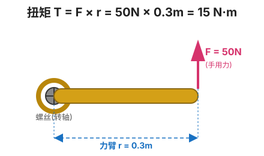
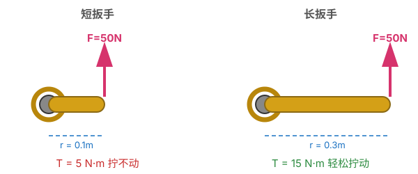
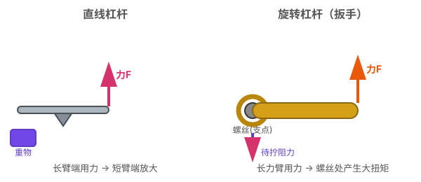
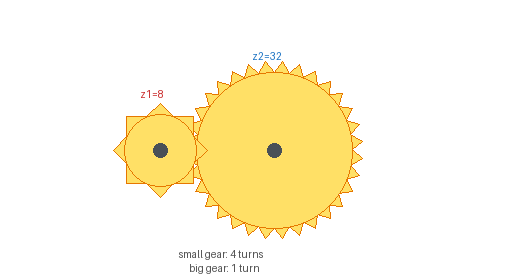
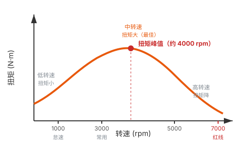
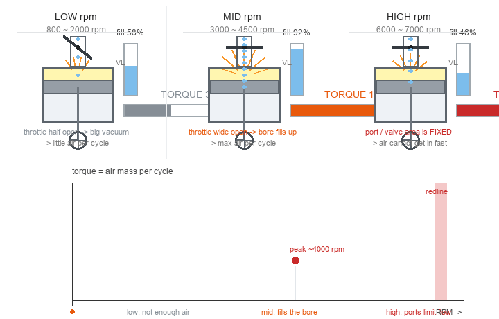
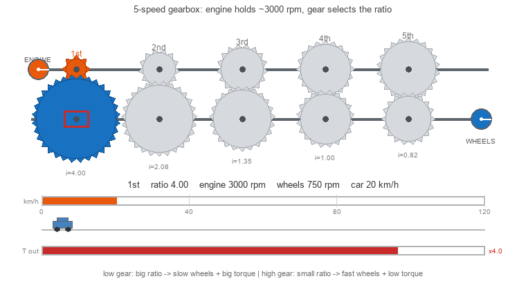
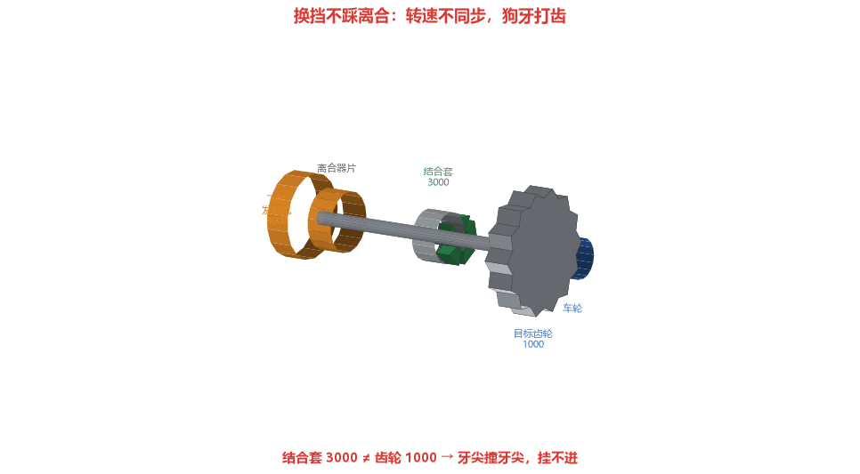
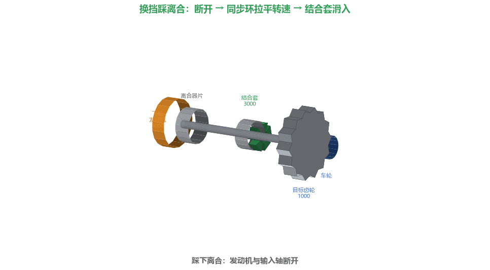

# 手动变速箱（MT）原理

> 手动挡三个经典问题：
> 1. 为什么低档位力气大、高档位速度快？
> 2. 为什么换挡要踩离合？
> 3. 起步为什么要"半联动"？
>
> 这三个问题答案都藏在**齿轮传动**、**功率守恒**、**摩擦同步**这三个物理/机械原理里。

---

## 目录

1. [前置知识：扭矩、转速、功率](#一前置知识扭矩转速功率)
2. [齿轮传动：杠杆原理的旋转版](#二齿轮传动杠杆原理的旋转版)
3. [为什么低档位力气大、高档位速度快](#三为什么低档位力气大高档位速度快)
4. [发动机特性：为什么需要变速箱](#四发动机特性为什么需要变速箱)
5. [为什么换挡要踩离合](#五为什么换挡要踩离合)
6. [离合器与同步环的工作原理](#六离合器与同步环的工作原理)
7. [完整换挡流程](#七完整换挡流程)
8. [知识串联](#八知识串联)

---

## 一、前置知识：扭矩、转速、功率

### 扭矩（Torque）—— 旋转的"力气"

**定义**：扭矩 = 力 × 力臂

```
T = F × r

  F = 作用力（N，牛顿）
  r = 力臂（从转轴到力作用线的距离，m，米）
  T = 扭矩（N·m，牛·米）
```

#### 示意图一：扳手拧螺丝



> 手用 50N 的力，握在离螺丝 0.3m 处，扭矩 T = 50 × 0.3 = **15 N·m**。
> 直观：力作用在"离螺丝 0.3m 的扳手柄"上，产生让螺丝旋转的"旋转力"。

#### 示意图二：力臂越长，扭矩越大（同样大的力）



> 同样的 50N，短扳手（r=0.1m）只产生 5 N·m 拧不动；长扳手（r=0.3m）产生 15 N·m 轻松拧动。
> 这就是"长扳手省力"的原理。

#### 示意图三：旋转版的"杠杆"



> 扳手拧螺丝 = 杠杆原理的"旋转版"。直线杠杆把力放大，旋转杠杆把扭矩放大，本质都是：**力臂长 → 放大效果**。

#### 扭矩的直觉总结

- 扭矩不是"力的大小"，是"力 × 力臂"——同样大的力，离转轴越远，扭矩越大，所以方向盘做得大、扳手做得长
- 汽车的扭矩同理：发动机活塞连杆推动曲轴，曲轴的力臂设计决定了发动机扭矩特性，大扭矩车（柴油车、跑车）加速猛
- 理解了扭矩再看齿轮：大齿轮半径大 = 力臂长 → 输出扭矩大，这就是低档位"力气大"的根源

> **扭矩 = 旋转的"力气"**。扭矩大，汽车加速猛、爬坡强；扭矩小，"没劲"。

#### 方向盘大小与扭矩的关系

> 方向盘半径就是"力臂"，但它不是越大越好——是"省力 vs 灵敏"的权衡，本质和"低档 vs 高档"是同一个道理。

```
方向盘: 扭矩 T = 手力 F × 方向盘半径 r

  ┌ 大方向盘（半径大）:
  │  省力（扭矩放大，打方向轻松）
  │  但费距离（转同样角度，手要走更长的弧）→ 打方向"慢"、不灵敏
  │
  └ 小方向盘（半径小）:
     费力（扭矩小，打方向重）
     但省距离（手转的圈小）→ 打方向"快"、灵敏

例子: 转 90° 方向
  大方向盘（半径 20cm）: 手沿弧走 ≈ 31cm
  小方向盘（半径 15cm）: 手沿弧走 ≈ 24cm
  → 大方向盘手要多挪 7cm，转向自然慢
```

**为什么现代车方向盘普遍做小？—— 助力转向的功劳**

```
没有助力转向的老车:
  打方向完全靠手力 → 必须大方向盘才能省力
  → 老车方向盘又大又细

现代车有助力转向（液压/电动助力）:
  省力交给助力系统 → 方向盘不需要靠"大"来省力
  → 反而做小，为了:
      ├── 灵敏（快速打方向）
      ├── 节省空间（不顶腿）
      └── 减少手臂动作幅度

赛车为什么方向盘特别小?
  → 赛车要快速、精准打方向（灵敏优先）
  → 省力交给强力助力转向，不在乎手力
```

**本质：同一个物理原理**

```
方向盘大小 = 省力（扭矩） vs 灵敏（速度）的权衡

  大方向盘 ≈ 低档位（省力/大扭矩，但慢）
  小方向盘 ≈ 高档位（费力/小扭矩，但快）

  → 都是"力 × 距离"的杠杆权衡
  → 和本文主线"低档力气大、高档速度快"是同一个道理
```

### 转速（RPM）—— 旋转的"快慢"

```
转速 ω 或 n（revolutions per minute, 转/分钟）

  发动机怠速: ~800 rpm
  常用转速:   1500~3000 rpm
  红线转速:   6000~7000 rpm（再高会爆缸）
```

### 功率（Power）—— 扭矩 × 转速

```
功率 P = T × ω

  T 是扭矩（N·m）
  ω 是角速度（rad/s，和 rpm 成正比）

⚠️ 关键: 功率 = 扭矩 × 转速，这是守恒关系的基础
```

### 三个量的关系（核心！）

```
P = T × ω

  ┌ 想要"力气大"（T 大），在功率 P 固定时 → ω 必须小（慢）
  ┌ 想要"速度快"（ω 大），在功率 P 固定时 → T 必须小（没劲）
  └ 力气 和 速度 不可兼得（功率不变的前提下）

这就是手动挡"低档力气大、高档速度快"的全部物理根源:
  发动机功率有限 → 通过齿轮传动在"扭矩"和"转速"之间换算
```

---

## 二、齿轮传动：杠杆原理的旋转版

### 两个齿轮啮合



> 小齿轮（z1=10）带大齿轮（z2=40），小齿轮转 4 圈，大齿轮才转 1 圈。

**齿数比决定一切**：

```
设小齿轮 z1=10，大齿轮 z2=40

  转速关系:
    小齿轮转 4 圈，大齿轮才转 1 圈
    → 输出转速 = 输入转速 / 4

  扭矩关系:
    啮合处的力 F 相同（作用力 = 反作用力）
    小齿轮力臂 r1 小 → 输入扭矩 T1 = F × r1
    大齿轮力臂 r2 大 → 输出扭矩 T2 = F × r2
    → 输出扭矩 = 输入扭矩 × (r2/r1) = 输入扭矩 × (z2/z1) = 4 倍

  → 齿轮传动: 转速降 4 倍，扭矩升 4 倍（功率守恒！）
```

### 传动比（Gear Ratio）

```
传动比 i = z_从动 / z_主动 = z2 / z1

  i > 1（小带大）:
    转速↓，扭矩↑ → "减速增扭" → 低档位
    例: 一档 i = 4，扭矩放大 4 倍，转速降 4 倍

  i = 1（等齿数）:
    转速不变，扭矩不变 → 直接挡（通常 4 档或 5 档）

  i < 1（大带小）:
    转速↑，扭矩↓ → "超速挡" → 高档位（5档/6档）
    例: 6 档 i = 0.8，转速升 1.25 倍，扭矩降 1.25 倍
    → 用于高速巡航省油
```

### 功率守恒（为什么扭矩升必然转速降）

```
理想齿轮传动（无摩擦损耗）:
  输入功率 = 输出功率
  P_in = P_out
  T_in × ω_in = T_out × ω_out

  → T_out / T_in = ω_in / ω_out = z2 / z1

  力气大（T 大）必然转速低（ω 小），因为功率守恒
  → 这是物理铁律，齿轮只能"换算"，不能凭空造功率
```

---

## 三、为什么低档位力气大、高档位速度快

### 各档传动比（典型 5 速手动）

```
档位    传动比 i     输出扭矩      输出转速     用途
─────  ─────────  ──────────  ──────────  ───────
1档     3.6         ×3.6         ÷3.6        起步、爬陡坡
2档     2.1         ×2.1         ÷2.1        加速
3档     1.4         ×1.4         ÷1.4        中速行驶
4档     1.0         ×1.0         ÷1.0        直接挡（市区）
5档     0.8         ×0.8         ÷0.8        高速巡航（省油）
倒档    -3.5        反向         -           倒车
```

### 为什么 1 档力气大

```
1 档传动比 i = 3.6

  发动机扭矩 200 N·m
  → 经过一档齿轮: 输出扭矩 = 200 × 3.6 = 720 N·m

  → 传到车轮的扭矩大
  → 加速猛、爬坡强（重载起步、陡坡必须用低档）

为什么不能一直用 1 档?

  发动机最高转速 ~7000 rpm
  1 档时输出转速 = 7000 / 3.6 ≈ 1944 rpm（轮端）
  对应车速 = 1944 × 轮周长 ≈ 30~40 km/h
  → 1 档跑不到 40 km/h 就到发动机红线
  → 想更快必须换高档（降传动比）
```

### 为什么 5 档速度快

```
5 档传动比 i = 0.8（超速挡）

  发动机转速 3000 rpm
  → 输出转速 = 3000 / 0.8 = 3750 rpm（轮端）
  → 车速可达 120 km/h（高速巡航）

  → 但扭矩 = 输入 × 0.8 = 160 N·m（比发动机扭矩还小）
  → "没劲"，加速慢，爬坡费力

为什么 5 档省油?

  高速巡航时不需要大扭矩（平路匀速阻力小）
  发动机可在较低转速（如 2500 rpm）维持高速
  → 转速低 = 燃油消耗少 = 省油
```

### 本质：扭矩-转速的权衡

```
发动机功率 P 固定（比如 100 kW）

  1 档: 大扭矩 × 低转速 → 力气大，但跑不快
  5 档: 小扭矩 × 高转速 → 跑得快，但没劲

  ┌ 起步/爬坡: 需要大扭矩 → 用低档
  ┌ 巡航: 需要高速度 → 用高档
  └ 两者不可兼得 → 用变速箱切换

类比: 变速自行车
  ┌ 前小后大（低档）: 踩起来轻（扭矩大），但跑不快
  └ 前大后小（高档）: 踩起来重（扭矩小），但跑得快
  → 一模一样的齿轮传动原理
```

---

## 四、发动机特性：为什么需要变速箱

### 发动机扭矩-转速曲线



> 低转速扭矩小（没劲、可能熄火），中转速扭矩大（最佳工作区），高转速扭矩降（接近红线，功率不升反降）。



> 动画对照三档转速的同一个气缸：**节气门开度 → 每循环进气量（充气系数）→ 扭矩**，下方红点沿扭矩曲线从低转速扫到高转速。

**核心洞察**：扭矩的上限不是由"转多快"决定的，而是由"每个循环能装进多少空气"决定的。

```
扭矩的物理来源:
  曲轴扭矩 = 燃气压力 × 活塞面积 × 曲柄力臂

  → 压力从哪来？    从燃烧
  → 燃烧释放多少能量？ 由这一循环吸入的空气 + 油决定
  → 所以: 扭矩 ∝ 每循环空气质量 ∝ 充气系数 VE(转速)

  充气系数 = 实际吸入的空气量 / 气缸理论容积
  → 扭矩曲线的形状，本质上就是 VE 随转速变化的形状
```

#### 低转速扭矩小：空气进不来（节流损失）

```
1 个四缸发动机怠速 800 rpm:
  每分钟吸气次数 = 800 × 4 ÷ 2 = 1600 次

  → 想抽够气就得"大口抽"，但节气门半开，歧管里是大真空
  → 每个缸只抽进很少的空气

加上:
  → 曲轴转得慢，燃烧持续角占整个循环的比例大
     等火燃完，活塞已经开始下行了，力臂变小

结果: 每循环空气少 → 每循环爆发力小 → 扭矩小

这也是为什么起步必须降档:
  起步需要大扭矩，发动机在低转速给不出来 → 靠变速箱放大
```

#### 中转速扭矩大：进气道、气门、燃烧全都顺

```
  ┌ 节气门全开，没有节流损失
  ├ 吸气次数够多，每缸基本充满（充气系数 → 90%+）
  │   → 每循环空气质量最大 → 爆发力最大
  ├ 燃烧正时恰到好处: 压力在活塞顶部附近释放，力臂最大
  └ 摩擦、泵气损耗还没涨起来

→ 三个因素同时最优 → 扭矩峰值区
```

#### 高转速扭矩降：气缸来不及喘气

```
  转速翻倍 = 每循环时间减半

  但: 进气门和进气道的流通截面积是固定的！
      空气的流量有天花板
      → 每循环空气质量反而下降（充气系数掉）

加上:
  ├ 排气也排不干净 → 残余废气稀释新鲜混合气
  ├ 摩擦、泵气损耗随转速持续上升 → 直接吃掉净扭矩
  └ 气门刚（valve float）、敲击等机械极限逼近

→ 高转速扭矩必然往下走
```

**注意"功率不升反降"要加限定**：

```
P = T × ω

  中转速之后:   扭矩开始降，但转速升得比扭矩降得快 → 功率继续升
  过峰值转速后: 扭矩下降的速度超过转速上升的速度     → 功率见顶 → 回落

  → "功率不升反降"只发生在红区附近，不是高转速就立刻掉

  常见误区: 把"红区"当成"开始有动力"的地方
  实际: 红区附近功率见顶，过了就开始掉了
```

**这正好解释了变速箱存在的意义**：

```
发动机的"好扭矩区间"很窄（比如 2000~4000 rpm 扭矩大）

但车轮需要的是: "低速大扭矩" → "高速小扭矩" 的全范围

  → 变速箱 = 把发动机那窄窄一段扭矩带，拉伸映射到整个车速范围
```

### 为什么发动机不能直接驱动车轮

```
假设没有变速箱，发动机直接连车轮:

  问题 1: 起步
    怠速 800 rpm → 车速 = 800 × 轮周长 ≈ 60 km/h
    → 一松离合车就 60 km/h 猛冲？还会熄火
    → 起步需要"慢但有力"，发动机直接给不了

  问题 2: 巡航
    巡航 120 km/h → 需要发动机 ~5000 rpm
    → 油耗爆炸、噪音大、磨损快
    → 巡航需要"快但省油"，发动机直接给不了

  问题 3: 爬坡
    重载爬坡需要大扭矩 → 但发动机扭矩上限有限
    → 需要齿轮"放大扭矩"

  → 变速箱的作用: 让发动机始终工作在【合理转速区间】
     同时满足"起步要力、巡航要快、爬坡要扭"的各种需求
```

### 变速箱 = 让发动机待在最佳转速



> **核心**：发动机（输入轴，橙色盘）转速**始终不变** = 最佳转速区。换挡只是改变**哪一对齿轮**在驱动车轮。
>
> - **低档（1 档）**：发动机是**小齿轮**、变速箱输出是**大齿轮**（齿数比 i=4）
>   → 输出转速 ÷ 4（车轮**慢**）、扭矩 × 4（**力气大**，起步 / 爬坡用）
> - **高档（5 档）**：发动机是**大齿轮**、变速箱输出是**小齿轮**（i≈0.8）
>   → 输出转速 × 1.2（车轮**快**）、扭矩 × 0.8（**没劲**，巡航用）
>
> 红色滑动结合套（拨叉）滑到哪一列，就锁哪一对齿轮驱动车轮——发动机自己不变速，变的只是传动比。这就是"低档力气大、高档速度快"的全部来源。

```
不同车速，选不同档位，让发动机转速保持在 2000~3000 rpm:

  车速    档位    发动机转速
  20     1档     3000
  40     2档     3000
  60     3档     3000
  80     4档     3000
  100    5档     3000

  → 同样 3000 rpm（最佳扭矩区间），通过换挡覆盖 20~100 km/h
  → 这就是"换挡"的本质: 改变传动比，让发动机转速匹配车速
```

---

## 五、为什么换挡要踩离合





> 两张 3D 图共用同一根传动轴：**飞轮（发动机）→ 离合器片 → 输入轴＋结合套 → 目标齿轮 → 输出轴 → 车轮**。结合套和齿轮互相面对的那圈小齿叫**狗牙（dog teeth）**——换挡就是把结合套推过去，让它的狗牙插进齿轮的牙槽里，把齿轮锁到轴上。3D 视角下狗牙是真实的拉伸小块，咬合/打齿一眼可辨。
>
> - **左图（不踩离合）**：离合器片贴合，发动机把输入轴/结合套锁在 3000 rpm，齿轮只有 1000 rpm，**转速不同步（≠）**。结合套被硬推过去时，狗牙**齿尖撞齿尖**→ 火花、打齿声，永远挂不进，车身顿挫。
> - **右图（踩离合）**：踩下离合，飞轮与离合器片**断开**（中间出现间隙），输入轴自由。**同步环（锥面）**靠摩擦把结合套转速从 3000 一路拉到 1000，与齿轮**同步（=）**。狗牙对准槽口，结合套平稳滑入，锁定齿轮，车身不顿挫。
>
> 一句话：换挡前必须先让两边齿轮**转速同步**；踩离合就是为了让输入轴脱开发动机、自由地被同步环拉到目标转速。

### 不踩离合会怎样：齿轮"打架"

```
换挡的本质: 把当前档位的齿轮脱开，挂上新档位的齿轮

  从 2 档换 3 档:
    2 档齿轮对（z=20, z=42）脱开
    3 档齿轮对（z=25, z=35）啮合

  问题: 两个齿轮转速不同步!

  例: 换 3 档时
    输入轴齿轮（连发动机）: 3000 rpm
    输出轴齿轮（连车轮）: 对应车速的转速，比如 1000 rpm
    → 两者转速差 2000 rpm

  如果直接硬推齿轮啮合:
    ┌ 齿轮齿尖对齿尖，撞不进去 → 打齿声
    ┌ 强行挤进去 → 齿轮崩角、同步环烧毁
    └ 即使挤进去了，转速突变 → 车顿挫、传动系冲击

  → 必须先让两个齿轮"转速同步"再啮合
```

### 离合器的作用：断开发动机，让齿轮自由同步

```
踩离合 = 断开发动机和输入轴的连接

  ┌ 不踩离合:
  │  发动机持续驱动输入轴 → 输入轴转速被发动机"锁住"
  │  → 没法调整输入轴转速去匹配输出轴
  │
  └ 踩离合:
     输入轴和发动机脱开 → 输入轴自由
     → 同步环可以调整输入轴转速，匹配输出轴
     → 齿轮平稳啮合
```

### 为什么不踩离合换挡会"顿挫"

```
不踩离合强行换挡:

  齿轮硬啮合，转速突变
  → 传动系瞬间承受巨大冲击力
  → 车猛烈顿挫，乘客前仰后合
  → 齿轮、同步环、离合器片都受损

  长期不踩离合换挡:
    同步环磨损 → 换挡越来越难挂
    齿轮崩角 → 变速箱报废
```

---

## 六、离合器与同步环的工作原理

### 离合器：摩擦传递动力

```
离合器位于: 发动机飞轮 和 变速箱输入轴 之间

结构:
  ┌ 飞轮（连发动机曲轴，主动）
  ┌ 离合器片（从动，连变速箱输入轴）
  ┌ 压盘（用弹簧把片压向飞轮）
  └ 分离轴承（踩离合时把压盘拉开）

工作状态:

  全联动（松开离合）:
    压盘弹簧把离合器片紧紧压在飞轮上
    → 摩擦力使飞轮和片同步转动
    → 发动机动力 100% 传到变速箱

  半联动（离合踩一半）:
    压盘压力减小，片和飞轮【相对滑动】
    → 摩擦力部分传递，部分打滑
    → 动力"温柔"传递，转速渐进

  全分离（踩到底）:
    压盘完全松开，片和飞轮脱离
    → 动力完全断开 → 可换挡
```

### 起步为什么必须半联动

```
起步场景: 车静止 → 要动起来

  全联动起步（直接松离合）:
    发动机 800 rpm（怠速）
    车轮 0 rpm（静止）
    → 飞轮和片转速差 800 rpm
    → 瞬间接合 → 巨大冲击 + 发动机被憋熄火

  半联动起步:
    压盘轻压，片和飞轮打滑
    → 摩擦力把发动机动力"渗"给车轮
    → 车缓慢起步，发动机不熄火
    → 转速差在打滑中逐渐消除（车轮加速，发动机略降）

    待车速起来（离合完全接合时机成熟）
    → 完全松开离合 → 全联动

  → 半联动的本质: 用"摩擦打滑"缓冲转速差
     这就是为什么起步要"慢抬离合"
```

### 同步环：换挡的"撮合者"

```
同步环位于每对换挡齿轮之间

  作用: 让待啮合的两个齿轮转速同步，再允许啮合

结构（简化）:
  ┌ 接合套（可滑动，连输出轴）
  ┌ 同步环（锥面摩擦环）
  ┌ 待啮合齿轮（连输入轴，可自由转动）

换挡过程（如挂 3 档）:

  Step 1: 推变速杆 → 接合套向 3 档齿轮移动
  Step 2: 接合套先碰同步环
          同步环锥面和齿轮锥面摩擦
          → 摩擦力把两个齿轮转速拉近
  Step 3: 转速同步后，接合套才能滑入齿轮的花键
          → 齿轮正式啮合

  关键: 同步环【强制】转速同步后才允许啮合
     → 这就是现代手动挡换挡不需要"两脚离合"的原因
```

### 老式车为什么需要"两脚离合"

```
没有同步环的老变速箱（如早期卡车）:

  升档流程（2→3）:
    1. 踩离合 → 摘空挡
    2. 松离合 → 发动机转速自然下降（等待转速匹配）
    3. 再踩离合 → 挂 3 档

  降档流程（3→2，更复杂，需要"轰油门"）:
    1. 踩离合 → 摘空挡
    2. 松离合 → 轰一脚油门提高发动机转速（匹配低档的高转速）
    3. 踩离合 → 挂 2 档

  → 用"轰油门"手动调整发动机转速去匹配齿轮
  → 现代同步环把这步自动化了，只需"一脚离合"
```

---

## 七、完整换挡流程

### 升档流程（2 档 → 3 档）

```
状态: 2 档行驶，发动机 3000 rpm，车速 40 km/h

  Step 1: 松油门
    → 发动机扭矩下降（减少换挡冲击）

  Step 2: 踩离合到底
    → 断开发动机和变速箱
    → 输入轴自由

  Step 3: 摘 2 档 → 推入 3 档
    → 同步环工作: 把输入轴转速拉低（3 档传动比小，需要更低转速）
    → 齿轮转速同步后啮合

  Step 4: 松离合（同时踩油门）
    → 离合逐渐接合，动力恢复
    → 此时发动机转速已降（如 2000 rpm），匹配 3 档
    → 平稳加速

  整个过程: 发动机转速从 3000 → 2000（"掉转速"）
            → 这就是升档时转速表"下掉"的原因
```

### 降档流程（3 档 → 2 档）

```
状态: 3 档行驶，发动机 2000 rpm，车速 40 km/h
需要降档加速（如超车）

  Step 1: 松油门 + 踩离合
  Step 2: 摘 3 档 → 推入 2 档
    → 同步环把输入轴转速拉高（2 档需要更高转速）
  Step 3: 【降档补油】轰一脚油门
    → 提高发动机转速匹配 2 档（如 2000 → 3000 rpm）
    → 避免接合时顿挫
  Step 4: 松离合 + 踩油门加速

  降档补油（heel-and-toe / blip）:
    → 手动挡老司机的标志动作
    → 不补油: 接合时发动机会被车轮"拖着转"，顿挫
    → 补油: 发动机转速先到匹配值，平稳接合
```

### 一句话总结换挡的本质

```
换挡 = 改变传动比 + 同步转速

  ┌ 改变传动比: 切换齿轮对（实现扭矩/转速换算）
  ┌ 同步转速:   让待啮合齿轮转速匹配（避免打齿）
  └ 踩离合:     断开发动机，给同步留出空间

  三个动作配合: 离合（断开）+ 换挡（换齿轮）+ 同步（匹配转速）
```

---

## 八、知识串联

### 物理/机械原理回顾

```
┌──────────────────┬────────────────────────────────────┐
│ 原理              │ 在手动挡里的体现                     │
├──────────────────┼────────────────────────────────────┤
│ 力矩 = 力 × 力臂  │ 齿轮扭矩 = 啮合力 × 齿轮半径          │
│                  │ 大齿轮力臂长 → 扭矩大                  │
├──────────────────┼────────────────────────────────────┤
│ 功率 = 扭矩 × 转速 │ 功率守恒: 扭矩大必然转速低             │
│                  │ → 低档力气大但慢，高档快但没劲          │
├──────────────────┼────────────────────────────────────┤
│ 杠杆原理          │ 齿轮传动是"旋转版杠杆"               │
│                  │ 小带大 = 省力费距离（像省力杠杆）       │
├──────────────────┼────────────────────────────────────┤
│ 摩擦力            │ 离合器片靠摩擦传动力                  │
│                  │ 同步环靠摩擦同步转速                   │
│                  │ 半联动 = 受控的摩擦打滑                │
├──────────────────┼────────────────────────────────────┤
│ 能量守恒          │ 齿轮不能凭空造功率                    │
│                  │ 扭矩放大以转速降低为代价                │
└──────────────────┴────────────────────────────────────┘
```

### 与其他笔记的关联

```
→ physics/flight-physics/flight-principles.md
   飞行原理讲"推力 vs 阻力"，手动挡讲"扭矩 vs 阻力"
   → 都是力学在不同载具上的应用

→ computer/connection-pool/...（连接池）
   看似无关，但都有"传动比 vs 吞吐量"的权衡思想:
   ┌ 低档 = 小批量高频次（扭矩大，吞吐小）
   └ 高档 = 大批量低频次（扭矩小，吞吐大）
   → 工程上"力气 vs 速度"的权衡无处不在

→ computer/data-structures/heap.md
   堆的"上浮/下沉"和齿轮的"传动比"都是"换算关系"
   → 物理换算（扭矩↔转速）vs 数据换算（索引↔父子）
```

### 三个问题的最终答案

```
Q1: 为什么低档位力气大、高档位速度快?

  低档: 传动比 > 1，小齿轮带大齿轮
        → 扭矩放大（力气大），转速降低（跑不快）
        → 起步、爬坡需要大扭矩

  高档: 传动比 ≤ 1，大齿轮带小齿轮（或直接传动）
        → 扭矩减小（没劲），转速提高（跑得快）
        → 巡航需要高速度

  本质: 功率守恒 P = T × ω
        力气和速度是齿轮传动对功率的两种"换算方式"


Q2: 为什么换挡要踩离合?

  换挡要切换齿轮对，两齿轮转速不同步
  → 直接硬啮合会打齿、顿挫、损坏

  踩离合断开发动机 → 输入轴自由
  → 同步环调整转速 → 齿轮平稳啮合

  本质: 用离合器"断开动力源"，给同步留出空间


Q3: 起步为什么要半联动?

  车静止（0 rpm），发动机怠速（800 rpm）
  → 直接接合: 转速差太大，冲击 + 熄火

  半联动: 离合器片和飞轮打滑
  → 摩擦力"渗"动力，转速差在打滑中渐进消除
  → 车缓慢起步，发动机不熄火

  本质: 用受控的摩擦打滑，缓冲巨大的转速差
```
